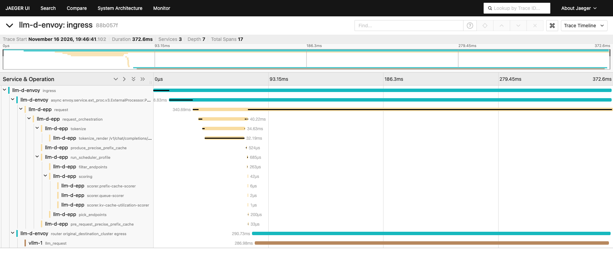
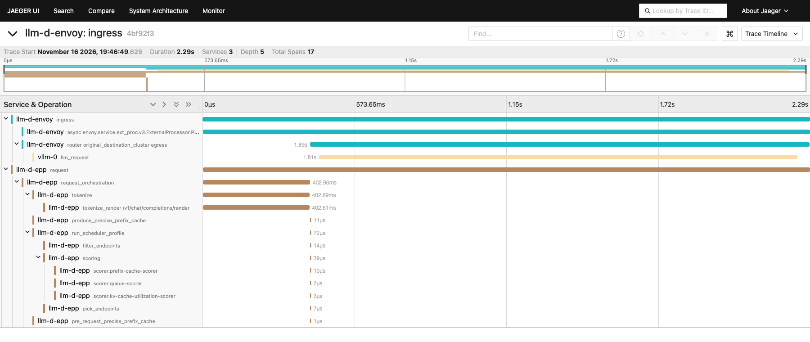
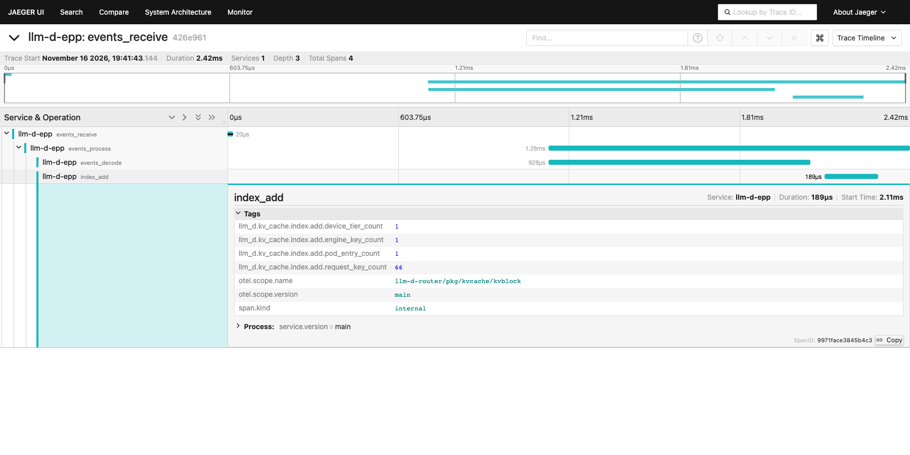
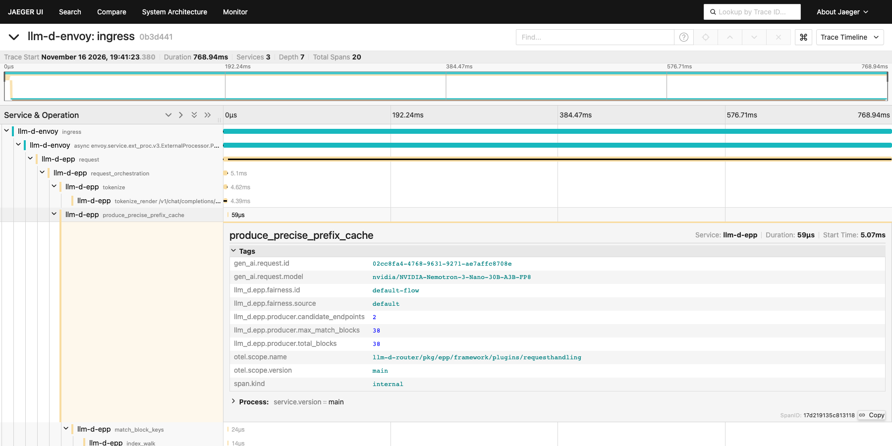
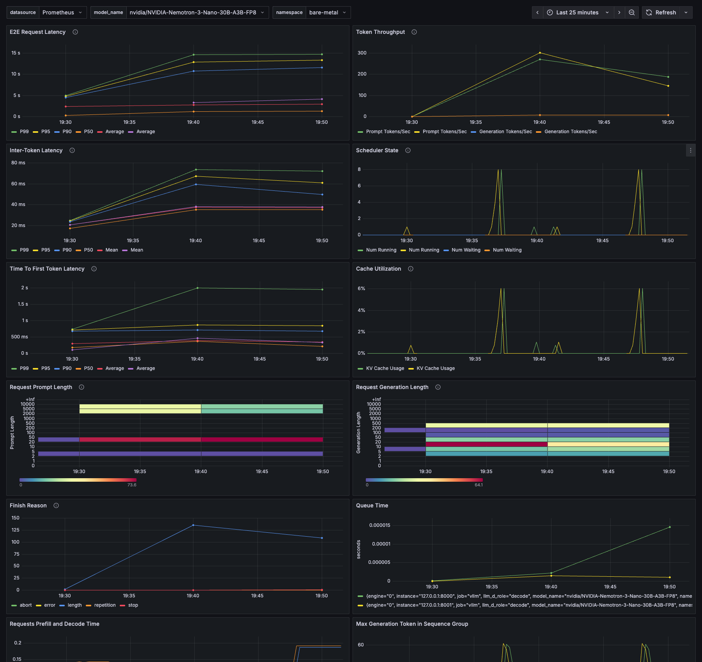
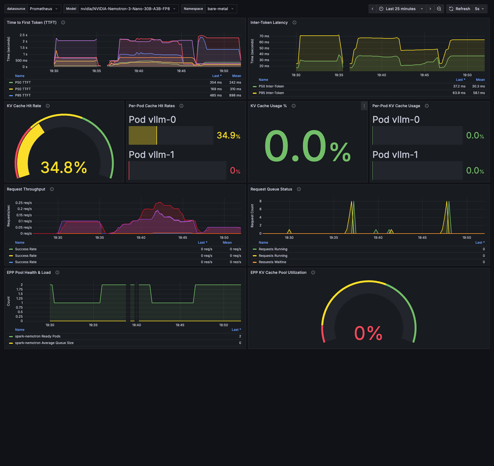
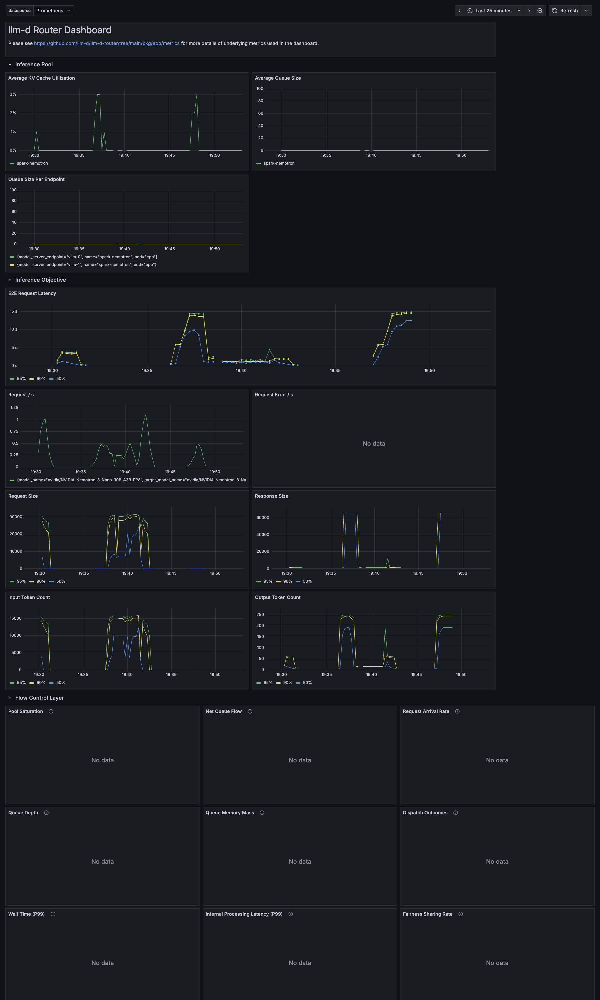
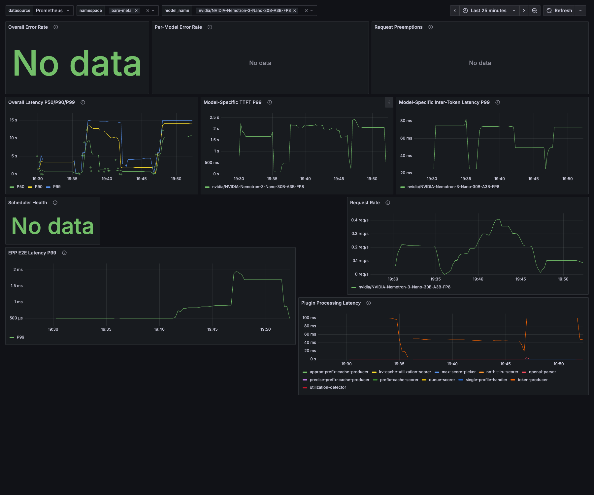
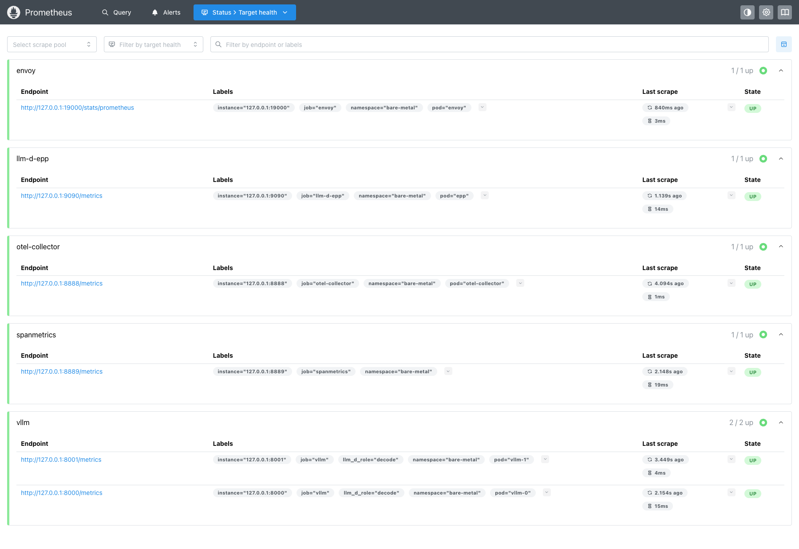

# 在 DGX Spark 上不依赖 Kubernetes 运行 llm-d：Nemotron + 完整可观测性

本指南在**一台 NVIDIA DGX Spark 上、不使用 Kubernetes** 安装 llm-d 路由栈。
所有组件都是由 `docker compose` 管理的普通 Docker 容器：

- **两个 vLLM replica**，在 GB10 GPU 上提供 **NVIDIA Nemotron** 模型服务。
- **llm-d EPP**（Endpoint Picker，端点选择器）：它通过一个 YAML 文件（`file-discovery`）而不是
  `InferencePool` 来发现各个 replica，并基于 **KV 事件做精确的 prefix cache 路由**。
- **Envoy** 作为数据面。
- **完整可观测性**：OpenTelemetry trace（Envoy → EPP → vLLM 串在同一个 trace 里）、Prometheus
  指标，以及上游 llm-d 的 Grafana dashboard。

本指南涵盖安装、端到端测试，以及**过程中发现的差距**。每个差距都附有证据和一份可以直接提交到上游的
issue 草稿。

下面所有内容都于 **2026-11-16/17** 在 `spark-3bee`（Ubuntu 24.04.5、GB10、aarch64、121 GiB
统一内存）上实际执行过。**每个 `console` 代码块都是真实的命令及其真实输出**，是在执行各步骤时
记录下来的。较长的输出用 `...` 做了截断。

English version: [`README.md`](README.md)

| 上游基线 | 版本 |
| --- | --- |
| llm-d（guides） | `main` @ `565373b7`（2026-11-12）：`guides/no-kubernetes-deployment` |
| llm-d-router（EPP） | `ghcr.io/llm-d/llm-d-router-endpoint-picker:main` = commit `4dff5aa1`（2026-11-16） |
| vLLM | `nvcr.io/nvidia/vllm:26.08-py3` = vLLM `0.27.1+93523f72.dev` |
| Envoy | `envoyproxy/envoy:v1.36.2` |
| 模型 | `nvidia/NVIDIA-Nemotron-3-Nano-30B-A3B-FP8`（默认），`nvidia/Llama-3.1-Nemotron-Nano-8B-v1`（对比） |
| 可观测性 | OTel Collector contrib 0.139.0、Jaeger 2.11.0、Prometheus 3.7.3、Grafana 12.2.1 |

---

## 目录

0. [结果一览](#0-结果一览)
1. [架构](#1-架构)
2. [本目录内容](#2-本目录内容)
3. [前置条件](#3-前置条件)
4. [逐步安装](#4-逐步安装)
5. [第一批请求](#5-第一批请求)
6. [端到端测试](#6-端到端测试)
7. [可观测性演示（含截图）](#7-可观测性演示)
8. [性能基线](#8-性能基线)
9. [日常运维（Day-2）](#9-日常运维day-2)
10. [发现的问题、差距与需要修复的地方](#10-发现的问题差距与需要修复的地方)
11. [故障排查与常见陷阱](#11-故障排查与常见陷阱)

---

## 0. 结果一览

| 能力 | 不使用 Kubernetes 时的结果 |
| --- | --- |
| EPP 在**没有 kubeconfig、没有 CRD** 的情况下运行（`file-discovery`） | ✅ `EPP starting (file discovery mode)` |
| OpenAI chat、completions 和流式请求经过 Envoy → EPP → vLLM | ✅ |
| Nemotron 的推理内容被拆分为 `reasoning` / `content`（`nemotron_v3` parser） | ✅ |
| 基于通过 ZMQ 传来的**真实 vLLM KV 事件**做精确 prefix cache 路由 | ✅ 适用于 ≥ 1 个引擎 block 的 prompt；⚠️ 见 [§10.1](#101-通用问题speculative-索引忽略引擎-block-大小precise-路由只有亲和没有缓存收益) |
| 不同 prompt 在 2 个 replica 间的负载分摊 | ✅ 8 / 8 |
| 编辑 `endpoints.yaml` 即可热加载 endpoint 池 | ✅ 无需重启 |
| 已停止的 replica 即使仍在文件中，也会被避开 | ✅ 10 / 10 个请求返回 200 |
| Envoy → EPP → vLLM 串成**一个 trace**（17 个 span，1 个 root） | ✅ 客户端不带 `traceparent` 时；⚠️ 带上后变成 2 个 root（[§10.2](#102-客户端-traceparent-会把-trace-拆成两个-root)） |
| vLLM、EPP、Envoy 及 span-metrics 的 Prometheus 指标；5 个 llm-d Grafana dashboard | ✅（有一个面板有问题，[§10.4](#104-grafana-scheduler-health-面板硬编码了-helm-job-名称)） |
| e2e 测试套件（`scripts/e2e-test.py`） | **22 PASS / 2 WARN / 0 FAIL**。两个 WARN 就是 §10.1 和 §10.2 中的差距 |

每个问题都另外写了上游 issue 草稿（英文正文，每份带"中文说明"）。**草稿只保存在本地，不在本仓库中，也都没有提交到 GitHub。**
各问题的完整描述见第 10 节。

| # | 草稿 | 目标 |
| --- | --- | --- |
| 01 | Speculative indexing ignores the engine block size (hybrid Mamba: 4224 tokens) | llm-d-router，新 issue |
| 02 | A client `traceparent` detaches the EPP span from the proxy span | llm-d-router，新 issue |
| 03 | No-Kubernetes guide: add observability + the precise-prefix path | llm-d，新 issue |
| 04 | Dashboard "Scheduler Health" hard-codes `job="gaie-optimized-baseline-epp"` | llm-d，新 issue |
| 05 | Per-endpoint ZMQ port (field report) | 在 llm-d-router#2959 / PR #4288 下**评论** |

---

## 1. 架构

```text
                       DGX Spark (spark-3bee) — docker compose, all containers on the host network
 ┌───────────────────────────────────────────────────────────────────────────────────────────────┐
 │                                                                                               │
 │  client ──HTTP :8081──▶ Envoy ───────── ext_proc gRPC :9002 ────────▶ EPP (llm-d router)      │
 │                         (trace root)  ◀── x-gateway-destination-endpoint  │ file-discovery    │
 │                           │                                               │  endpoints.yaml   │
 │                           │ ORIGINAL_DST (picked endpoint)                │ token-producer ───┼─▶ /v1/*/render on vLLM
 │                           ▼                                               │ precise-prefix    │
 │              ┌──────────────────────┐   ┌──────────────────────┐          │ scorers + picker  │
 │              │ vllm-0  :8000        │   │ vllm-1  :8001        │          │                   │
 │              │ Nemotron (GB10 GPU)  │   │ Nemotron (GB10 GPU)  │          │                   │
 │              │ KV events ZMQ :5556  │   │ KV events ZMQ :5557  │ ─────────┘  SUB (rankIndex    │
 │              │ replay      :5559    │   │ replay      :5560    │             trick, §4.4)      │
 │              └──────────────────────┘   └──────────────────────┘                              │
 │                                                                                               │
 │  spans:   Envoy, EPP, vLLM ──OTLP gRPC :4317──▶ otel-collector ──▶ Jaeger (UI :16686)         │
 │                                                       └─ spanmetrics :8889 ─┐                 │
 │  metrics: Prometheus :9091 ◀── vLLM /metrics, EPP :9090, Envoy :19000, collector ─┘           │
 │           Grafana :3000 (llm-d dashboards, Prometheus + Jaeger data sources)                  │
 └───────────────────────────────────────────────────────────────────────────────────────────────┘
```

**为什么所有组件都用 host 网络。** `file-discovery` plugin **只接受 IPv4 字面地址**（不接受主机名），
所以无法使用容器的 DNS 名称。使用 host 网络后，各组件之间都通过 `127.0.0.1` 互相访问，和上游指南中的
`docker run --network host` 完全一样。唯一的例外是 Jaeger：它运行在 bridge 网络上，OTLP 端口被重新映射到
`127.0.0.1:14317`，因为 collector 已经占用了 `:4317`。

| 端口 | 组件 | 用途 |
| --- | --- | --- |
| 8081 | Envoy | **客户端入口**（OpenAI API） |
| 19000 | Envoy | admin、`/ready`、`/clusters`、`/stats/prometheus`（绑定在 127.0.0.1） |
| 9002 / 9003 / 9090 | EPP | ext_proc gRPC（+ gRPC 健康检查）/ 健康检查 / `/metrics` |
| 8000 / 8001 | vllm-0 / vllm-1 | OpenAI API + `/metrics` + `/v1/*/render` |
| 5556, 5559 / 5557, 5560 | vllm-0 / vllm-1 | KV 事件 ZMQ PUB / replay |
| 4317 / 4318 / 8889 | otel-collector | OTLP gRPC / OTLP HTTP / span-metrics |
| 16686 | Jaeger | UI + 查询 API |
| 9091 | Prometheus | UI/API（9090 被 EPP 占用） |
| 3000 | Grafana | UI（匿名 Admin，仅限实验环境） |

---

## 2. 本目录内容

| 路径 | 说明 |
| --- | --- |
| [`compose.yaml`](compose.yaml) | 全部 8 个服务，分为 3 个 profile：`obs`、`model`、`router` |
| [`nemotron3-nano-30b.env`](nemotron3-nano-30b.env) / [`nemotron-nano-8b.env`](nemotron-nano-8b.env) | 模型预设（模型 id、vLLM 额外参数、内存配置） |
| [`configs/epp/endpoints.yaml`](configs/epp/endpoints.yaml) | file-discovery 的 endpoint 列表（支持热加载） |
| [`configs/epp/config-precise.tmpl.yaml`](configs/epp/config-precise.tmpl.yaml) | EPP 配置：精确 prefix cache（KV 事件）+ file-discovery。`${MODEL}` 由 `up.sh` 渲染 |
| `configs/epp/config-precise-nospec.yaml` | 由 `up.sh` 生成：precise 配置改为 `speculativeIndexing: false`（**推荐用于 hybrid 模型**，§10.1） |
| [`configs/epp/config-approx.yaml`](configs/epp/config-approx.yaml) | EPP 配置：原样使用上游 no-k8s 指南（近似 prefix） |
| [`configs/envoy/envoy.yaml`](configs/envoy/envoy.yaml) | 上游 no-k8s 的 `envoy.yaml` + OpenTelemetry tracing（diff 见 §4.4） |
| [`configs/otel/collector.yaml`](configs/otel/collector.yaml) | 接收 OTLP → 导出到 Jaeger + span-metrics |
| [`configs/prometheus/prometheus.yml`](configs/prometheus/prometheus.yml) | 静态抓取任务，为 llm-d dashboard 补上合成的 `namespace`/`pod` 标签 |
| [`configs/grafana/`](configs/grafana/) | 数据源 + 5 个上游 llm-d dashboard（未修改，来自 llm-d@`565373b7`） |
| [`scripts/up.sh`](scripts/up.sh) / [`scripts/down.sh`](scripts/down.sh) | 一键启动 / 拆除 |
| [`scripts/e2e-test.py`](scripts/e2e-test.py) | 端到端测试（24 项检查，只依赖标准库） |
| [`scripts/trace-tree.py`](scripts/trace-tree.py) | 以树形打印一个 Jaeger trace |
| [`scripts/bench.py`](scripts/bench.py) | 经过 Envoy 的小型流式 benchmark |
| [`scripts/served.sh`](scripts/served.sh) | 每个 replica 处理的请求数（来自 vLLM 指标） |
| [`scripts/capture-doc.sh`](scripts/capture-doc.sh) | 重新执行 README 中的步骤并记录 console 输出 |
| [`docs/screenshots/`](docs/screenshots/) | 下文用到的 Jaeger / Grafana / Prometheus 截图 |
| [`docs/test-logs/`](docs/test-logs/) | 本 README 中引用的每次测试运行的原始日志 |

---

## 3. 前置条件

### 3.1 主机

需要带 NVIDIA runtime 的 Docker、Compose v2 插件、`jq`、`envsubst`（gettext）和 `curl`。
这台 Spark 上都已经装好了。

```console
gyliu@spark-3bee:~/llm-d-nonk8s$ hostname; uname -m; grep PRETTY /etc/os-release
spark-3bee
aarch64
PRETTY_NAME="Ubuntu 24.04.5 LTS"
gyliu@spark-3bee:~/llm-d-nonk8s$ nvidia-smi --query-gpu=name,driver_version --format=csv
name, driver_version
NVIDIA GB10, 580.173.02
gyliu@spark-3bee:~/llm-d-nonk8s$ docker info --format "runtime={{.DefaultRuntime}} server={{.ServerVersion}}"; nvidia-ctk --version | head -1; docker compose version
runtime=nvidia server=29.2.1
NVIDIA Container Toolkit CLI version 1.20.0
Docker Compose version v5.0.2
```

### 3.2 GPU 内存预算（GB10 统一内存）

GB10 的 121 GiB 内存由 **CPU 和 GPU 共享**。`nvidia-smi` 无法报告总量（"Not Supported"）。
唯一有意义的数字是 `torch.cuda.mem_get_info()` 的结果：

```console
gyliu@spark-3bee:~/llm-d-nonk8s$ docker run --rm --gpus all --entrypoint='' nvcr.io/nvidia/vllm:26.08-py3 python3 -c 'import torch,vllm;f,t=torch.cuda.mem_get_info();print("vllm",vllm.__version__,"| GPU free",round(f/2**30,1),"GiB of",round(t/2**30,1),"GiB")'
...
vllm 0.27.1+93523f72.dev | GPU free 26.9 GiB of 121.7 GiB
```

这里只有 26.9 GiB 空闲，因为同一台 Spark 上运行的 **ComfyUI** 加载了模型。
两个 30B replica 大约需要 85 GiB：

| 每个 replica（Nemotron-3-Nano-30B-A3B-FP8） | GiB |
| --- | --- |
| 权重（`Model loading took 31.48 GiB`） | 31.5 |
| KV cache（`--kv-cache-memory-bytes 8G`） | 8.0 |
| CUDA graph（`Graph capturing ... took 2.31 GiB`） | 2.3 |
| **合计，× 2 个 replica** | **≈ 84** |

开始之前，先释放其他占用 GPU 的程序。ComfyUI 的 `/free` 接口可以在不停止进程的情况下卸载它缓存的模型。
只在它的队列为空时这样做，并告知正在使用它的人。

```console
gyliu@spark-3bee:~$ curl -s localhost:8188/queue | python3 -c "import json,sys;d=json.load(sys.stdin);print(\"running\",len(d[\"queue_running\"]),\"pending\",len(d[\"queue_pending\"]))"
running 0 pending 0
gyliu@spark-3bee:~$ curl -s -X POST localhost:8188/free -H "Content-Type: application/json" -d "{\"unload_models\":true,\"free_memory\":true}"; sleep 5; nvidia-smi --query-compute-apps=pid,used_memory --format=csv,noheader
2401, 371 MiB
1324081, 31620 MiB
```

（第二个进程是 `vllm-0`，它当时已经在加载了。）两个 replica 都启动后，GPU 内存只剩
**1.1 GiB**（§4.7）。不要同时运行 ComfyUI 任务。

---

## 4. 逐步安装

下面的步骤**逐个**启动各个服务，这样你可以看到并检查每个服务做了什么。
[§4.10](#410-一键方式scriptsupsh) 给出了一条命令完成全部步骤的等价方式。

### 4.1 把 demo 目录复制到 Spark

在存放本仓库的 Mac（或任意工作站）上执行：

```console
gyliu-cary@gyliu513-MacBook-Pro-2 llm-d-spark-nonk8s-demo % ssh mygpu 'hostname; nvidia-smi -L'
spark-3bee
GPU 0: NVIDIA GB10 (UUID: GPU-3f370c1d-e554-fce7-5841-cf15d5495a57)
gyliu-cary@gyliu513-MacBook-Pro-2 llm-d-spark-nonk8s-demo % rsync -a --exclude docs --exclude .env ./ mygpu:~/llm-d-nonk8s/
gyliu-cary@gyliu513-MacBook-Pro-2 llm-d-spark-nonk8s-demo % ssh mygpu 'ls ~/llm-d-nonk8s ~/llm-d-nonk8s/scripts'
/home/gyliu/llm-d-nonk8s:
compose.yaml
configs
logs
nemotron3-nano-30b.env
nemotron-nano-8b.env
scripts

/home/gyliu/llm-d-nonk8s/scripts:
bench.py
capture-doc.sh
down.sh
e2e-test.py
__pycache__
served.sh
trace-tree.py
up.sh
```

`mygpu` 是一个 SSH 别名（Tailscale 主机名，用户为 `gyliu`）。后面所有命令都在 Spark 的
`~/llm-d-nonk8s` 目录中执行。

### 4.2 拉取镜像

所有镜像都是多架构镜像，都有 `linux/arm64` 版本。EPP 使用 `main` tag，于 2026-11-16 从 commit
`4dff5aa1` 构建。

```console
gyliu@spark-3bee:~/llm-d-nonk8s$ docker pull -q nvcr.io/nvidia/vllm:26.08-py3
nvcr.io/nvidia/vllm:26.08-py3
gyliu@spark-3bee:~/llm-d-nonk8s$ docker pull -q ghcr.io/llm-d/llm-d-router-endpoint-picker:main
ghcr.io/llm-d/llm-d-router-endpoint-picker:main
gyliu@spark-3bee:~/llm-d-nonk8s$ docker pull -q envoyproxy/envoy:v1.36.2
docker.io/envoyproxy/envoy:v1.36.2
gyliu@spark-3bee:~/llm-d-nonk8s$ docker pull -q otel/opentelemetry-collector-contrib:0.139.0
docker.io/otel/opentelemetry-collector-contrib:0.139.0
gyliu@spark-3bee:~/llm-d-nonk8s$ docker pull -q jaegertracing/jaeger:2.11.0
docker.io/jaegertracing/jaeger:2.11.0
gyliu@spark-3bee:~/llm-d-nonk8s$ docker pull -q prom/prometheus:v3.7.3
docker.io/prom/prometheus:v3.7.3
gyliu@spark-3bee:~/llm-d-nonk8s$ docker pull -q grafana/grafana:12.2.1
docker.io/grafana/grafana:12.2.1
gyliu@spark-3bee:~/llm-d-nonk8s$ docker image inspect ghcr.io/llm-d/llm-d-router-endpoint-picker:main --format '{{.Architecture}} created={{.Created}}'
arm64 created=2026-11-16T20:07:19.682452563Z
gyliu@spark-3bee:~/llm-d-nonk8s$ docker run --rm ghcr.io/llm-d/llm-d-router-endpoint-picker:main --help 2>&1 | grep -E -- '--(config-file|pool-name|secure-serving|health-checking|objectives-file) '
      --config-file string                             The path to the configuration file.
      --health-checking                                Enables health checking.
      --metrics-cert-dir string                        Directory with tls.crt and tls.key for the metrics endpoint. Empty serves metrics over plain HTTP. Independent of --secure-serving and --cert-path, which apply to the serving listener.
      --objectives-file string                         YAML file of objectives (name, priority) loaded at startup. File-discovery mode only.
      --pool-name string                               Name of the InferencePool this Endpoint Picker is associated with.
      --secure-serving                                 Serve the listener over TLS. (default true)
```

> **为什么用 NGC 镜像。** 没有任何 `vllm/vllm-openai` 镜像支持 GB10 + aarch64。NVIDIA 的
> `nvcr.io/nvidia/vllm` 是公开的，不需要登录 NGC。**绝对不要覆盖它的 `ENTRYPOINT`。**
> 它会启用 CUDA 前向兼容；没有它，FlashInfer JIT 会报 `cudaErrorUnsupportedPtxVersion` 失败。
> `compose.yaml` 使用的是 `command:`，因此保留了原有的 entrypoint。

### 4.3 下载模型

两个模型都**不需要申请访问权限**，所以不需要 HF token。匿名下载有限速：在这条线路上，31 GB 的模型
大约下载了 8 分钟。模型会放到一个缓存目录中，vLLM 容器以读写方式挂载这个目录。

```console
gyliu@spark-3bee:~/llm-d-nonk8s$ docker run --rm --name hf-dl -v ~/llm-d-cache/huggingface:/root/.cache/huggingface --entrypoint="" nvcr.io/nvidia/vllm:26.08-py3 hf download nvidia/NVIDIA-Nemotron-3-Nano-30B-A3B-FP8
...
Warning: You are sending unauthenticated requests to the HF Hub. Please set a HF_TOKEN to enable higher rate limits and faster downloads.
...
Fetching 38 files: 100%|██████████| 38/38 [08:06<00:00, 12.81s/it]
...
  path: /root/.cache/huggingface/hub/models--nvidia--NVIDIA-Nemotron-3-Nano-30B-A3B-FP8/snapshots/9bee19446c0dfd01f356e10979d225b2a6621944
gyliu@spark-3bee:~/llm-d-nonk8s$ docker run --rm --name hf-dl2 -v ~/llm-d-cache/huggingface:/root/.cache/huggingface --entrypoint="" nvcr.io/nvidia/vllm:26.08-py3 hf download nvidia/Llama-3.1-Nemotron-Nano-8B-v1 --exclude "original/*"
...
...
Fetching 16 files: 100%|██████████| 16/16 [03:20<00:00, 12.54s/it]
...
  path: /root/.cache/huggingface/hub/models--nvidia--Llama-3.1-Nemotron-Nano-8B-v1/snapshots/54641c1611fcff44fa4865626462445e0a153fc7
gyliu@spark-3bee:~/llm-d-nonk8s$ ls ~/llm-d-cache/huggingface/hub | grep nvidia
models--nvidia--Llama-3.1-Nemotron-Nano-8B-v1
models--nvidia--NVIDIA-Nemotron-3-Nano-30B-A3B-FP8
gyliu@spark-3bee:~/llm-d-nonk8s$ du -sh ~/llm-d-cache/huggingface/hub/models--nvidia--*
15G	/home/gyliu/llm-d-cache/huggingface/hub/models--nvidia--Llama-3.1-Nemotron-Nano-8B-v1
31G	/home/gyliu/llm-d-cache/huggingface/hub/models--nvidia--NVIDIA-Nemotron-3-Nano-30B-A3B-FP8
```

（这里用 `--entrypoint=""` 没问题：下载不需要 GPU。两次下载都是用
`nohup ... > logs/hf-download*.log &` 在后台运行的。30B 的命令最初是以
`bash -c "hf download <30B> && hf download <8B> --exclude \"*.pth\" \"original/*\""` 运行的。30B
部分成功了；串在后面的 8B 部分踩到了 §11 中的 `--exclude` 陷阱，于是按上面所示重新运行。
设置 `HF_TOKEN` 可以加快下载，但不是必需的。）

**选哪个 Nemotron？**

| 模型 | 架构 | 为什么用它 |
| --- | --- | --- |
| `NVIDIA-Nemotron-3-Nano-30B-A3B-FP8`（**默认**） | Hybrid Mamba-2 + MoE（混合专家）+ attention，3B 激活参数，FP8 | 当前的 Nemotron，也是 NVIDIA 为 DGX Spark 推荐的模型。在 GB10 上单流 48 tok/s |
| `Llama-3.1-Nemotron-Nano-8B-v1` | 纯 transformer，BF16 | 对比参照：展示引擎 block 大小为 64 时精确 prefix 路由的效果（[§10.1](#101-通用问题speculative-索引忽略引擎-block-大小precise-路由只有亲和没有缓存收益)） |

vLLM 以 `HF_HUB_OFFLINE=1`（在 `compose.yaml` 中设置）使用 HF 缓存，所以 replica 启动时
从不访问 Hub。

### 4.4 检查并渲染配置

```console
gyliu@spark-3bee:~/llm-d-nonk8s$ ls -R configs | head -30
configs:
envoy
epp
grafana
otel
prometheus

configs/envoy:
envoy.yaml

configs/epp:
config-approx.yaml
config-precise-nospec.yaml
config-precise.tmpl.yaml
config-precise.yaml
endpoints.yaml
...
```

**endpoint 列表。** 它取代了 `InferencePool`。`address` 必须是 IPv4 字面地址。
这里借用 `rankIndex` 给同一主机上的每个 replica 分配各自的 KV 事件端口：precise producer 会连接
`socketPort + rankIndex` 和 `replaySocketPort + rankIndex`。这是一个临时办法，直到 llm-d-router
PR #4288 为每个条目加上 `zmqPort`（[§10.5](#105-同一主机上的多个-replica-需要借助-rankindex-技巧来分配-kv-事件端口)）。

```console
gyliu@spark-3bee:~/llm-d-nonk8s$ cat configs/epp/endpoints.yaml
# file-discovery endpoints (watched; rewrite atomically with `mv` to change the pool).
# address MUST be a literal IPv4 (no hostnames). All vLLM replicas run on the
# Spark with host networking, so 127.0.0.1 + distinct ports.
#
# rankIndex is (ab)used here to give each replica its own KV-event port:
# the precise-prefix producer dials socketPort+rankIndex (5556/5557) and
# replaySocketPort+rankIndex (5559/5560). Upstream PR llm-d-router#4288 adds a
# proper per-entry zmqPort (issue #2959).
endpoints:
  - name: vllm-0
    address: 127.0.0.1
    port: "8000"
    rankIndex: 0
    labels:
      llm-d.ai/inference-serving: "true"   # informational; verified NOT required for KV-event subscription
      llm-d.ai/model: nemotron
  - name: vllm-1
    address: 127.0.0.1
    port: "8001"
    rankIndex: 1
    labels:
      llm-d.ai/inference-serving: "true"
      llm-d.ai/model: nemotron
```

**模型预设。** `compose.yaml` 读取 `.env`。在统一内存上，`KV_CACHE_BYTES` 和 `GPU_MEM_UTIL`
**两个都必须设置**：只设其中一个，vLLM 在 GB10 上的启动内存检查就会失败。vLLM 的参数解析器接受
`8G`，但不接受 `8GiB`。

```console
gyliu@spark-3bee:~/llm-d-nonk8s$ cat nemotron3-nano-30b.env
# Nemotron 3 Nano 30B-A3B (hybrid Mamba-2 + MoE + attention, FP8) — default model
MODEL=nvidia/NVIDIA-Nemotron-3-Nano-30B-A3B-FP8
VLLM_EXTRA_ARGS="--trust-remote-code --reasoning-parser nemotron_v3 --tool-call-parser qwen3_coder --enable-auto-tool-choice"
KV_CACHE_BYTES=8G
GPU_MEM_UTIL=0.10
MAX_MODEL_LEN=16384
```

**渲染 EPP 配置。** precise 配置中的 `token-producer` 必须写明所服务的模型名：EPP 通过调用各
replica 的 `/v1/chat/completions/render` 来做分词，模型名不匹配的请求会被拒绝。

```console
gyliu@spark-3bee:~/llm-d-nonk8s$ cp nemotron3-nano-30b.env .env && set -a && . ./.env && set +a && envsubst '${MODEL}' < configs/epp/config-precise.tmpl.yaml > configs/epp/config-precise.yaml && grep -n -A1 "modelName" configs/epp/config-precise.yaml
23:      modelName: nvidia/NVIDIA-Nemotron-3-Nano-30B-A3B-FP8
24-      vllm:
gyliu@spark-3bee:~/llm-d-nonk8s$ echo EPP_CONFIG=config-precise.yaml >> .env; cat .env
# Nemotron 3 Nano 30B-A3B (hybrid Mamba-2 + MoE + attention, FP8) — default model
MODEL=nvidia/NVIDIA-Nemotron-3-Nano-30B-A3B-FP8
VLLM_EXTRA_ARGS="--trust-remote-code --reasoning-parser nemotron_v3 --tool-call-parser qwen3_coder --enable-auto-tool-choice"
KV_CACHE_BYTES=8G
GPU_MEM_UTIL=0.10
MAX_MODEL_LEN=16384
EPP_CONFIG=config-precise.yaml
```

[`config-precise.tmpl.yaml`](configs/epp/config-precise.tmpl.yaml) 中的 plugin 组合来自上游
`guides/precise-prefix-cache-routing`，并针对 file-discovery 做了调整：

| Plugin | 作用 |
| --- | --- |
| `file-discovery`（`watchFile: true`） | 从 `endpoints.yaml` 获取 endpoint 清单；文件被原子替换时重新加载 |
| `metrics-data-source` + `core-metrics-extractor` | 抓取每个 replica 的 `/metrics`（队列、KV 利用率） |
| `token-producer`（`vllm.endpointDiscovery`） | 直接在 replica 上分词（`/render`），轮询方式 |
| `endpoint-notification-source` → `precise-prefix-cache-producer` | **file 模式下必需的连接。** 没有它，producer 就没有 ZMQ 订阅者（llm-d-router#4256） |
| `prefix-cache-scorer`（w=3）、`queue-scorer`（w=2）、`kv-cache-utilization-scorer`（w=2）、`max-score-picker` | 打分 profile |

**Envoy 配置。** 这就是上游 no-k8s 的 `envoy.yaml`，除了 tracing 之外没有改动：

```console
gyliu@spark-3bee:~/llm-d-nonk8s$ diff <(git -C ~/llm-d show 565373b7:guides/no-kubernetes-deployment/router/envoy/envoy.yaml) configs/envoy/envoy.yaml | head -60
1,16c1,6
< # Envoy config for the no-Kubernetes file-discovery deployment.
...
---
> # Envoy config for llm-d without Kubernetes on the DGX Spark.
> # Based verbatim on upstream llm-d guides/no-kubernetes-deployment/router/envoy/envoy.yaml
> # (llm-d@565373b7) with two additions, marked "SPARK:":
> #   1. OpenTelemetry tracing in the HTTP connection manager -> otel-collector :4317
> #   2. an `otel_collector` cluster for (1)
> # Admin stays on 127.0.0.1:19000; Prometheus (host network) scrapes /stats/prometheus there.
37a28,42
>                 # SPARK: root a trace per request and export it over OTLP.
>                 generate_request_id: true
>                 tracing:
>                   random_sampling:
>                     value: 100
>                   spawn_upstream_span: true
>                   provider:
>                     name: envoy.tracers.opentelemetry
>                     typed_config:
>                       "@type": type.googleapis.com/envoy.config.trace.v3.OpenTelemetryConfig
>                       service_name: llm-d-envoy
>                       grpc_service:
>                         envoy_grpc:
>                           cluster_name: otel_collector
>                         timeout: 1s
138a144,162
>
>     # SPARK: OTLP/gRPC exporter target for Envoy's own spans.
>     - name: otel_collector
>       type: STATIC
...
```

Compose 识别出 8 个服务：

```console
gyliu@spark-3bee:~/llm-d-nonk8s$ docker compose --profile obs --profile model --profile router config --services
envoy
epp
grafana
jaeger
otel-collector
prometheus
vllm-0
vllm-1
```

### 4.5 启动可观测性组件（profile `obs`）

先启动它，这样从第一个请求开始的 span 和指标都能被记录下来。

```console
gyliu@spark-3bee:~/llm-d-nonk8s$ docker compose --profile obs up -d
 Network llm-d-nonk8s_default Creating
 Network llm-d-nonk8s_default Created
 Container prometheus Creating
 Container otel-collector Creating
 Container grafana Creating
 Container jaeger Creating
 ...
 Container prometheus Started
 Container grafana Started
 Container otel-collector Started
 Container jaeger Started
gyliu@spark-3bee:~/llm-d-nonk8s$ docker ps --format "table {{.Names}}\t{{.Status}}" --filter name=otel --filter name=jaeger --filter name=prometheus --filter name=grafana
NAMES            STATUS
jaeger           Up 8 seconds
grafana          Up 8 seconds
prometheus       Up 8 seconds
otel-collector   Up 8 seconds
gyliu@spark-3bee:~/llm-d-nonk8s$ curl -s localhost:9091/-/ready; echo; curl -s localhost:3000/api/health | jq -c .; curl -s -o /dev/null -w "jaeger UI %{http_code}\n" localhost:16686/
Prometheus Server is Ready.

{"database":"ok","version":"12.2.1","commit":"563109b696e9c1cbaf345f2ab7a11f7f78422982"}
jaeger UI 200
gyliu@spark-3bee:~/llm-d-nonk8s$ docker logs otel-collector 2>&1 | grep -E "Starting (GRPC|HTTP) server|Everything is ready" | cut -c1-160
2026-11-17T00:55:34.399Z	info	otlpreceiver@v0.139.0/otlp.go:120	Starting GRPC server	{"resource": {"service.instance.id": "ffd4581c-01e9-4bb6-8ace-79824437d9f6"
2026-11-17T00:55:34.400Z	info	otlpreceiver@v0.139.0/otlp.go:178	Starting HTTP server	{"resource": {"service.instance.id": "ffd4581c-01e9-4bb6-8ace-79824437d9f6"
2026-11-17T00:55:34.400Z	info	service@v0.139.0/service.go:245	Everything is ready. Begin running and processing data.	{"resource": {"service.instance.id": "ffd4
```

### 4.6 启动 vLLM replica 0

vLLM 的命令行参数，来自 [`compose.yaml`](compose.yaml)：

| Flag | 原因 |
| --- | --- |
| `--block-size 64` | 希望路由器和引擎的 block 对齐。**对这个 hybrid 模型会被覆盖为 4224**，见下面的日志和 [§10.1](#101-通用问题speculative-索引忽略引擎-block-大小precise-路由只有亲和没有缓存收益) |
| `--kv-cache-memory-bytes 8G` + `--gpu-memory-utilization 0.10` | 统一内存的容量配置（GB10 上两个都需要） |
| `--enable-prefix-caching` | 对这个模型，vLLM 会把 Mamba cache 模式切换为 `all`（实验性） |
| `--kv-events-config '{"enable_kv_cache_events":true,"publisher":"zmq","endpoint":"tcp://*:5556","replay_endpoint":"tcp://*:5559","topic":"kv@127.0.0.1:8000@<model>"}'` | 供 EPP 使用的 KV 事件。topic **必须**与 endpoint 条目的 `address:port` 一致 |
| `--otlp-traces-endpoint http://127.0.0.1:4317` + `OTEL_SERVICE_NAME=vllm-0` | vLLM 自己的 `llm_request` span |
| `--trust-remote-code --reasoning-parser nemotron_v3 --tool-call-parser qwen3_coder --enable-auto-tool-choice` | Nemotron 3 专用（来自 `nemotron3-nano-30b.env`） |

```console
gyliu@spark-3bee:~/llm-d-nonk8s$ docker compose --profile model up -d --no-deps vllm-0
 Container vllm-0 Creating
 Container vllm-0 Created
 Container vllm-0 Starting
 Container vllm-0 Started
gyliu@spark-3bee:~/llm-d-nonk8s$ until curl -sf localhost:8000/v1/models >/dev/null; do sleep 5; done   # took 335s
gyliu@spark-3bee:~/llm-d-nonk8s$ docker logs vllm-0 2>&1 | grep -E "non-default args|Mamba cache mode|Setting attention block size|Model loading took|GPU KV cache size|init engine|Route: /v1/(chat/)?completions/render|Application startup complete" | sed -E "s/^\(APIServer pid=1\) |^\(EngineCore pid=[0-9]+\) //" | cut -c1-260
INFO 11-17 00:55:50 [api_utils.py:273] non-default args: {'model_tag': 'nvidia/NVIDIA-Nemotron-3-Nano-30B-A3B-FP8', 'enable_auto_tool_choice': True, 'tool_call_parser': 'qwen3_coder', 'disable_access_log_for_endpoints': '/health,/metrics,/v1/models,/v1/complet
WARNING 11-17 00:55:50 [config.py:618] Mamba cache mode is set to 'all' for NemotronHForCausalLM by default when prefix caching is enabled
INFO 11-17 01:00:37 [gpu_model_runner.py:5405] Model loading took 31.48 GiB memory and 276.726271 seconds
INFO 11-17 01:00:37 [interface.py:911] Setting attention block size to 4224 tokens to ensure that attention page size is >= mamba page size.
INFO 11-17 01:00:44 [kv_cache_utils.py:2235] GPU KV cache size: 541,491 tokens
INFO 11-17 01:01:12 [core.py:348] init engine (profile, create kv cache, warmup model) took 35.32 s (compilation: 0.79 s)
INFO 11-17 01:01:15 [launcher.py:46] Route: /v1/chat/completions/render, Methods: POST
INFO 11-17 01:01:15 [launcher.py:46] Route: /v1/completions/render, Methods: POST
INFO:     Application startup complete.
gyliu@spark-3bee:~/llm-d-nonk8s$ curl -s localhost:8000/v1/models | jq -c ".data[] | {id, max_model_len}"
{"id":"nvidia/NVIDIA-Nemotron-3-Nano-30B-A3B-FP8","max_model_len":16384}
gyliu@spark-3bee:~/llm-d-nonk8s$ curl -s localhost:8000/metrics | grep -E "^vllm:cache_config_info" | grep -oE "block_size=\"[0-9]+\"|enable_prefix_caching=\"[A-Za-z]+\"|kv_cache_size_tokens=\"[0-9]+\""
block_size="4224"
enable_prefix_caching="True"
kv_cache_size_tokens="541491"
block_size="64"
gyliu@spark-3bee:~/llm-d-nonk8s$ ss -ltnp 2>/dev/null | grep -E ":(8000|5556|5559) " | awk "{print \$4}"
0.0.0.0:5556
0.0.0.0:5559
0.0.0.0:8000
```

上面的输出中有三点值得注意：

1. **`Setting attention block size to 4224 tokens`。** 对这个 hybrid Mamba 模型，vLLM 只能以
   完整的 4224 token 为单位复用已缓存的 prefix。这正是 §10.1 中主要差距的根源。
2. `/v1/chat/completions/render` 和 `/v1/completions/render` 这两个路由在 vLLM 0.27.1 中默认就有，
   不需要额外的 flag。EPP 的 `token-producer` 会用到它们。
3. 在 page cache 为冷的情况下，加载用了 335 秒。仅从 EXT4 加载 safetensors 就花了 276 秒；
   之后的重启会更快。

### 4.7 启动 vLLM replica 1

`vllm-1` 配置了 `depends_on: vllm-0: service_healthy`，因此两个 replica 永远不会同时做内存
profiling：

```console
gyliu@spark-3bee:~/llm-d-nonk8s$ docker compose --profile model up -d vllm-1
 Container vllm-0 Running
 Container vllm-1 Creating
 Container vllm-1 Created
 Container vllm-0 Waiting
 Container vllm-0 Healthy
 Container vllm-1 Starting
 Container vllm-1 Started
gyliu@spark-3bee:~/llm-d-nonk8s$ until curl -sf localhost:8001/v1/models >/dev/null; do sleep 5; done   # took 295s
gyliu@spark-3bee:~/llm-d-nonk8s$ docker ps --format "table {{.Names}}\t{{.Status}}" --filter name=vllm
NAMES     STATUS
vllm-1    Up 4 minutes (healthy)
vllm-0    Up 10 minutes (healthy)
gyliu@spark-3bee:~/llm-d-nonk8s$ docker exec vllm-0 python3 -c 'import torch;f,t=torch.cuda.mem_get_info();print("GPU free after 2 replicas:",round(f/2**30,1),"GiB")'
GPU free after 2 replicas: 1.1 GiB
```

> 两个 replica 共享**同一块** GB10。这里用两个 replica 是为了演示路由（亲和性、负载分摊、
> 故障转移），并不会让吞吐翻倍。见 §8。

### 4.8 启动 EPP

EPP 使用 `main` 镜像运行，参数为 `--secure-serving=false`（Envoy 在同一台主机上）和
`--health-checking=true`（Envoy 会对 ext_proc 端口做健康检查）。它的环境变量设置了
`OTEL_TRACES_SAMPLER=parentbased_always_on`：**EPP 默认的采样比例是 0.1**，那样只会保留
十分之一的 trace。

```console
gyliu@spark-3bee:~/llm-d-nonk8s$ docker compose --profile router up -d --no-deps epp
 Container epp Creating
 Container epp Created
 Container epp Starting
 Container epp Started
gyliu@spark-3bee:~/llm-d-nonk8s$ docker logs epp 2>&1 | jq -r "select(.body|test(\"GIE build|file-discovery mode|EPP starting|watching endpoints|Connected subscriber|Replay complete|gRPC server listening\")) | [.severity_text, .body, (.endpoint // .port // .path // .\"commit-sha\" // \"\" | tostring)] | @tsv"
INFO	GIE build	4dff5aa1278cfa06c6eaa483a2cfb788331458fc
INFO	file-discovery mode: Kubernetes-only features are inactive (InferenceModelRewrite, InferenceObjective reconciler, and any k8s-notification-source data layer plugins); see docs/discovery.md
INFO	EPP starting (file discovery mode)
INFO	watching endpoints file for changes	/etc/epp/endpoints.yaml
INFO	gRPC server listening	9003
INFO	Connected subscriber socket	tcp://127.0.0.1:5557
INFO	gRPC server listening	9002
INFO	Connected subscriber socket	tcp://127.0.0.1:5556
INFO	Replay complete
INFO	Replay complete
gyliu@spark-3bee:~/llm-d-nonk8s$ curl -s localhost:9090/metrics | grep -E "^llm_d_epp_kv_cache_events_active_subscribers|^llm_d_epp_pool_ready_pods|^llm_d_epp_inference_pool_ready_pods" ; curl -s localhost:9090/metrics | grep -c "^llm_d_epp"
llm_d_epp_kv_cache_events_active_subscribers 2
56
```

需要检查的内容：`file discovery mode`（没有创建 Kubernetes client）、两个 ZMQ 订阅者
（`5556` = rank 0，`5557` = rank 1），以及两者的 replay 都已完成。`compose.yaml` 挂载的是
`configs/epp` **目录**而不是单个文件，这样对 `endpoints.yaml` 做原子 `mv` 时，文件监视器才能
感知到（bind mount 单个文件会固定在旧的 inode 上）。

### 4.9 启动 Envoy

```console
gyliu@spark-3bee:~/llm-d-nonk8s$ docker compose --profile router up -d --no-deps envoy
 Container envoy Creating
 Container envoy Created
 Container envoy Starting
 Container envoy Started
gyliu@spark-3bee:~/llm-d-nonk8s$ curl -s localhost:19000/ready
LIVE
gyliu@spark-3bee:~/llm-d-nonk8s$ curl -s localhost:19000/clusters | grep -E "^ext_proc::.*(health_flags|cx_active)|^otel_collector::.*health_flags"
ext_proc::127.0.0.1:9002::cx_active::0
ext_proc::127.0.0.1:9002::health_flags::healthy
otel_collector::127.0.0.1:4317::health_flags::healthy
gyliu@spark-3bee:~/llm-d-nonk8s$ docker ps --format "table {{.Names}}\t{{.Status}}"
NAMES            STATUS
envoy            Up 12 seconds
epp              Up 18 seconds
vllm-1           Up 5 minutes (healthy)
vllm-0           Up 10 minutes (healthy)
jaeger           Up 11 minutes
grafana          Up 11 minutes
prometheus       Up 11 minutes
otel-collector   Up 11 minutes
```

`ext_proc::...::health_flags::healthy` 表示 Envoy 对 EPP 的 gRPC 健康检查通过了
（这需要 `--health-checking=true`；否则 Envoy 只能通过 panic routing 访问 EPP）。

### 4.10 一键方式：`scripts/up.sh`

`scripts/up.sh [model-env] [precise|nospec|approx]` 一次性完成 §4.4 到 §4.9。它把预设复制为 `.env`，
渲染 EPP 配置，然后依次启动 `obs`、`model`（并等待两个 replica 就绪）和 `router`：

```console
gyliu@spark-3bee:~/llm-d-nonk8s$ scripts/up.sh nemotron3-nano-30b.env precise
 ...
 Container vllm-0 Started
 Container vllm-0 Waiting
waiting for both vLLM replicas (first start compiles; ~5-15 min)...
  vLLM :8000 ready
  vLLM :8001 ready
...
Envoy ready on :8081 (EPP config: config-precise.yaml, model: nvidia/NVIDIA-Nemotron-3-Nano-30B-A3B-FP8)
```

`scripts/down.sh` 会删除全部 8 个容器。`~/llm-d-cache` 中的模型缓存和 vLLM 编译缓存会保留。

---

## 5. 第一批请求

所有请求都发往 **`:8081` 上的 Envoy**，从不直接发给某个 replica。

Nemotron 3 默认会进行推理（reasoning），`nemotron_v3` parser 会把推理内容放进
`message.reasoning`。要给足 `max_tokens`。设成 300 个 token 时，推理把 token 全部用完了，
`content` 返回的是 `null`。

```console
gyliu@spark-3bee:~/llm-d-nonk8s$ curl -s localhost:8081/v1/chat/completions -H 'Content-Type: application/json' -d '{"model":"nvidia/NVIDIA-Nemotron-3-Nano-30B-A3B-FP8","messages":[{"role":"user","content":"In one sentence: what does an inference router do?"}],"max_tokens":1024}' | jq '{model, reasoning: (.choices[0].message.reasoning | .[:200] + " ..."), content: .choices[0].message.content, usage: .usage}'
{
  "model": "nvidia/NVIDIA-Nemotron-3-Nano-30B-A3B-FP8",
  "reasoning": "The user asks: \"In one sentence: what does an inference router do?\" We need to answer in one sentence, describing the function of an inference router. Likely: It directs incoming inference requests to ...",
  "content": "\nAn inference router directs incoming AI inference requests to the appropriate model or compute resource, dynamically selecting the optimal execution path based on factors like workload, latency requirements, and model availability.",
  "usage": {
    "prompt_tokens": 27,
    "total_tokens": 121,
    "completion_tokens": 94,
    "prompt_tokens_details": null
  }
}
```

要关闭推理，传入 `chat_template_kwargs.enable_thinking=false`。这里只用了 35 个 token，
而不是 94 个：

```console
gyliu@spark-3bee:~/llm-d-nonk8s$ curl -s localhost:8081/v1/chat/completions -H 'Content-Type: application/json' -d '{"model":"nvidia/NVIDIA-Nemotron-3-Nano-30B-A3B-FP8","messages":[{"role":"user","content":"In one sentence: what does an inference router do?"}],"max_tokens":200,"chat_template_kwargs":{"enable_thinking":false}}' | jq -c '{content: .choices[0].message.content, reasoning: .choices[0].message.reasoning, completion_tokens: .usage.completion_tokens}'
{"content":"An inference router's job is to efficiently determine and dispatch the optimal path or model/placement for an incoming inference request to maximize throughput, minimize latency, and balance cost.","reasoning":null,"completion_tokens":35}
```

流式（SSE，Server-Sent Events）请求和旧版 completions API 同样经过 EPP：

```console
gyliu@spark-3bee:~/llm-d-nonk8s$ curl -sN localhost:8081/v1/chat/completions -H 'Content-Type: application/json' -d '{"model":"nvidia/NVIDIA-Nemotron-3-Nano-30B-A3B-FP8","messages":[{"role":"user","content":"Count from 1 to 3"}],"max_tokens":120,"stream":true,"chat_template_kwargs":{"enable_thinking":false}}' | grep -o '"content":"[^"]*"' | head -8 | tr '\n' ' '; echo
"content":"" "content":"1" "content":"  " "content":"\n" "content":"2" "content":"  " "content":"\n" "content":"3"
gyliu@spark-3bee:~/llm-d-nonk8s$ curl -s localhost:8081/v1/completions -H 'Content-Type: application/json' -d '{"model":"nvidia/NVIDIA-Nemotron-3-Nano-30B-A3B-FP8","prompt":"The capital of France is","max_tokens":6,"temperature":0}' | jq -c '{text: .choices[0].text, usage}'
{"text":" Paris.\" No extra punctuation","usage":{"prompt_tokens":5,"total_tokens":11,"completion_tokens":6,"prompt_tokens_details":null}}
gyliu@spark-3bee:~/llm-d-nonk8s$ docker logs epp 2>&1 | jq -r "select(.body==\"Request handled\" or (.body|test(\"picked|Picked|selected endpoint\";\"i\"))) | [.body, (.endpoint // .\"x-gateway-destination-endpoint\" // .targetEndpoint // \"\" | tostring)] | @tsv" | tail -3
Request handled	127.0.0.1:8000
Request handled	127.0.0.1:8001
Request handled	127.0.0.1:8000
```

EPP 日志显示了每个请求由哪个 replica 处理。

---

## 6. 端到端测试

[`scripts/e2e-test.py`](scripts/e2e-test.py) 只依赖 Python 标准库，在 Spark 上运行。每项检查都会
输出 `PASS` / `WARN` / `FAIL`，并附上它所依据的证据。热加载和故障类检查会自行恢复 endpoints
文件和被停止的 replica。

| 检查 | 证明了什么 |
| --- | --- |
| health ×5 | 两个 replica 的 `/health`；Envoy 的 `/ready`；Envoy 对 EPP 的 gRPC 健康检查；EPP 的 `/metrics` 可访问 |
| chat / streaming / completions | OpenAI API 能经过 Envoy → EPP → vLLM 正常工作；客户端侧 TTFT（首 token 延迟，Time To First Token） |
| prefix cache 路由，短 prefix（约 2.46k token）和长 prefix（约 8.46k token） | 8 个共享同一 prefix 的请求（每次运行都用新的随机 prefix）。只有当**路由行为与引擎真实的缓存命中一致**时才算 PASS：要么固定到一个 replica 且有命中，要么分散且没有命中 |
| KV 事件 | EPP 通过 ZMQ 收到了 vLLM 的 KV 事件 |
| 负载分摊 | 16 个不同的 prompt 以并发 8 发送，两个 replica 都收到了请求 |
| 热加载 ×2 | 从 `endpoints.yaml` 中删除 `vllm-1`（原子 `mv`）→ 没有请求到达它；恢复 → 它重新收到流量，无需重启 |
| replica 宕机 | `docker stop vllm-1`，**不**修改文件 → 请求是否仍返回 200？ |
| trace ×3 | Jaeger 中有所有服务；Envoy → EPP → vLLM 是**一个** trace（1 个 root）；带客户端 `traceparent` 时也同样检查 |
| Prometheus ×5、Grafana | 所有抓取目标都是 up；关键 PromQL 有数据返回；5 个 dashboard 已加载 |

```console
gyliu@spark-3bee:~/llm-d-nonk8s$ python3 scripts/e2e-test.py
model=nvidia/NVIDIA-Nemotron-3-Nano-30B-A3B-FP8

[PASS] health vllm-0: GET /health -> 200
[PASS] health vllm-1: GET /health -> 200
[PASS] health envoy: LIVE
[PASS] envoy->EPP gRPC health check: ext_proc::127.0.0.1:9002::health_flags::healthy
[PASS] EPP /metrics (no auth in file mode): 1290 lines
[PASS] chat completion via Envoy:8081: 200 in 4.35s, served by ['vllm-1'], usage={'prompt_tokens': 27, 'total_tokens': 227, 'completion_tokens': 200, 'prompt_tokens_details': None}, text='The user asks: "In one sentence, what is a DGX Spark?" They want a concise answe'
[PASS] streaming (SSE) via Envoy: 46 chunks, client TTFT 230 ms
[PASS] /v1/completions via Envoy:  Paris.",
      "placeholders":
[WARN] prefix-cache routing, short prefix (~2459 prompt tokens): AFFINITY WITHOUT ANY CACHE BENEFIT: requests per replica {'vllm-0': 8, 'vllm-1': 0}, vLLM prefix-cache hit tokens {'vllm-0': 0, 'vllm-1': 0}
[PASS] prefix-cache routing, long prefix (~8459 prompt tokens): real cache-aware routing: requests per replica {'vllm-0': 0, 'vllm-1': 8}, vLLM prefix-cache hit tokens {'vllm-0': 0, 'vllm-1': 29568}
[PASS] EPP receives vLLM KV events over ZMQ: llm_d_epp_kv_cache_events_active_subscribers 2; llm_d_epp_kv_cache_events_messages_received_total{pod_identifier="default/vllm-1"} 9; llm_d_epp_kv_cache_events_pool_capacity 8; llm_d_epp_kv_cache_events_stores_skipped_total{cache_kind="mamba",reason="unsupported_cache_kind"} 36
[PASS] load spread (distinct prompts, 8 concurrent): requests per replica {'vllm-0': 5, 'vllm-1': 11}
[PASS] endpoints.yaml hot reload (remove vllm-1): requests per replica {'vllm-0': 6, 'vllm-1': 0}
[PASS] endpoints.yaml hot reload (restore vllm-1): requests per replica {'vllm-0': 6, 'vllm-1': 6}
[PASS] replica down, endpoints file unchanged: status codes [200, 200, 200, 200, 200, 200, 200, 200, 200, 200] (non-200 = EPP still picks the dead endpoint)
  restarting vllm-1 (waits for /health)...
[PASS] Jaeger services: ['jaeger', 'llm-d-envoy', 'llm-d-epp', 'vllm-0', 'vllm-1']
[PASS] Envoy -> EPP -> vLLM in ONE trace (no client traceparent): trace e290c0a6b1aececb0620a285704a94c0: 17 spans, services ['llm-d-envoy', 'llm-d-epp', 'vllm-0'], roots ['llm-d-envoy:ingress']
trace e290c0a6b1aececb0620a285704a94c0: 17 spans, services ['llm-d-envoy', 'llm-d-epp', 'vllm-0'], roots=1
[llm-d-envoy] ingress  (2004.2 ms)
  [llm-d-envoy] async envoy.service.ext_proc.v3.ExternalProcessor.Process egress  (1989.7 ms)
    [llm-d-epp] request  (1973.1 ms)
      [llm-d-epp] request_orchestration  (41.9 ms)
        [llm-d-epp] tokenize  (36.5 ms)
          [llm-d-epp] tokenize_render /v1/chat/completions/render  (34.6 ms)
        [llm-d-epp] produce_precise_prefix_cache  (0.6 ms)
        [llm-d-epp] run_scheduler_profile  (0.4 ms)
          [llm-d-epp] filter_endpoints  (0.0 ms)
          [llm-d-epp] scoring  (0.3 ms)
            [llm-d-epp] scorer.prefix-cache-scorer  (0.3 ms)
            [llm-d-epp] scorer.queue-scorer  (0.0 ms)
            [llm-d-epp] scorer.kv-cache-utilization-scorer  (0.0 ms)
          [llm-d-epp] pick_endpoints  (0.0 ms)
        [llm-d-epp] pre_request_precise_prefix_cache  (0.3 ms)
  [llm-d-envoy] router original_destination_cluster egress  (1921.7 ms)
    [vllm-0] llm_request  (1694.5 ms)

[WARN] client traceparent: Envoy + EPP + vLLM under the client's trace id, single root: 17 spans, services ['llm-d-envoy', 'llm-d-epp', 'vllm-1'], roots ['llm-d-epp:request', 'llm-d-envoy:ingress'] (2 roots = EPP prefers the client header over Envoy's ext_proc span context)
[PASS] Prometheus scrape targets up: {'envoy/envoy': 'up', 'llm-d-epp/epp': 'up', 'otel-collector/otel-collector': 'up', 'spanmetrics/': 'up', 'vllm/vllm-0': 'up', 'vllm/vllm-1': 'up'}
[PASS] PromQL sum by (pod) (vllm:request_success_total): [('vllm-0', '39'), ('vllm-1', '1')]
[PASS] PromQL histogram_quantile(0.5, sum by (le) (rate(vllm:time_to_first: [('', '0.089611')]
[PASS] PromQL count({job="llm-d-epp", __name__=~".+"}): [('', '1069')]
[PASS] PromQL sum by (service_name) (traces_spanmetrics_calls_total): [('vllm-0', '56'), ('vllm-1', '48'), ('llm-d-envoy', '198'), ('llm-d-epp', '996')]
[PASS] Grafana llm-d dashboards provisioned: llm-d Diagnostic Drill-Down, llm-d Failure & Saturation Indicators, llm-d Performance Dashboard, llm-d Router, llm-d vLLM Overview

PASS: 22
WARN: 2
FAIL: 0
```

如何解读这些结果：

- **两个 WARN 都是真实存在的差距**，分析见 [§10.1](#101-通用问题speculative-索引忽略引擎-block-大小precise-路由只有亲和没有缓存收益)
  和 [§10.2](#102-客户端-traceparent-会把-trace-拆成两个-root)。
- 长 prefix 得到了真正的缓存感知路由：8 个请求中有 7 个各自复用了 4224 个已缓存 token
  （7 × 4224 = 29,568）。
- `stores_skipped_total{cache_kind="mamba",reason="unsupported_cache_kind"}` 是**设计如此**。
  路由器只对 attention 组建索引（`pkg/kvevents/pool.go` 中的 `isPrefixIndexableSpecKind`），
  Mamba 组的事件会被计数后丢弃。
- **replica 宕机**检查通过：`vllm-1` 被停止且仍留在文件中时，全部 10 个请求都返回 200。
  可能的机制是 `utilization-detector` filter 的 `stalenessPolicy: saturated`（见 EPP 启动日志），
  它会剔除指标抓取已过期的 endpoint。我没有进一步追查。
- `PromQL sum by (pod) (vllm:request_success_total)` 显示 `vllm-1 = 1`，是因为 replica 宕机
  检查会重启那个容器，计数器随之清零。
- `/v1/completions` 返回的文本只是这个 chat 模型在 "The capital of France is" 之后随意续写的内容。
  这里只检查状态码和路由。

---

## 7. 可观测性演示

在工作站上打开 SSH 隧道，然后在浏览器中访问 `http://localhost:16686`（Jaeger）、
`http://localhost:3000`（Grafana）和 `http://localhost:9091`（Prometheus）：

```console
gyliu-cary@gyliu513-MacBook-Pro-2 llm-d-spark-nonk8s-demo % ssh -f -N -L 16686:127.0.0.1:16686 -L 3000:127.0.0.1:3000 -L 9091:127.0.0.1:9091 mygpu
gyliu-cary@gyliu513-MacBook-Pro-2 llm-d-spark-nonk8s-demo % curl -s localhost:3000/api/health | jq -c .; curl -s localhost:9091/-/ready; echo; curl -s localhost:16686/api/services | jq -c .data
{"database":"ok","version":"12.2.1","commit":"563109b696e9c1cbaf345f2ab7a11f7f78422982"}
Prometheus Server is Ready.

["llm-d-epp","llm-d-envoy","jaeger","vllm-0","vllm-1"]
```

### 7.1 一个请求，一个 trace：Envoy → EPP → vLLM



17 个 span，3 个服务，**1 个 root**：

- `llm-d-envoy ingress` 是 root。
- Envoy 的 ext_proc 调用（`async envoy.service.ext_proc.v3.ExternalProcessor.Process
  egress`）下面是 EPP 的完整决策过程。这里 `tokenize_render` 用了 32 ms（调用 vLLM 的
  `/render`），精确 prefix 查找、打分和选择各自都不到 1 ms。
- Envoy 的 `router original_destination_cluster egress` span 的子 span 是 vLLM 自己的
  `llm_request`。

这一切**在没有 Kubernetes、也没有 Gateway 的情况下**就能工作，因为 Envoy 1.36 会把它的 ext_proc
span context 放在 gRPC metadata 中传递，而 EPP（llm-d-router#2830）会把它提取出来。在更早的实验中，
未开启 tracing 的独立 Envoy 无法把代理和 EPP 关联起来。

### 7.2 客户端 `traceparent` → 两个 root（差距）



同样的请求，但带上了客户端的 `traceparent` header。现在 Envoy 的 span 和 EPP 的 `request` 变成了
客户端那个（未导出的）span 下面的**兄弟节点**，EPP 不再位于 Envoy 的 ext_proc span 之下。
`scripts/trace-tree.py` 显示了同样的结果：

```console
gyliu@spark-3bee:~/llm-d-nonk8s$ python3 scripts/trace-tree.py
trace 4bf92f3577b34da6a3ce929d0e0ea9ea: 17 spans, services ['llm-d-envoy', 'llm-d-epp', 'vllm-1'], roots=2
[llm-d-envoy] ingress  (330.1 ms)
  [llm-d-envoy] async envoy.service.ext_proc.v3.ExternalProcessor.Process egress  (328.8 ms)
  [llm-d-envoy] router original_destination_cluster egress  (286.6 ms)
    [vllm-1] llm_request  (282.0 ms)
[llm-d-epp] request  (325.6 ms)
  [llm-d-epp] request_orchestration  (36.8 ms)
    [llm-d-epp] tokenize  (36.6 ms)
      [llm-d-epp] tokenize_render /v1/chat/completions/render  (36.5 ms)
    [llm-d-epp] produce_precise_prefix_cache  (0.0 ms)
    [llm-d-epp] run_scheduler_profile  (0.1 ms)
      [llm-d-epp] filter_endpoints  (0.0 ms)
      [llm-d-epp] scoring  (0.0 ms)
        [llm-d-epp] scorer.prefix-cache-scorer  (0.0 ms)
        [llm-d-epp] scorer.queue-scorer  (0.0 ms)
        [llm-d-epp] scorer.kv-cache-utilization-scorer  (0.0 ms)
      [llm-d-epp] pick_endpoints  (0.0 ms)
    [llm-d-epp] pre_request_precise_prefix_cache  (0.0 ms)
```

细节和修复建议见 [§10.2](#102-客户端-traceparent-会把-trace-拆成两个-root)。

### 7.3 到达 EPP 的 KV 事件



`kvEventsConfig.tracing: true` 会为 KV 事件处理流水线开启 span。vLLM 发出的一个 `BlockStored`
事件被接收、解码、处理，然后作为 **66 个路由器 key** 建入索引（`index_add`），因为
4224 / 64 = 66：一个 4224 token 的引擎 block 对应 66 个 64 token 的路由器 block。

### 7.4 对引擎无法缓存的 prompt 做 speculative prefix 匹配（差距）



这是一个 2,460 token 的 prompt。EPP 报告 `max_match_blocks = 38 / total_blocks = 38`，即完全匹配。
但 2,460 < 4,224，所以 vLLM 不可能缓存了其中任何部分，它的 `prefix_cache_hits` 一直是 0。
这个匹配来自 **speculative（推测性）** 条目。见 §10.1。

### 7.5 Grafana：llm-d vLLM Overview



这个 dashboard 是未经修改的上游版本。它能在 Kubernetes 之外工作，是因为
[`prometheus.yml`](configs/prometheus/prometheus.yml) 为每个目标附加了静态的
`namespace="bare-metal"` 和 `pod="vllm-0|vllm-1"` 标签。上游 dashboard 按 `namespace` 过滤、
按 `pod` 分组。

### 7.6 Grafana：llm-d Performance / KV cache



每个 pod 的 TTFT 和 token 间延迟、KV cache 命中率（来自 `vllm:prefix_cache_hits`），以及 EPP
池的视图（"spark-nemotron Ready Pods = 2"；池名来自 `--pool-name`）。

### 7.7 Grafana：llm-d Router



Inference Pool 和 Inference Objective 两行都有数据：每个 endpoint 的队列长度、E2E（端到端）延迟、
请求和响应大小、token 数量。**Flow Control Layer** 这一行显示 "No data"。这是预期之内的：EPP 日志
中有 `Flow Control layer is disabled via the flowControl feature gate`，而这些面板需要开启这个
feature gate。

### 7.8 Grafana：Failure & Saturation（一个面板有问题）



错误率和抢占面板是空的，因为没有发生任何失败。**Scheduler Health 在 EPP 正常运行的情况下却显示
"No data"**：它的查询硬编码了 `job="gaie-optimized-baseline-epp"`（[§10.4](#104-grafana-scheduler-health-面板硬编码了-helm-job-名称)）。

### 7.9 Prometheus 抓取目标



六个静态目标，全部为 `UP`：Envoy 的 `/stats/prometheus`、EPP 的 `:9090/metrics`（file 模式下是
不带认证的普通 HTTP）、collector、span-metrics，以及两个 vLLM replica。

---

## 8. 性能基线

[`scripts/bench.py`](scripts/bench.py) 经过 Envoy 发送流式 chat 请求（max tokens 为 256），
并测量客户端侧的 TTFT 和解码速度：

```console
gyliu@spark-3bee:~/llm-d-nonk8s$ python3 scripts/bench.py 1 4 8
concurrency=1  n=4   TTFT p50=   121 ms p95=   127 ms  decode/req= 48.6 tok/s  aggregate=  47.3 tok/s  split={'vllm-0': 2, 'vllm-1': 2}
concurrency=4  n=8   TTFT p50=   385 ms p95=   490 ms  decode/req= 18.0 tok/s  aggregate=  67.7 tok/s  split={'vllm-0': 3, 'vllm-1': 5}
concurrency=8  n=16  TTFT p50=   337 ms p95=   470 ms  decode/req= 20.7 tok/s  aggregate= 161.2 tok/s  split={'vllm-0': 8, 'vllm-1': 8}
```

所有运行结果，两个模型（原始日志见 [`docs/test-logs/`](docs/test-logs/)）：

| 模型，1 块 GB10 上 2 个 replica | 并发 | TTFT p50 | 每请求解码 tok/s | 总 tok/s |
| --- | --- | --- | --- | --- |
| Nemotron-3-Nano-30B-A3B-FP8 | 1 | 101–129 ms | 47.8–48.6 | 46.5–47.3 |
| | 4 | 200–385 ms | 18.0–29.7 | 67.7–115.6 |
| | 8 | 269–377 ms | 17.0–21.2 | 126.6–165.9 |
| Llama-3.1-Nemotron-Nano-8B-v1（BF16） | 1 | 87 ms | 14.3 | 14.2 |
| | 4 | 154 ms | 15.0 | 59.3 |
| | 8 | 355 ms | 6.8 | 53.4 |

- 30B 的 **MoE** 模型（3B 激活参数，FP8）解码速度比稠密的 8B BF16 模型**快约 3.4 倍**。GB10 的
  解码速度受内存带宽限制，所以每个 token 需要读取的字节数比参数量更重要。
- 并发为 4 时，不同运行之间差异很大（67.7–115.6 tok/s）。两个 replica 共享一块 GPU，结果取决于
  请求碰巧如何交错执行。
- 这些数字衡量的是单台机器上的路由栈，**不是**容量 benchmark。

---

## 9. 日常运维（Day-2）

### 9.1 不重启即可修改 endpoint 池

[`scripts/served.sh`](scripts/served.sh) 会打印每个 replica 处理的请求数。通过原子替换文件
（先写临时文件，再 `mv`）来移除 `vllm-1`：

```console
gyliu@spark-3bee:~/llm-d-nonk8s$ cat scripts/served.sh
for p in 8000 8001; do printf "vllm :%s served=%s\n" $p $(curl -s localhost:$p/metrics | awk '/^vllm:request_success_total\{/ {s+=$2} END {print s}'); done
gyliu@spark-3bee:~/llm-d-nonk8s$ grep -E "^  - name" configs/epp/endpoints.yaml
  - name: vllm-0
  - name: vllm-1
gyliu@spark-3bee:~/llm-d-nonk8s$ cp configs/epp/endpoints.yaml /tmp/endpoints.full && sed '/- name: vllm-1/,$d' /tmp/endpoints.full > configs/epp/endpoints.yaml.tmp && mv configs/epp/endpoints.yaml.tmp configs/epp/endpoints.yaml && grep -E '^  - name' configs/epp/endpoints.yaml
  - name: vllm-0
gyliu@spark-3bee:~/llm-d-nonk8s$ docker logs --since 15s epp 2>&1 | jq -r "select(.body|test(\"endpoints file\")) | [.severity_text,.body] | @tsv"
INFO	endpoints file changed, reloading
gyliu@spark-3bee:~/llm-d-nonk8s$ scripts/served.sh
vllm :8000 served=58
vllm :8001 served=18
gyliu@spark-3bee:~/llm-d-nonk8s$ for i in $(seq 1 6); do curl -s -o /dev/null -w '%{http_code} ' localhost:8081/v1/chat/completions -H 'Content-Type: application/json' -d '{"model":"nvidia/NVIDIA-Nemotron-3-Nano-30B-A3B-FP8","messages":[{"role":"user","content":"hi '$i'"}],"max_tokens":4}'; done; echo
200 200 200 200 200 200
gyliu@spark-3bee:~/llm-d-nonk8s$ scripts/served.sh
vllm :8000 served=64
vllm :8001 served=18
```

6 个请求全部发到了 `vllm-0`（58 → 64），`vllm-1` 保持在 18。再把它加回来：

```console
gyliu@spark-3bee:~/llm-d-nonk8s$ cp /tmp/endpoints.full configs/epp/endpoints.yaml.tmp && mv configs/epp/endpoints.yaml.tmp configs/epp/endpoints.yaml && grep -E "^  - name" configs/epp/endpoints.yaml
  - name: vllm-0
  - name: vllm-1
gyliu@spark-3bee:~/llm-d-nonk8s$ for i in $(seq 1 6); do curl -s -o /dev/null -w '%{http_code} ' localhost:8081/v1/chat/completions -H 'Content-Type: application/json' -d '{"model":"nvidia/NVIDIA-Nemotron-3-Nano-30B-A3B-FP8","messages":[{"role":"user","content":"hello '$i'"}],"max_tokens":4}'; done; echo
200 200 200 200 200 200
gyliu@spark-3bee:~/llm-d-nonk8s$ scripts/served.sh
vllm :8000 served=67
vllm :8001 served=21
```

> 一定要以原子方式替换文件（`mv`）。在 macOS 的 Docker Desktop 上，原子替换之后重新加载可能会
> 停止工作（llm-d-router#3615）。这个 bug 不影响 Spark 这样的 Linux 主机。

### 9.2 切换模型

```console
gyliu@spark-3bee:~/llm-d-nonk8s$ docker compose --profile model --profile router down 2>&1 | tail -2
 Container vllm-0 Removing
 Container vllm-0 Removed
gyliu@spark-3bee:~/llm-d-nonk8s$ scripts/up.sh nemotron-nano-8b.env precise
 ...
waiting for both vLLM replicas (first start compiles; ~5-15 min)...
  vLLM :8000 ready
  vLLM :8001 ready
 ...
 Container epp Started
 Container envoy Started
Envoy ready on :8081 (EPP config: config-precise.yaml, model: nvidia/Llama-3.1-Nemotron-Nano-8B-v1)
```

这一步是为 8B 对比而运行的。它的 e2e 日志是
[`docs/test-logs/e2e-8b-precise.log`](docs/test-logs/e2e-8b-precise.log)。

### 9.3 只切换 EPP 打分配置（vLLM 保持运行）

```console
gyliu@spark-3bee:~/llm-d-nonk8s$ sed -i "s/^EPP_CONFIG=.*/EPP_CONFIG=config-precise-nospec.yaml/" .env && docker compose --profile router up -d --force-recreate --no-deps epp 2>&1 | tail -1
 Container epp Started
```

可用的配置：`config-precise.yaml`（默认）、`config-precise-nospec.yaml`（precise 且
`speculativeIndexing: false`，**推荐用于 hybrid 模型**，§10.1）和 `config-approx.yaml`
（上游指南中的近似打分器）。

### 9.4 停止全部服务 / 归还 GPU

```console
gyliu@spark-3bee:~/llm-d-nonk8s$ docker compose --profile model --profile router stop 2>&1 | tail -4
 Container envoy Stopped
 Container vllm-1 Stopped
 Container vllm-0 Stopping
 Container vllm-0 Stopped
```

这样会保留可观测性组件，trace 和指标仍然可以浏览。`scripts/down.sh` 会删除所有内容。

---

## 10. 发现的问题、差距与需要修复的地方

严重程度：**高** = 用户会遇到的错误行为；**中** = 缺少某项能力，或者需要变通办法；**低** = 外观或文档问题。

| # | 差距 | 严重程度 | 修复位置 | 草稿 |
| --- | --- | --- | --- | --- |
| 10.1 | **通用问题**：speculative 索引忽略引擎 block 大小，只要实际引擎 block > `blockSizeTokens` 就会出现只有亲和、没有缓存收益（hybrid Mamba 模型的 4224 token block 最严重） | **高** | llm-d-router | 01（本地草稿） |
| 10.2 | 客户端 `traceparent` 会把 trace 拆成两个 root | 中 | llm-d-router | 02（本地草稿） |
| 10.3 | no-k8s 指南没有可观测性、没有 precise-prefix 路径，也没有 compose 文件 | 中 | llm-d（guides） | 03（本地草稿） |
| 10.4 | Grafana 的 "Scheduler Health" 硬编码了 Helm job 名称 | 低 | llm-d（dashboards） | 04（本地草稿） |
| 10.5 | 同一主机上的多个 replica 需要借助 `rankIndex` 技巧来分配 KV 事件端口 | 中 | llm-d-router（PR #4288 尚未合并） | 05（本地草稿）（评论） |
| 10.6 | 在这个 hybrid 模型上，近似 prefix 路由即使在 8.4k token 时也没有亲和性 | 中（尚未定位根因） | llm-d-router | — 需先调查 |
| 10.7 | 没有 file-discovery / 非 k8s 对应实现的功能 | 中 | llm-d-router、llm-d | 已有 issue |
| 10.8 | 单机限制（DGX Spark） | 信息 | — | — |

### 10.1 通用问题：speculative 索引忽略引擎 block 大小，precise 路由只有亲和没有缓存收益

> **一句话：** 这不是 Nemotron 特有的问题，而是 llm-d-router precise producer 的一个通用缺陷。只要某个
> endpoint **实际生效**的引擎 block 大小 `E` 大于路由器的 `blockSizeTokens`（`R`），同时开启
> `speculativeIndexing: true`（上游指南的默认取值），路由器就会把引擎根本无法复用的 token 记成"已缓存"。
> hybrid Mamba 模型把 `E` 放大到 4224，是这个缺陷最严重、最容易触发的场景，但不是唯一的场景。

**问题是什么。** precise 路由靠路由器自己维护的一本"账"（KV block 索引）来判断哪个 replica 缓存了哪些
prefix。这本账有两个来源：

| 来源 | 什么时候写入 | 粒度 | 是否考虑引擎 block 大小 |
| --- | --- | --- | --- |
| 真实 KV 事件（`BlockStored`） | vLLM 真正存下一个完整的引擎 block 之后 | 引擎 block（这里是 4224），再展开成 4224 / 64 = 66 个路由器 key（§7.3） | **是**，正确 |
| speculative 条目 | EPP 刚做完路由决定、请求还没到 vLLM 时 | 路由器 block（64），prompt 有多少个 64 token 块就记多少个 | **否**，这就是 bug |

speculative 条目的本意是填补"请求刚发出、KV 事件还没回来"这段空窗，前提假设是：**路由过去的内容，
引擎很快就会以同样的粒度缓存下来**。当 `E = R` 时这个假设成立（见下面 8B 那一行）；当 `E > R` 时，
引擎只能以 `E` 为单位复用 prefix，假设就不成立了。

对于 `NemotronHForCausalLM`，vLLM 为了让一个 attention page 能装下 Mamba 状态，会**静默地**把
`--block-size 64` 覆盖为 **4224 token**（§4.6，只打一行 INFO 日志）。于是对一个 2,460 token 的 prompt：

- 引擎侧：2,460 < 4,224，凑不满一个 block，**永远不可能命中缓存**，也不会发出任何 `BlockStored` 事件。
- 路由器侧：speculative 立刻记下 ⌊2460 / 64⌋ = 38 个 block，下一个同 prefix 请求查到 **38 / 38 全部命中**
  （§7.4），prefix 打分器给出满分。
- 结果：所有共享这个 prefix 的请求被钉到同一个 replica，vLLM 每次都在完整地重新计算整个 prompt。

**代码层面的原因（与模型无关）。** `pkg/epp/framework/plugins/requesthandling/dataproducer/preciseprefixcache/prerequest.go`
中的 `PreRequest`（在 llm-d-router `main` 的 `647ca7ca` 上核对过）对选中的 endpoint 执行
`index.Add(ctx, nil, promptKeys, []kvblock.PodEntry{{..., Speculative: true}})`。`promptKeys` 是按
`blockSizeTokens` 切出来的**全部**路由器 key。这条路径既不查询该 endpoint 的引擎 block 大小，也不做取整。
路由器其实已经知道 `E`：`groupCatalog` 从事件里学到了 `BlockSize`，`vllm:cache_config_info{block_size}`
也被抓取了，只是 speculative 路径没有用到。所以这个缺陷的触发条件只有一个：**`E > R`**，跟模型是谁无关。

**证据：一次只改变 `speculativeIndexing` 的 A/B 测试，每次运行都使用新的随机 prefix，确保没有残留缓存：**

```console
gyliu@spark-3bee:~/llm-d-nonk8s$ diff configs/epp/config-precise.yaml configs/epp/config-precise-nospec.yaml
34c34
<       speculativeIndexing: true
---
>       speculativeIndexing: false
gyliu@spark-3bee:~/llm-d-nonk8s$ sed -i "s/^EPP_CONFIG=.*/EPP_CONFIG=config-precise-nospec.yaml/" .env && docker compose --profile router up -d --force-recreate --no-deps epp 2>&1 | tail -1
 Container epp Started
gyliu@spark-3bee:~/llm-d-nonk8s$ python3 scripts/e2e-test.py -k prefix
model=nvidia/NVIDIA-Nemotron-3-Nano-30B-A3B-FP8

[PASS] prefix-cache routing, short prefix (~2461 prompt tokens): nothing cacheable, load balanced: requests per replica {'vllm-0': 5, 'vllm-1': 3}, vLLM prefix-cache hit tokens {'vllm-0': 0, 'vllm-1': 0}
[PASS] prefix-cache routing, long prefix (~8461 prompt tokens): real cache-aware routing: requests per replica {'vllm-0': 0, 'vllm-1': 8}, vLLM prefix-cache hit tokens {'vllm-0': 0, 'vllm-1': 29568}

PASS: 2
WARN: 0
FAIL: 0
gyliu@spark-3bee:~/llm-d-nonk8s$ sed -i "s/^EPP_CONFIG=.*/EPP_CONFIG=config-precise.yaml/" .env && docker compose --profile router up -d --force-recreate --no-deps epp 2>&1 | tail -1
 Container epp Started
gyliu@spark-3bee:~/llm-d-nonk8s$ python3 scripts/e2e-test.py -k prefix
model=nvidia/NVIDIA-Nemotron-3-Nano-30B-A3B-FP8

[WARN] prefix-cache routing, short prefix (~2461 prompt tokens): AFFINITY WITHOUT ANY CACHE BENEFIT: requests per replica {'vllm-0': 8, 'vllm-1': 0}, vLLM prefix-cache hit tokens {'vllm-0': 0, 'vllm-1': 0}
[PASS] prefix-cache routing, long prefix (~8461 prompt tokens): real cache-aware routing: requests per replica {'vllm-0': 0, 'vllm-1': 8}, vLLM prefix-cache hit tokens {'vllm-0': 0, 'vllm-1': 29568}

PASS: 1
WARN: 1
FAIL: 0
```

| | 短 prefix（2.46k < 4224） | 长 prefix（8.46k） |
| --- | --- | --- |
| 30B hybrid，`speculativeIndexing: true` | **8 / 0，命中 0 个 token** ← 错误 | 8 / 0，命中 29,568 个 token |
| 30B hybrid，`speculativeIndexing: false` | 5 / 3，命中 0 个 token（正确：没有可缓存的内容） | 8 / 0，命中 29,568 个 token（来自真实 KV 事件） |
| 8B 纯 transformer（引擎 block 为 64），`true` | 8 / 0，命中 **15,232** 个 token | 8 / 0，命中 52,352 个 token |

8B 这一行说明：当引擎 block 等于路由器 block 时，同样的配置能按设计正常工作。关闭 speculation 后，长
prefix 仍然能靠真实 KV 事件获得亲和性和真实命中。所以出问题的**只有 speculative 路径**。

**为什么说这是通用问题。**

1. **过度登记可以量化，而且只取决于 `E`、`R`、`N`。** 设 prompt 长度为 `N`，路由器 speculative 登记
   ⌊N/R⌋·R 个 token，引擎实际能复用的只有 ⌊N/E⌋·E 个 token。差值最多接近 `E − R`：

   | prompt 长度 `N` | 路由器认为已缓存 | 引擎实际能复用（`E` = 4224） | 虚报比例 |
   | --- | --- | --- | --- |
   | 2,460（本次实测） | 2,432（38 块） | 0 | **100%** |
   | 4,000 | 3,968 | 0 | **100%** |
   | 6,000 | 5,952 | 4,224 | 29% |
   | 8,461（本次实测） | 8,448 | 8,448 | ≈ 0% |

   所有 `N < E` 的 prompt 都是 100% 虚报；更长的 prompt，尾部不足一个 `E` 的部分也会被虚报，prefix 分数
   虚高，各 replica 之间的排序可能因此出错。只有 `N` 恰好接近 `E` 的整数倍时才不受影响。

2. **`E > R` 在实际部署中很常见，而且往往不是运维人员主动选的。**
   - **hybrid / SSM / 线性注意力模型。** vLLM 会根据 Mamba（或线性注意力）状态的大小自动放大 attention
     block，用户传的 `--block-size` 会被覆盖。这一类包括 NemotronH / Nemotron-3、Granite-4.0-H、Jamba、
     Bamba、Falcon-H1、Zamba2、Qwen3-Next 等，放大后的具体数值随模型、dtype 和并行方式而变。本次只实测了
     Nemotron-3-Nano-30B-A3B。hybrid 架构正是新模型的主流方向之一，所以受影响的范围会越来越大。
   - **硬件或 kernel 约束。** 上游指南自己就有例子：TPU v6e 用 `--block-size=64` 会编译失败，只能用 256
     （`router/tpu-v6e.values.yaml`），因此指南要求手动把 `blockSizeTokens` 也改成 256。这说明 `E = R`
     完全靠运维人员手工保持一致，任何一处漏改都会落入 `E > R`。
   - **异构 endpoint 池。** 一个 EPP 只有一个 `blockSizeTokens`，但池子里的 endpoint 可能跑在不同的硬件上、
     用不同的 vLLM 版本，或者在 P/D 分离中 prefill 和 decode 的配置不同。只要有一个 endpoint 的 `E` 和
     `R` 不同，靠配置对齐就做不到，只能由路由器按 endpoint 分别处理。
3. **与部署方式无关。** 本次运行没有用 Kubernetes（file-discovery），但 precise producer 的插件代码和配置
   在 Kubernetes（InferencePool）下完全一样，上游 `guides/precise-prefix-cache-routing` 的 vLLM、SGLang、
   TPU 三套 values 都是 `speculativeIndexing: true`。
4. **很难被发现。** vLLM 只打一行 INFO 日志；EPP 的 trace 和指标显示的是"匹配度很高"，看上去一切正常。
   唯一能暴露问题的信号是 vLLM 侧的 `vllm:prefix_cache_hits_total` 一直不涨，而一般人不会把它和路由器的
   匹配数放在一起对比。
5. **流量越密，钉得越牢。** 每次路由都会重新登记 speculative 条目（默认 TTL 2 秒，`defaultSpeculativeTTL`）。
   只要同 prefix 请求之间的间隔小于 TTL，亲和性就会一直延续下去，不会自然衰减。

**影响。** 大多数 chat、agent 和 RAG（检索增强生成）的 prompt 都短于 4,224 token，所以在 hybrid 模型上，
precise 路由多数时候只会造成**负载倾斜，却没有缓存收益**（本次实测 8 / 0），比单纯按负载分配还差：
prefix 满分把请求钉在一台机器上，抵消了 queue 和 kv-utilization 打分器的负载均衡作用。负载倾斜对 TTFT 和
排队时间的具体影响本次没有单独测量。

**如何判断自己的部署是否受影响。**

```console
# 每个 vLLM endpoint 实际生效的 block 大小（不要只看启动参数 --block-size）
curl -s <endpoint>/metrics | grep -E '^vllm:cache_config_info' | grep -oE 'block_size="[0-9]+"'
docker logs <vllm> 2>&1 | grep "Setting attention block size"
# 对比 EPP 配置里的 tokenProcessorConfig.blockSizeTokens 和 speculativeIndexing
```

只要某个 endpoint 的 `block_size` 大于 `blockSizeTokens`，并且开启了 `speculativeIndexing`，就受影响。
`vllm:cache_config_info` 可能有多行（本例为 4224 和 64），以 attention group 的值为准，也就是
`Setting attention block size` 日志里的那个数。

**本 demo 的变通办法。** 对 hybrid 模型使用 `config-precise-nospec.yaml`（`speculativeIndexing: false`）：
短 prefix 恢复负载均衡，长 prefix 仍然靠真实 KV 事件得到亲和和命中。代价是失去 speculative 带来的
"事件回来之前的亲和"，对 `E = R` 的模型没有必要关闭。

**修复（建议，按优先级）。**

1. **按 endpoint 的引擎 block 大小向下取整。** speculative 登记时只登记 ⌊N/E⌋·E 个 token 对应的路由器
   key；不足一个引擎 block 的 prompt 不登记。`E` 从 `groupCatalog` 或 `vllm:cache_config_info` 获取。
2. 或者让 speculative 条目也带上 `RetrievalSpan = E / R`，与 PR #2899 给事件条目加的字段保持一致，由
   匹配逻辑统一处理。
3. **可观测性兜底。** 当学到的引擎 block 大小与 `blockSizeTokens` 不一致时，EPP 打一条 warning 并暴露一个
   指标，让 `E ≠ R` 不再是静默的。
4. 修复之前，在上游指南里写明：**只有当每个 endpoint 实际生效的 block 大小都等于 `blockSizeTokens` 时，
   `speculativeIndexing: true` 才是安全的**，并给出上面的检查命令；hybrid 模型应设为 `false`。

相关：llm-d-router#1702（speculative 条目对 HMA group 不感知，问题在 group id，不是 block 大小）、
#2899 / #2889（只给事件条目加了 `RetrievalSpan`）、#3788。它们都没有覆盖"speculative 条目登记了引擎
无法缓存的 block"这种情况。草稿：[`docs/issues/01-…`](docs/issues/01-router-speculative-index-ignores-engine-block-size.md)。

### 10.2 客户端 `traceparent` 会把 trace 拆成两个 root

**问题是什么。** 客户端不带 `traceparent` 时，trace 是一棵完整的树（§7.1）。带上之后，EPP 的
`request` span 会变成 Envoy `ingress` 的兄弟节点（§7.2）。`extractTraceContext`
（`pkg/epp/handlers/server.go:369`）先从 gRPC metadata 中读取 Envoy 的 ext_proc span context，然后用
请求 header **覆盖**它（这是自 #2830 起的设计："client trace context takes precedence"）。

**影响。** 恰恰在用户带上自己的 trace id（做端到端追踪）时，代理 → EPP 的关联以及 ext_proc 的
延迟拆分都会丢失。

**修复（建议）。** 当两个 context 的 **trace id 相同**时，优先使用 gRPC metadata 中的 span，因为它是
更具体的后代节点。只有在 id 不同或 metadata 中没有 context 时，才使用 header。

### 10.3 no-Kubernetes 指南缺少可观测性和 precise-prefix 路径

按照 `guides/no-kubernetes-deployment` 部署，得到的路由器**没有 trace，也没有指标配置**，并且只有
近似打分器。§4.4–§4.9 中超出该指南的所有内容都是自己摸索出来的：

- Envoy 的 OTel tracing（约 30 行）。
- `OTEL_TRACES_SAMPLER`（EPP 默认只保留 10% 的 trace）。
- 带 `namespace`/`pod` 标签的静态 Prometheus 配置，让 dashboard 能正常工作。
- `endpoint-notification-source` → precise producer 的连接。
- KV 事件的 topic 和端口约定。
- 来自 llm-d-router PR #4292 的 ext_proc keepalive，指南中的 `envoy.yaml` 同样缺少它。
- 一个 compose 文件。

草稿建议以本 demo 为基础，给该指南增加一个 `observability/` 目录和一个 precise 版本。

### 10.4 Grafana "Scheduler Health" 面板硬编码了 Helm job 名称

`llm-d-failure-saturation-dashboard.json` 第 735 行：
`up{job="gaie-optimized-baseline-epp",...}`。只要 job 名称不同（包括其他指南和非 k8s 部署），
即使 EPP 正常运行，也会显示 "No data"（§7.8）。建议的修复：增加一个 dashboard 变量 `epp_job`
（默认值 `.*epp.*`）。

**已检查，*不是* bug：** dashboard 中的 `${DS_PROMETHEUS}` 占位符。每个 dashboard 都定义了一个名为
`DS_PROMETHEUS` 的数据源变量，所以用普通的文件方式加载时，这些占位符也能正确解析。本 demo 中的
dashboard 与上游逐字节一致。

### 10.5 同一主机上的多个 replica 需要借助 `rankIndex` 技巧来分配 KV 事件端口

file-discovery 条目无法声明自己的 ZMQ 端口。precise producer 连接的是 `socketPort + rankIndex`。
本 demo 设置 `rankIndex: 0/1` 来得到 5556/5557（以及 replay 端口 5559/5560）。这样能用（§4.8），但
`rankIndex` 的本意是"数据并行 rank"，而 P/D（prefill/decode 分离）的 `p2psource` producer 也会把它
加到 NIXL 端口上。llm-d-router#2959 / PR #4288（尚未合并）为每个条目增加了 `zmqPort`。草稿 05 是
一条支持性的实地报告评论，而不是新 issue。

一个相关的小问题：KV 事件指标给 endpoint 打的标签是 `pod_identifier="default/vllm-1"`，尽管 EPP
是以 `--pool-namespace=bare-metal` 运行的。文件中的条目默认 namespace 是 `default`。

**已检查，*不需要*：** 之前有一个假设，认为 KV 事件池默认的 pod selector
（`llm-d.ai/inference-serving=true`）必须作为标签出现在文件条目上。实际上并不需要：

```console
gyliu@spark-3bee:~/llm-d-nonk8s$ python3 - <<"Y"
import re
s=open("configs/epp/endpoints.yaml").read()
open("/tmp/endpoints.nolabel.yaml","w").write(re.sub(r"\n\s+llm-d.ai/inference-serving: \"true\"[^\n]*","",s))
Y
cp configs/epp/endpoints.yaml /tmp/endpoints.full; cp /tmp/endpoints.nolabel.yaml configs/epp/endpoints.yaml.tmp && mv configs/epp/endpoints.yaml.tmp configs/epp/endpoints.yaml; grep -c inference-serving configs/epp/endpoints.yaml
0
gyliu@spark-3bee:~/llm-d-nonk8s$ docker compose --profile router up -d --force-recreate --no-deps epp 2>&1 | tail -1
 Container epp Started
gyliu@spark-3bee:~/llm-d-nonk8s$ curl -s localhost:9090/metrics | grep -E "^llm_d_epp_kv_cache_events_active_subscribers"; docker logs epp 2>&1 | jq -r "select(.body|test(\"Connected subscriber\")) | .endpoint"
llm_d_epp_kv_cache_events_active_subscribers 2
tcp://127.0.0.1:5556
tcp://127.0.0.1:5557
```

### 10.6 在这个 hybrid 模型上，近似 prefix 路由没有亲和性

使用上游指南的近似配置（`config-approx.yaml`）时，即使是 8.4k token 的 prefix 也被 4 / 4 拆分了
（[`docs/test-logs/e2e-30b-approx-prefix.log`](docs/test-logs/e2e-30b-approx-prefix.log)）。
推测 `autoTune` 采用了 vLLM 的 `block_size="4224"`。在 Jaeger span 中，前几个请求之后，两个 endpoint
的 prefix 得分相同，都是 0.5（两个 block 中命中一个），于是由 `no-hit-lru-scorer` 来打破平局。vLLM
在两个 replica 上仍然都有命中（各 12,672 个 token），也就是说每个 replica 都各付出了一次首次 prefill
的代价。**我还没有定位根因。** 这可能是 4224 token block 加上其他打分器权重下的正确行为。提交之前
需要进一步研究。

### 10.7 没有 file-discovery / 非 k8s 对应实现的功能（来自上游文档和代码）

| 功能 | 不使用 Kubernetes 时的状态 |
| --- | --- |
| `InferenceModelRewrite`、InferenceObjective reconciler、`k8s-notification-source` | 不生效（启动时会打印日志）。objectives 可以用 `--objectives-file` 覆盖，在启动时读取一次 |
| HA（高可用）/ leader 选举 | 没有。只有一个 EPP，`isLeader` 被硬编码为 true。重启会丢弃正在处理的请求（llm-d-router#4202） |
| Inference Payload Processor（IPP） | **没有非 k8s 模式。** 它总是会创建一个 controller manager |
| P/D 分离（prefill/decode 分离） | Sidecar 不依赖 k8s 也能工作（在文件中用 `llm-d.ai/role` 标签）。**NIXL 无法在 GB10 上初始化**（之前在 Spark 上的工作），所以这里没有展示 |
| 自动扩缩容（WVA / HPA / KEDA） | 仅限 Kubernetes |
| 配置校验 / 调度 profile 热加载 | 没有集群时的 `--validate-config`：llm-d-router#4062；热加载：#2849（两者都未关闭） |
| ext_proc keepalive（EPP 被杀掉后，流式请求会一直挂起直到 `message_timeout`） | llm-d-router#4203；PR #4292 只修复了 chart |
| 安全 | file 模式下，EPP 的 `/metrics` 和 pprof 都是不带认证的普通 HTTP。本 demo 还使用了 host 网络和匿名 Grafana Admin。**仅限实验环境** |

### 10.8 单机限制（DGX Spark）

- 两个 30B replica 占用 121 GiB 中约 84 GiB，只剩 1.1 GiB 空闲。其他任何程序（例如 ComfyUI）都不能
  同时使用 GPU。
- 两个 replica 共享一块 GB10，所以它们展示的是路由行为，而不是吞吐扩展（§8）。
- 必须使用 NGC vLLM 镜像（aarch64 + GB10），并且必须保留它的 entrypoint。

---

## 11. 故障排查与常见陷阱

| 现象 | 原因 | 解决办法 |
| --- | --- | --- |
| `argument --kv-cache-memory-bytes: Value 8GiB cannot be converted` | vLLM 的 `human_readable_int` | 使用 `8G` |
| source `.env` 时出现 `.env: line 3: --reasoning-parser: command not found` | 含空格的值没有加引号 | 给 `VLLM_EXTRA_ARGS="..."` 加引号（compose 也接受引号） |
| `vllm-1` 依赖失败：`container vllm-0 is unhealthy` | vLLM-0 在 `start_period` 内退出了（flag 错误） | `docker logs vllm-0`；修正 flag；`docker rm -f vllm-0 vllm-1` |
| FlashInfer `cudaErrorUnsupportedPtxVersion` | 绕过了 NGC entrypoint（`entrypoint:` / `--entrypoint`） | 只使用 `command:` |
| GB10 上 vLLM 启动时内存断言失败 | `--gpu-memory-utilization` / `--kv-cache-memory-bytes` 只设置了一个 | 两个都设置 |
| 第二个 replica OOM / 空闲内存极少 | 有其他 GPU 使用者（ComfyUI） | 在其队列为空时执行 `curl -X POST :8188/free ...`（§3.2） |
| Jaeger 中只出现约 10% 的请求 | EPP 默认采样器为 `parentbased_traceidratio` 0.1 | `OTEL_TRACES_SAMPLER=parentbased_always_on` |
| Nemotron 返回 `content: null` | 推理用完了全部 `max_tokens` | 调大 `max_tokens`，或传入 `chat_template_kwargs.enable_thinking=false` |
| `hf download ... --exclude "*.pth" "original/*"` → `File not found in repository` | 第二个模式被解析成了文件名 | 每个模式各用一个 `--exclude` |
| vLLM/EPP 的 Grafana dashboard 为空 | k8s 之外没有 `namespace` 标签 | 在 `prometheus.yml` 中加静态标签（本 demo 已这样做） |
| Prometheus 无法绑定 `:9090` | 在 host 网络上 9090 被 EPP 占用 | Prometheus 使用 `:9091` |
