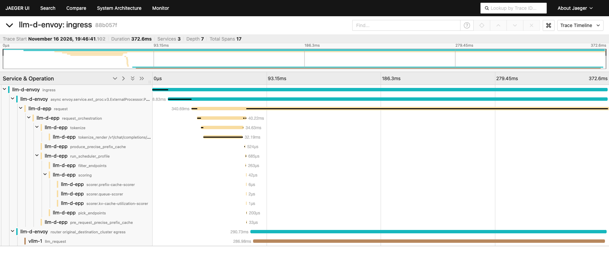
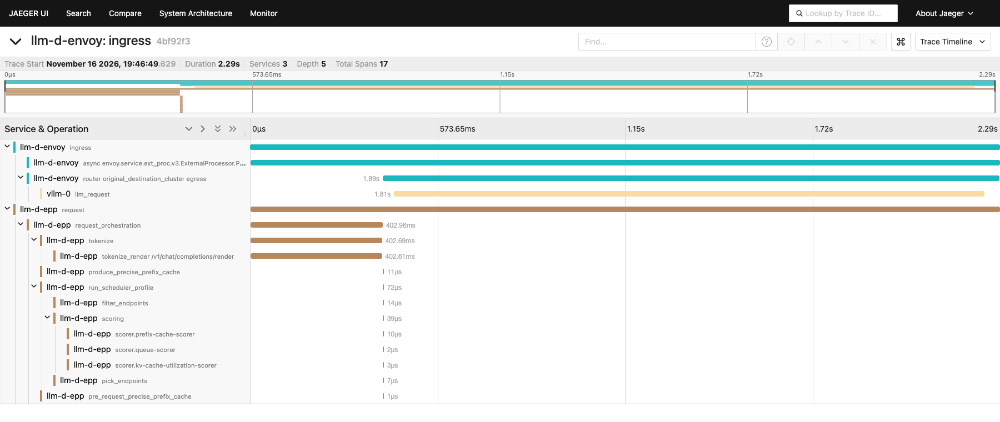
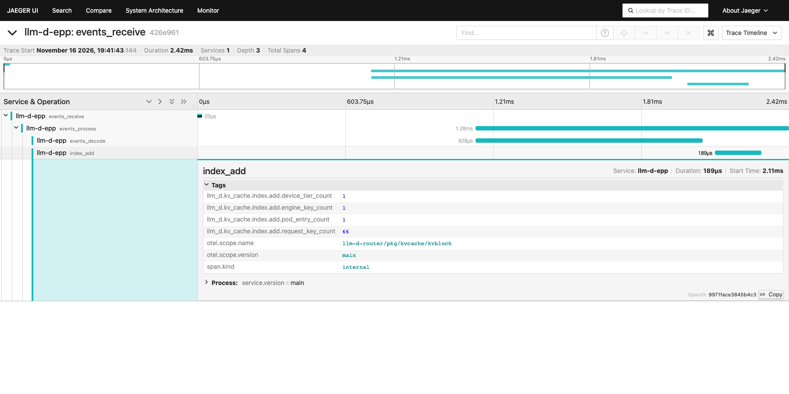
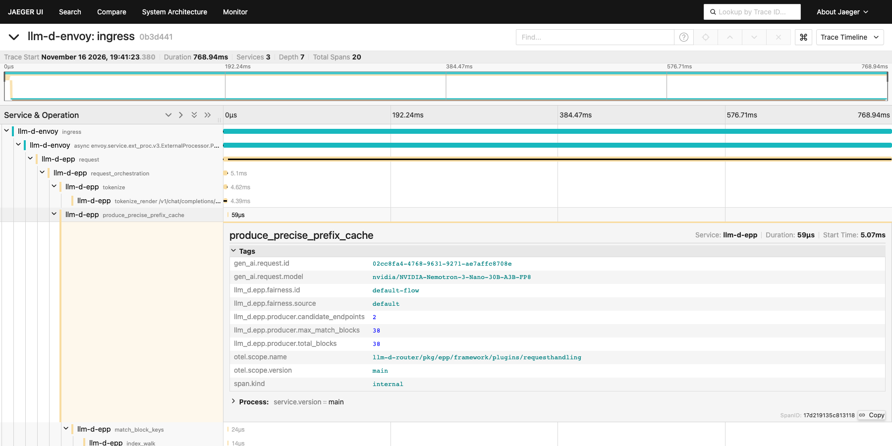
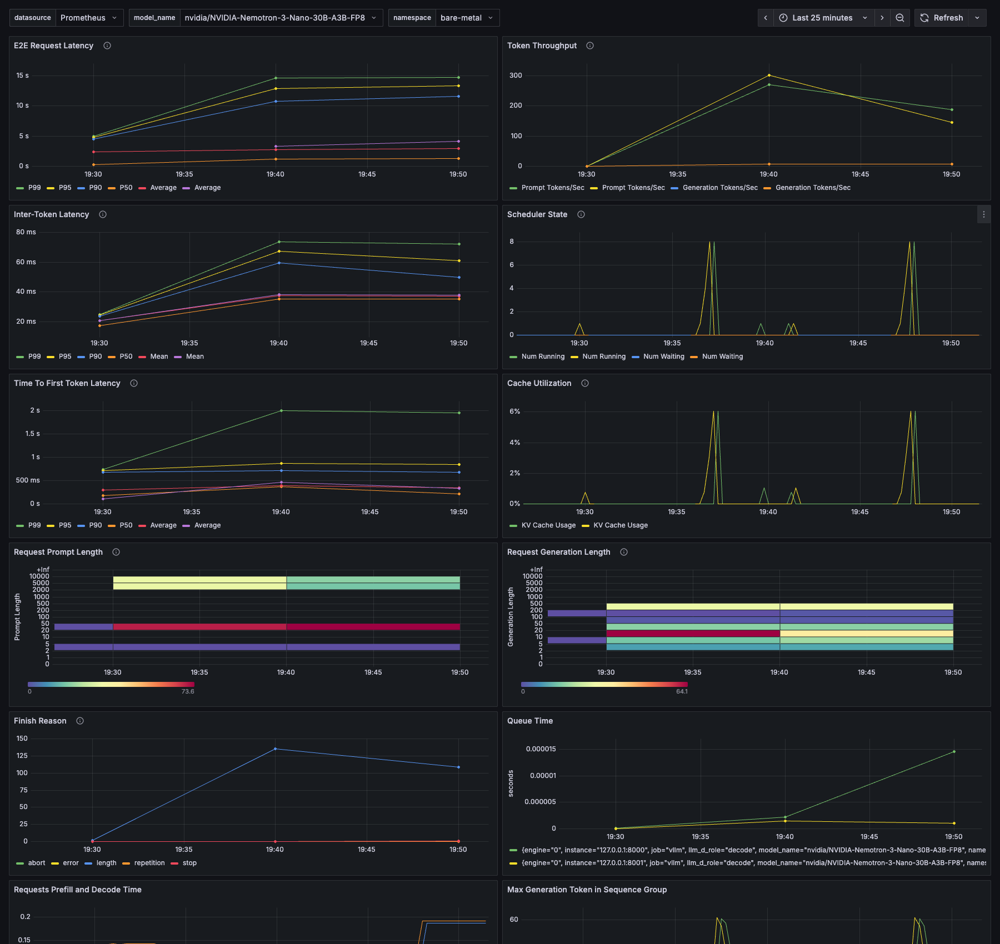
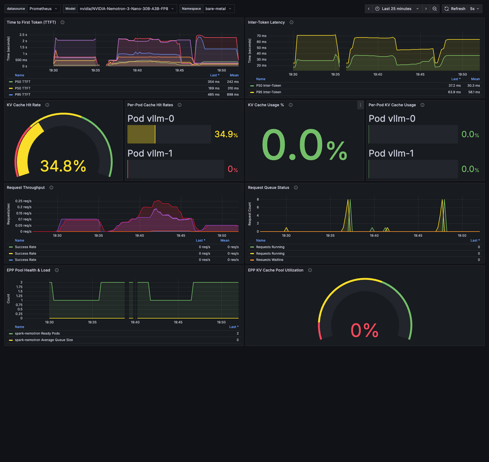
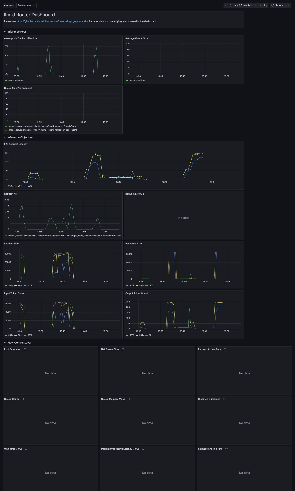
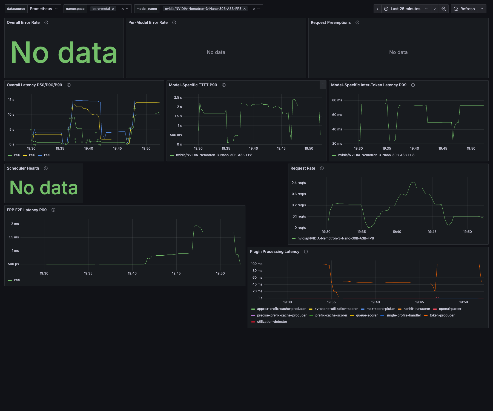
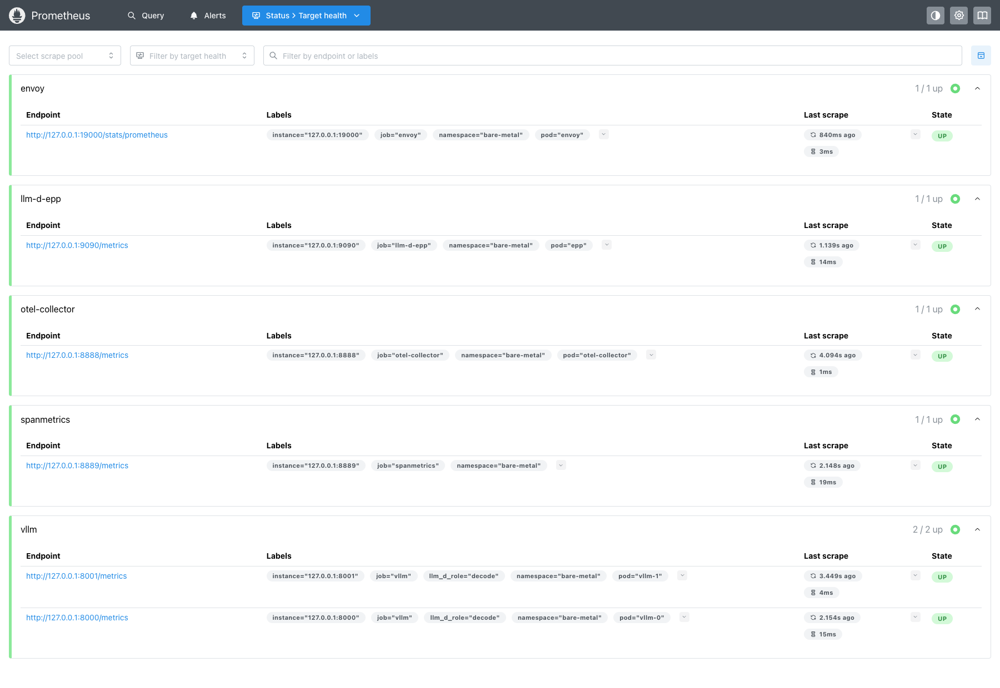

# llm-d Without Kubernetes on a DGX Spark — Nemotron + Full Observability

This guide installs the llm-d routing stack on **one NVIDIA DGX Spark without Kubernetes**.
Every component is a plain Docker container managed by `docker compose`:

- **Two vLLM replicas** serving **NVIDIA Nemotron** on the GB10 GPU.
- The **llm-d EPP** (Endpoint Picker), which finds the replicas through a YAML file
  (`file-discovery`) instead of an `InferencePool`. It does **precise, KV-event-driven
  prefix-cache routing**.
- **Envoy** as the data plane.
- **Full observability**: OpenTelemetry traces (Envoy → EPP → vLLM in one trace), Prometheus
  metrics and the upstream llm-d Grafana dashboards.

The guide covers installation, the end-to-end tests, and the **gaps found along the way**, each
with evidence and a ready-to-file upstream issue draft.

Everything below was executed on **2026-11-16/17** on `spark-3bee` (Ubuntu 24.04.5, GB10,
aarch64, 121 GiB unified memory). **Every `console` block is the real command and its real
output**, captured while running the steps. Long output is trimmed with `...`.

中文版见 [`README-zh.md`](README-zh.md)。

| Upstream baseline | Version |
| --- | --- |
| llm-d (guides) | `main` @ `565373b7` (2026-11-12): `guides/no-kubernetes-deployment` |
| llm-d-router (EPP) | `ghcr.io/llm-d/llm-d-router-endpoint-picker:main` = commit `4dff5aa1` (2026-11-16) |
| vLLM | `nvcr.io/nvidia/vllm:26.08-py3` = vLLM `0.27.1+93523f72.dev` |
| Envoy | `envoyproxy/envoy:v1.36.2` |
| Models | `nvidia/NVIDIA-Nemotron-3-Nano-30B-A3B-FP8` (default), `nvidia/Llama-3.1-Nemotron-Nano-8B-v1` (comparison) |
| Observability | OTel Collector contrib 0.139.0, Jaeger 2.11.0, Prometheus 3.7.3, Grafana 12.2.1 |

---

## Contents

0. [Results at a glance](#0-results-at-a-glance)
1. [Architecture](#1-architecture)
2. [What's in this folder](#2-whats-in-this-folder)
3. [Prerequisites](#3-prerequisites)
4. [Installation, step by step](#4-installation-step-by-step)
5. [First requests](#5-first-requests)
6. [End-to-end test](#6-end-to-end-test)
7. [Observability walkthrough (with screenshots)](#7-observability-walkthrough)
8. [Performance baseline](#8-performance-baseline)
9. [Day-2 operations](#9-day-2-operations)
10. [Findings, gaps and what needs fixing](#10-findings-gaps-and-what-needs-fixing)
11. [Troubleshooting / traps](#11-troubleshooting--traps)

---

## 0. Results at a glance

| Capability | Result without Kubernetes |
| --- | --- |
| EPP runs with **no kubeconfig, no CRDs** (`file-discovery`) | ✅ `EPP starting (file discovery mode)` |
| OpenAI chat, completions and streaming through Envoy → EPP → vLLM | ✅ |
| Nemotron reasoning split into `reasoning` / `content` (`nemotron_v3` parser) | ✅ |
| Precise prefix-cache routing from **real vLLM KV events** over ZMQ | ✅ for prompts ≥ 1 engine block; ⚠️ see [§10.1](#101-general-speculative-indexing-ignores-the-engine-block-size-so-precise-routing-gives-affinity-with-no-cache-benefit) |
| Load spreading of distinct prompts across 2 replicas | ✅ 8 / 8 |
| Endpoint pool hot reload by editing `endpoints.yaml` | ✅ no restart |
| A stopped replica is avoided even though it is still listed in the file | ✅ 10 / 10 requests return 200 |
| **One trace** across Envoy → EPP → vLLM (17 spans, 1 root) | ✅ without a client `traceparent`; ⚠️ 2 roots with one ([§10.2](#102-a-client-traceparent-splits-the-trace-into-two-roots)) |
| Prometheus metrics for vLLM, EPP, Envoy and span-metrics; 5 llm-d Grafana dashboards | ✅ (one panel is broken, [§10.4](#104-grafana-scheduler-health-panel-hard-codes-a-helm-job-name)) |
| e2e test suite (`scripts/e2e-test.py`) | **22 PASS / 2 WARN / 0 FAIL**. Both WARNs are the gaps in §10.1 and §10.2 |

Each gap below also has an upstream issue draft (English, with a 中文说明 section). **The drafts
are kept locally and are not part of this repository, and none have been filed.** The gaps
themselves are described in full in §10.

| # | Draft | Target |
| --- | --- | --- |
| 01 | Speculative indexing ignores the engine block size (hybrid Mamba: 4224 tokens) | llm-d-router, new issue |
| 02 | A client `traceparent` detaches the EPP span from the proxy span | llm-d-router, new issue |
| 03 | No-Kubernetes guide: add observability + the precise-prefix path | llm-d, new issue |
| 04 | Dashboard "Scheduler Health" hard-codes `job="gaie-optimized-baseline-epp"` | llm-d, new issue |
| 05 | Per-endpoint ZMQ port (field report) | **comment** on llm-d-router#2959 / PR #4288 |

---

## 1. Architecture

```text
                       DGX Spark (spark-3bee) — docker compose, all containers on the host network
 ┌───────────────────────────────────────────────────────────────────────────────────────────────┐
 │                                                                                               │
 │  client ──HTTP :8081──▶ Envoy ───────── ext_proc gRPC :9002 ────────▶ EPP (llm-d router)      │
 │                         (trace root)  ◀── x-gateway-destination-endpoint  │ file-discovery    │
 │                           │                                               │  endpoints.yaml   │
 │                           │ ORIGINAL_DST (picked endpoint)                │ token-producer ───┼─▶ /v1/*/render on vLLM
 │                           ▼                                               │ precise-prefix    │
 │              ┌──────────────────────┐   ┌──────────────────────┐          │ scorers + picker  │
 │              │ vllm-0  :8000        │   │ vllm-1  :8001        │          │                   │
 │              │ Nemotron (GB10 GPU)  │   │ Nemotron (GB10 GPU)  │          │                   │
 │              │ KV events ZMQ :5556  │   │ KV events ZMQ :5557  │ ─────────┘  SUB (rankIndex    │
 │              │ replay      :5559    │   │ replay      :5560    │             trick, §4.4)      │
 │              └──────────────────────┘   └──────────────────────┘                              │
 │                                                                                               │
 │  spans:   Envoy, EPP, vLLM ──OTLP gRPC :4317──▶ otel-collector ──▶ Jaeger (UI :16686)         │
 │                                                       └─ spanmetrics :8889 ─┐                 │
 │  metrics: Prometheus :9091 ◀── vLLM /metrics, EPP :9090, Envoy :19000, collector ─┘           │
 │           Grafana :3000 (llm-d dashboards, Prometheus + Jaeger data sources)                  │
 └───────────────────────────────────────────────────────────────────────────────────────────────┘
```

**Why host networking for everything.** The `file-discovery` plugin accepts **literal IPv4
addresses only** (no hostnames), so container DNS names cannot be used. With host networking,
every component reaches the others on `127.0.0.1`, exactly as in the upstream guide's
`docker run --network host`. Jaeger is the only exception: it runs on the bridge network, with
its OTLP port remapped to `127.0.0.1:14317`, because the collector already owns `:4317`.

| Port | Component | Purpose |
| --- | --- | --- |
| 8081 | Envoy | **client entry point** (OpenAI API) |
| 19000 | Envoy | admin, `/ready`, `/clusters`, `/stats/prometheus` (bound to 127.0.0.1) |
| 9002 / 9003 / 9090 | EPP | ext_proc gRPC (+ gRPC health) / health / `/metrics` |
| 8000 / 8001 | vllm-0 / vllm-1 | OpenAI API + `/metrics` + `/v1/*/render` |
| 5556, 5559 / 5557, 5560 | vllm-0 / vllm-1 | KV-event ZMQ PUB / replay |
| 4317 / 4318 / 8889 | otel-collector | OTLP gRPC / OTLP HTTP / span-metrics |
| 16686 | Jaeger | UI + query API |
| 9091 | Prometheus | UI/API (9090 is taken by the EPP) |
| 3000 | Grafana | UI (anonymous Admin — lab only) |

---

## 2. What's in this folder

| Path | What it is |
| --- | --- |
| [`compose.yaml`](compose.yaml) | All 8 services, in 3 profiles: `obs`, `model`, `router` |
| [`nemotron3-nano-30b.env`](nemotron3-nano-30b.env) / [`nemotron-nano-8b.env`](nemotron-nano-8b.env) | Model presets (model id, vLLM extra args, memory sizing) |
| [`configs/epp/endpoints.yaml`](configs/epp/endpoints.yaml) | The file-discovery endpoint list (hot-reloaded) |
| [`configs/epp/config-precise.tmpl.yaml`](configs/epp/config-precise.tmpl.yaml) | EPP config: precise prefix cache (KV events) + file-discovery. `${MODEL}` is rendered by `up.sh` |
| `configs/epp/config-precise-nospec.yaml` | Rendered by `up.sh`: the precise config with `speculativeIndexing: false` (**recommended for hybrid models**, §10.1) |
| [`configs/epp/config-approx.yaml`](configs/epp/config-approx.yaml) | EPP config: upstream no-k8s guide as-is (approximate prefix) |
| [`configs/envoy/envoy.yaml`](configs/envoy/envoy.yaml) | Upstream no-k8s `envoy.yaml` + OpenTelemetry tracing (diff in §4.4) |
| [`configs/otel/collector.yaml`](configs/otel/collector.yaml) | OTLP in → Jaeger + span-metrics |
| [`configs/prometheus/prometheus.yml`](configs/prometheus/prometheus.yml) | Static scrape jobs with synthetic `namespace`/`pod` labels for the llm-d dashboards |
| [`configs/grafana/`](configs/grafana/) | Data sources + 5 upstream llm-d dashboards (unmodified, from llm-d@`565373b7`) |
| [`scripts/up.sh`](scripts/up.sh) / [`scripts/down.sh`](scripts/down.sh) | One-shot bring-up / tear-down |
| [`scripts/e2e-test.py`](scripts/e2e-test.py) | End-to-end test (24 checks, standard library only) |
| [`scripts/trace-tree.py`](scripts/trace-tree.py) | Prints a Jaeger trace as a tree |
| [`scripts/bench.py`](scripts/bench.py) | Small streaming benchmark through Envoy |
| [`scripts/served.sh`](scripts/served.sh) | Requests served per replica (from vLLM metrics) |
| [`scripts/capture-doc.sh`](scripts/capture-doc.sh) | Re-runs the README steps and records the console output |
| [`docs/screenshots/`](docs/screenshots/) | Jaeger / Grafana / Prometheus screenshots used below |
| [`docs/test-logs/`](docs/test-logs/) | Raw logs of every test run quoted in this README |

---

## 3. Prerequisites

### 3.1 Host

You need Docker with the NVIDIA runtime, the Compose v2 plugin, `jq`, `envsubst` (gettext)
and `curl`. All of them were already installed on this Spark.

```console
gyliu@spark-3bee:~/llm-d-nonk8s$ hostname; uname -m; grep PRETTY /etc/os-release
spark-3bee
aarch64
PRETTY_NAME="Ubuntu 24.04.5 LTS"
gyliu@spark-3bee:~/llm-d-nonk8s$ nvidia-smi --query-gpu=name,driver_version --format=csv
name, driver_version
NVIDIA GB10, 580.173.02
gyliu@spark-3bee:~/llm-d-nonk8s$ docker info --format "runtime={{.DefaultRuntime}} server={{.ServerVersion}}"; nvidia-ctk --version | head -1; docker compose version
runtime=nvidia server=29.2.1
NVIDIA Container Toolkit CLI version 1.20.0
Docker Compose version v5.0.2
```

### 3.2 GPU memory budget (GB10 unified memory)

The GB10's 121 GiB is **shared by the CPU and the GPU**. `nvidia-smi` cannot report a total
("Not Supported"). The only number that matters is `torch.cuda.mem_get_info()`:

```console
gyliu@spark-3bee:~/llm-d-nonk8s$ docker run --rm --gpus all --entrypoint='' nvcr.io/nvidia/vllm:26.08-py3 python3 -c 'import torch,vllm;f,t=torch.cuda.mem_get_info();print("vllm",vllm.__version__,"| GPU free",round(f/2**30,1),"GiB of",round(t/2**30,1),"GiB")'
...
vllm 0.27.1+93523f72.dev | GPU free 26.9 GiB of 121.7 GiB
```

Only 26.9 GiB was free here because **ComfyUI** (also running on this Spark) had models loaded.
Two 30B replicas need about 85 GiB:

| Per replica (Nemotron-3-Nano-30B-A3B-FP8) | GiB |
| --- | --- |
| Weights (`Model loading took 31.48 GiB`) | 31.5 |
| KV cache (`--kv-cache-memory-bytes 8G`) | 8.0 |
| CUDA graphs (`Graph capturing ... took 2.31 GiB`) | 2.3 |
| **Total, × 2 replicas** | **≈ 84** |

Before starting, free other GPU users. ComfyUI's `/free` endpoint unloads its cached models
without stopping the process. Do this only when its queue is empty, and tell whoever uses it.

```console
gyliu@spark-3bee:~$ curl -s localhost:8188/queue | python3 -c "import json,sys;d=json.load(sys.stdin);print(\"running\",len(d[\"queue_running\"]),\"pending\",len(d[\"queue_pending\"]))"
running 0 pending 0
gyliu@spark-3bee:~$ curl -s -X POST localhost:8188/free -H "Content-Type: application/json" -d "{\"unload_models\":true,\"free_memory\":true}"; sleep 5; nvidia-smi --query-compute-apps=pid,used_memory --format=csv,noheader
2401, 371 MiB
1324081, 31620 MiB
```

(The second process is `vllm-0`, which was already loading.) After both replicas were up,
**1.1 GiB** of GPU memory was left (§4.7). Do not run ComfyUI jobs at the same time.

---

## 4. Installation, step by step

The steps below start each service **one at a time**, so you can see and check what each one
does. [§4.10](#410-one-shot-alternative-scriptsupsh) has the one-command equivalent.

### 4.1 Copy the demo folder to the Spark

From the Mac (or any workstation) that holds this repository:

```console
gyliu-cary@gyliu513-MacBook-Pro-2 llm-d-spark-nonk8s-demo % ssh mygpu 'hostname; nvidia-smi -L'
spark-3bee
GPU 0: NVIDIA GB10 (UUID: GPU-3f370c1d-e554-fce7-5841-cf15d5495a57)
gyliu-cary@gyliu513-MacBook-Pro-2 llm-d-spark-nonk8s-demo % rsync -a --exclude docs --exclude .env ./ mygpu:~/llm-d-nonk8s/
gyliu-cary@gyliu513-MacBook-Pro-2 llm-d-spark-nonk8s-demo % ssh mygpu 'ls ~/llm-d-nonk8s ~/llm-d-nonk8s/scripts'
/home/gyliu/llm-d-nonk8s:
compose.yaml
configs
logs
nemotron3-nano-30b.env
nemotron-nano-8b.env
scripts

/home/gyliu/llm-d-nonk8s/scripts:
bench.py
capture-doc.sh
down.sh
e2e-test.py
__pycache__
served.sh
trace-tree.py
up.sh
```

`mygpu` is an SSH alias (Tailscale host name, user `gyliu`). All remaining commands run on the
Spark in `~/llm-d-nonk8s`.

### 4.2 Pull the images

All images are multi-arch and have `linux/arm64` builds. The EPP is the `main` tag, built
2026-11-16 from commit `4dff5aa1`.

```console
gyliu@spark-3bee:~/llm-d-nonk8s$ docker pull -q nvcr.io/nvidia/vllm:26.08-py3
nvcr.io/nvidia/vllm:26.08-py3
gyliu@spark-3bee:~/llm-d-nonk8s$ docker pull -q ghcr.io/llm-d/llm-d-router-endpoint-picker:main
ghcr.io/llm-d/llm-d-router-endpoint-picker:main
gyliu@spark-3bee:~/llm-d-nonk8s$ docker pull -q envoyproxy/envoy:v1.36.2
docker.io/envoyproxy/envoy:v1.36.2
gyliu@spark-3bee:~/llm-d-nonk8s$ docker pull -q otel/opentelemetry-collector-contrib:0.139.0
docker.io/otel/opentelemetry-collector-contrib:0.139.0
gyliu@spark-3bee:~/llm-d-nonk8s$ docker pull -q jaegertracing/jaeger:2.11.0
docker.io/jaegertracing/jaeger:2.11.0
gyliu@spark-3bee:~/llm-d-nonk8s$ docker pull -q prom/prometheus:v3.7.3
docker.io/prom/prometheus:v3.7.3
gyliu@spark-3bee:~/llm-d-nonk8s$ docker pull -q grafana/grafana:12.2.1
docker.io/grafana/grafana:12.2.1
gyliu@spark-3bee:~/llm-d-nonk8s$ docker image inspect ghcr.io/llm-d/llm-d-router-endpoint-picker:main --format '{{.Architecture}} created={{.Created}}'
arm64 created=2026-11-16T20:07:19.682452563Z
gyliu@spark-3bee:~/llm-d-nonk8s$ docker run --rm ghcr.io/llm-d/llm-d-router-endpoint-picker:main --help 2>&1 | grep -E -- '--(config-file|pool-name|secure-serving|health-checking|objectives-file) '
      --config-file string                             The path to the configuration file.
      --health-checking                                Enables health checking.
      --metrics-cert-dir string                        Directory with tls.crt and tls.key for the metrics endpoint. Empty serves metrics over plain HTTP. Independent of --secure-serving and --cert-path, which apply to the serving listener.
      --objectives-file string                         YAML file of objectives (name, priority) loaded at startup. File-discovery mode only.
      --pool-name string                               Name of the InferencePool this Endpoint Picker is associated with.
      --secure-serving                                 Serve the listener over TLS. (default true)
```

> **Why the NGC image.** No `vllm/vllm-openai` image supports GB10 + aarch64. NVIDIA's
> `nvcr.io/nvidia/vllm` is public, so no NGC login is needed. **Never override its
> `ENTRYPOINT`.** It enables CUDA forward compatibility, and without it FlashInfer JIT fails
> with `cudaErrorUnsupportedPtxVersion`. `compose.yaml` uses `command:`, which keeps the
> entrypoint.

### 4.3 Download the models

Both models are **ungated**, so no HF token is required. Anonymous downloads are rate-limited:
the 31 GB model took about 8 minutes on this link. The models go into a cache directory that
the vLLM containers mount read/write.

```console
gyliu@spark-3bee:~/llm-d-nonk8s$ docker run --rm --name hf-dl -v ~/llm-d-cache/huggingface:/root/.cache/huggingface --entrypoint="" nvcr.io/nvidia/vllm:26.08-py3 hf download nvidia/NVIDIA-Nemotron-3-Nano-30B-A3B-FP8
...
Warning: You are sending unauthenticated requests to the HF Hub. Please set a HF_TOKEN to enable higher rate limits and faster downloads.
...
Fetching 38 files: 100%|██████████| 38/38 [08:06<00:00, 12.81s/it]
...
  path: /root/.cache/huggingface/hub/models--nvidia--NVIDIA-Nemotron-3-Nano-30B-A3B-FP8/snapshots/9bee19446c0dfd01f356e10979d225b2a6621944
gyliu@spark-3bee:~/llm-d-nonk8s$ docker run --rm --name hf-dl2 -v ~/llm-d-cache/huggingface:/root/.cache/huggingface --entrypoint="" nvcr.io/nvidia/vllm:26.08-py3 hf download nvidia/Llama-3.1-Nemotron-Nano-8B-v1 --exclude "original/*"
...
...
Fetching 16 files: 100%|██████████| 16/16 [03:20<00:00, 12.54s/it]
...
  path: /root/.cache/huggingface/hub/models--nvidia--Llama-3.1-Nemotron-Nano-8B-v1/snapshots/54641c1611fcff44fa4865626462445e0a153fc7
gyliu@spark-3bee:~/llm-d-nonk8s$ ls ~/llm-d-cache/huggingface/hub | grep nvidia
models--nvidia--Llama-3.1-Nemotron-Nano-8B-v1
models--nvidia--NVIDIA-Nemotron-3-Nano-30B-A3B-FP8
gyliu@spark-3bee:~/llm-d-nonk8s$ du -sh ~/llm-d-cache/huggingface/hub/models--nvidia--*
15G	/home/gyliu/llm-d-cache/huggingface/hub/models--nvidia--Llama-3.1-Nemotron-Nano-8B-v1
31G	/home/gyliu/llm-d-cache/huggingface/hub/models--nvidia--NVIDIA-Nemotron-3-Nano-30B-A3B-FP8
```

(`--entrypoint=""` is fine here: the download needs no GPU. The two downloads were run in the
background with `nohup ... > logs/hf-download*.log &`. The 30B command first ran as
`bash -c "hf download <30B> && hf download <8B> --exclude \"*.pth\" \"original/*\""`. The 30B
part succeeded; the chained 8B part hit the `--exclude` trap in §11 and was re-run as shown.
Setting `HF_TOKEN` would speed the downloads up but is not required.)

**Which Nemotron?**

| Model | Architecture | Why it is here |
| --- | --- | --- |
| `NVIDIA-Nemotron-3-Nano-30B-A3B-FP8` (**default**) | Hybrid Mamba-2 + MoE + attention, 3B active, FP8 | The current Nemotron, and what NVIDIA recommends for DGX Spark. 48 tok/s single-stream on GB10 |
| `Llama-3.1-Nemotron-Nano-8B-v1` | Pure transformer, BF16 | Comparison point: shows what precise prefix routing does when the engine block size is 64 ([§10.1](#101-general-speculative-indexing-ignores-the-engine-block-size-so-precise-routing-gives-affinity-with-no-cache-benefit)) |

vLLM stores the HF cache with `HF_HUB_OFFLINE=1` (set in `compose.yaml`), so the replicas
never call the Hub at start-up.

### 4.4 Review and render the configuration

```console
gyliu@spark-3bee:~/llm-d-nonk8s$ ls -R configs | head -30
configs:
envoy
epp
grafana
otel
prometheus

configs/envoy:
envoy.yaml

configs/epp:
config-approx.yaml
config-precise-nospec.yaml
config-precise.tmpl.yaml
config-precise.yaml
endpoints.yaml
...
```

**The endpoint list.** This replaces the `InferencePool`. `address` must be an IPv4 literal.
`rankIndex` is used here to give each replica on the same host its own KV-event port: the
precise producer dials `socketPort + rankIndex` and `replaySocketPort + rankIndex`. This is a
workaround until llm-d-router PR #4288 adds a per-entry `zmqPort`
([§10.5](#105-several-replicas-on-one-host-need-the-rankindex-trick-for-kv-event-ports)).

```console
gyliu@spark-3bee:~/llm-d-nonk8s$ cat configs/epp/endpoints.yaml
# file-discovery endpoints (watched; rewrite atomically with `mv` to change the pool).
# address MUST be a literal IPv4 (no hostnames). All vLLM replicas run on the
# Spark with host networking, so 127.0.0.1 + distinct ports.
#
# rankIndex is (ab)used here to give each replica its own KV-event port:
# the precise-prefix producer dials socketPort+rankIndex (5556/5557) and
# replaySocketPort+rankIndex (5559/5560). Upstream PR llm-d-router#4288 adds a
# proper per-entry zmqPort (issue #2959).
endpoints:
  - name: vllm-0
    address: 127.0.0.1
    port: "8000"
    rankIndex: 0
    labels:
      llm-d.ai/inference-serving: "true"   # informational; verified NOT required for KV-event subscription
      llm-d.ai/model: nemotron
  - name: vllm-1
    address: 127.0.0.1
    port: "8001"
    rankIndex: 1
    labels:
      llm-d.ai/inference-serving: "true"
      llm-d.ai/model: nemotron
```

**The model preset.** `compose.yaml` reads `.env`. `KV_CACHE_BYTES` and `GPU_MEM_UTIL` are
**both** required on unified memory: either one alone fails vLLM's start-up memory checks on
GB10. vLLM's parser accepts `8G` but not `8GiB`.

```console
gyliu@spark-3bee:~/llm-d-nonk8s$ cat nemotron3-nano-30b.env
# Nemotron 3 Nano 30B-A3B (hybrid Mamba-2 + MoE + attention, FP8) — default model
MODEL=nvidia/NVIDIA-Nemotron-3-Nano-30B-A3B-FP8
VLLM_EXTRA_ARGS="--trust-remote-code --reasoning-parser nemotron_v3 --tool-call-parser qwen3_coder --enable-auto-tool-choice"
KV_CACHE_BYTES=8G
GPU_MEM_UTIL=0.10
MAX_MODEL_LEN=16384
```

**Render the EPP config.** The precise config's `token-producer` must name the served model:
EPP tokenizes by calling the replicas' `/v1/chat/completions/render`, and a model mismatch is
rejected.

```console
gyliu@spark-3bee:~/llm-d-nonk8s$ cp nemotron3-nano-30b.env .env && set -a && . ./.env && set +a && envsubst '${MODEL}' < configs/epp/config-precise.tmpl.yaml > configs/epp/config-precise.yaml && grep -n -A1 "modelName" configs/epp/config-precise.yaml
23:      modelName: nvidia/NVIDIA-Nemotron-3-Nano-30B-A3B-FP8
24-      vllm:
gyliu@spark-3bee:~/llm-d-nonk8s$ echo EPP_CONFIG=config-precise.yaml >> .env; cat .env
# Nemotron 3 Nano 30B-A3B (hybrid Mamba-2 + MoE + attention, FP8) — default model
MODEL=nvidia/NVIDIA-Nemotron-3-Nano-30B-A3B-FP8
VLLM_EXTRA_ARGS="--trust-remote-code --reasoning-parser nemotron_v3 --tool-call-parser qwen3_coder --enable-auto-tool-choice"
KV_CACHE_BYTES=8G
GPU_MEM_UTIL=0.10
MAX_MODEL_LEN=16384
EPP_CONFIG=config-precise.yaml
```

The plugin set in [`config-precise.tmpl.yaml`](configs/epp/config-precise.tmpl.yaml) is the
upstream `guides/precise-prefix-cache-routing` set, adapted for file-discovery:

| Plugin | Role |
| --- | --- |
| `file-discovery` (`watchFile: true`) | Endpoint inventory from `endpoints.yaml`; reloads on atomic rewrite |
| `metrics-data-source` + `core-metrics-extractor` | Scrapes each replica's `/metrics` (queue, KV utilization) |
| `token-producer` (`vllm.endpointDiscovery`) | Tokenizes on the replicas themselves (`/render`), round-robin |
| `endpoint-notification-source` → `precise-prefix-cache-producer` | **Required wiring in file mode.** Without it the producer has no ZMQ subscribers (llm-d-router#4256) |
| `prefix-cache-scorer` (w=3), `queue-scorer` (w=2), `kv-cache-utilization-scorer` (w=2), `max-score-picker` | Scoring profile |

**The Envoy config.** This is the upstream no-k8s `envoy.yaml`, unchanged except for tracing:

```console
gyliu@spark-3bee:~/llm-d-nonk8s$ diff <(git -C ~/llm-d show 565373b7:guides/no-kubernetes-deployment/router/envoy/envoy.yaml) configs/envoy/envoy.yaml | head -60
1,16c1,6
< # Envoy config for the no-Kubernetes file-discovery deployment.
...
---
> # Envoy config for llm-d without Kubernetes on the DGX Spark.
> # Based verbatim on upstream llm-d guides/no-kubernetes-deployment/router/envoy/envoy.yaml
> # (llm-d@565373b7) with two additions, marked "SPARK:":
> #   1. OpenTelemetry tracing in the HTTP connection manager -> otel-collector :4317
> #   2. an `otel_collector` cluster for (1)
> # Admin stays on 127.0.0.1:19000; Prometheus (host network) scrapes /stats/prometheus there.
37a28,42
>                 # SPARK: root a trace per request and export it over OTLP.
>                 generate_request_id: true
>                 tracing:
>                   random_sampling:
>                     value: 100
>                   spawn_upstream_span: true
>                   provider:
>                     name: envoy.tracers.opentelemetry
>                     typed_config:
>                       "@type": type.googleapis.com/envoy.config.trace.v3.OpenTelemetryConfig
>                       service_name: llm-d-envoy
>                       grpc_service:
>                         envoy_grpc:
>                           cluster_name: otel_collector
>                         timeout: 1s
138a144,162
>
>     # SPARK: OTLP/gRPC exporter target for Envoy's own spans.
>     - name: otel_collector
>       type: STATIC
...
```

Compose sees 8 services:

```console
gyliu@spark-3bee:~/llm-d-nonk8s$ docker compose --profile obs --profile model --profile router config --services
envoy
epp
grafana
jaeger
otel-collector
prometheus
vllm-0
vllm-1
```

### 4.5 Start the observability stack (profile `obs`)

Start it first, so spans and metrics from the very first request are captured.

```console
gyliu@spark-3bee:~/llm-d-nonk8s$ docker compose --profile obs up -d
 Network llm-d-nonk8s_default Creating
 Network llm-d-nonk8s_default Created
 Container prometheus Creating
 Container otel-collector Creating
 Container grafana Creating
 Container jaeger Creating
 ...
 Container prometheus Started
 Container grafana Started
 Container otel-collector Started
 Container jaeger Started
gyliu@spark-3bee:~/llm-d-nonk8s$ docker ps --format "table {{.Names}}\t{{.Status}}" --filter name=otel --filter name=jaeger --filter name=prometheus --filter name=grafana
NAMES            STATUS
jaeger           Up 8 seconds
grafana          Up 8 seconds
prometheus       Up 8 seconds
otel-collector   Up 8 seconds
gyliu@spark-3bee:~/llm-d-nonk8s$ curl -s localhost:9091/-/ready; echo; curl -s localhost:3000/api/health | jq -c .; curl -s -o /dev/null -w "jaeger UI %{http_code}\n" localhost:16686/
Prometheus Server is Ready.

{"database":"ok","version":"12.2.1","commit":"563109b696e9c1cbaf345f2ab7a11f7f78422982"}
jaeger UI 200
gyliu@spark-3bee:~/llm-d-nonk8s$ docker logs otel-collector 2>&1 | grep -E "Starting (GRPC|HTTP) server|Everything is ready" | cut -c1-160
2026-11-17T00:55:34.399Z	info	otlpreceiver@v0.139.0/otlp.go:120	Starting GRPC server	{"resource": {"service.instance.id": "ffd4581c-01e9-4bb6-8ace-79824437d9f6"
2026-11-17T00:55:34.400Z	info	otlpreceiver@v0.139.0/otlp.go:178	Starting HTTP server	{"resource": {"service.instance.id": "ffd4581c-01e9-4bb6-8ace-79824437d9f6"
2026-11-17T00:55:34.400Z	info	service@v0.139.0/service.go:245	Everything is ready. Begin running and processing data.	{"resource": {"service.instance.id": "ffd4
```

### 4.6 Start vLLM replica 0

The vLLM command line, from [`compose.yaml`](compose.yaml):

| Flag | Why |
| --- | --- |
| `--block-size 64` | Wanted router/engine block alignment. **Overridden to 4224 for this hybrid model**, see the log below and [§10.1](#101-general-speculative-indexing-ignores-the-engine-block-size-so-precise-routing-gives-affinity-with-no-cache-benefit) |
| `--kv-cache-memory-bytes 8G` + `--gpu-memory-utilization 0.10` | Unified-memory sizing (both needed on GB10) |
| `--enable-prefix-caching` | For this model, vLLM switches the Mamba cache mode to `all` (experimental) |
| `--kv-events-config '{"enable_kv_cache_events":true,"publisher":"zmq","endpoint":"tcp://*:5556","replay_endpoint":"tcp://*:5559","topic":"kv@127.0.0.1:8000@<model>"}'` | KV events for the EPP. The topic **must** match the `address:port` of the endpoint entry |
| `--otlp-traces-endpoint http://127.0.0.1:4317` + `OTEL_SERVICE_NAME=vllm-0` | vLLM's own `llm_request` span |
| `--trust-remote-code --reasoning-parser nemotron_v3 --tool-call-parser qwen3_coder --enable-auto-tool-choice` | Nemotron 3 specific (from `nemotron3-nano-30b.env`) |

```console
gyliu@spark-3bee:~/llm-d-nonk8s$ docker compose --profile model up -d --no-deps vllm-0
 Container vllm-0 Creating
 Container vllm-0 Created
 Container vllm-0 Starting
 Container vllm-0 Started
gyliu@spark-3bee:~/llm-d-nonk8s$ until curl -sf localhost:8000/v1/models >/dev/null; do sleep 5; done   # took 335s
gyliu@spark-3bee:~/llm-d-nonk8s$ docker logs vllm-0 2>&1 | grep -E "non-default args|Mamba cache mode|Setting attention block size|Model loading took|GPU KV cache size|init engine|Route: /v1/(chat/)?completions/render|Application startup complete" | sed -E "s/^\(APIServer pid=1\) |^\(EngineCore pid=[0-9]+\) //" | cut -c1-260
INFO 11-17 00:55:50 [api_utils.py:273] non-default args: {'model_tag': 'nvidia/NVIDIA-Nemotron-3-Nano-30B-A3B-FP8', 'enable_auto_tool_choice': True, 'tool_call_parser': 'qwen3_coder', 'disable_access_log_for_endpoints': '/health,/metrics,/v1/models,/v1/complet
WARNING 11-17 00:55:50 [config.py:618] Mamba cache mode is set to 'all' for NemotronHForCausalLM by default when prefix caching is enabled
INFO 11-17 01:00:37 [gpu_model_runner.py:5405] Model loading took 31.48 GiB memory and 276.726271 seconds
INFO 11-17 01:00:37 [interface.py:911] Setting attention block size to 4224 tokens to ensure that attention page size is >= mamba page size.
INFO 11-17 01:00:44 [kv_cache_utils.py:2235] GPU KV cache size: 541,491 tokens
INFO 11-17 01:01:12 [core.py:348] init engine (profile, create kv cache, warmup model) took 35.32 s (compilation: 0.79 s)
INFO 11-17 01:01:15 [launcher.py:46] Route: /v1/chat/completions/render, Methods: POST
INFO 11-17 01:01:15 [launcher.py:46] Route: /v1/completions/render, Methods: POST
INFO:     Application startup complete.
gyliu@spark-3bee:~/llm-d-nonk8s$ curl -s localhost:8000/v1/models | jq -c ".data[] | {id, max_model_len}"
{"id":"nvidia/NVIDIA-Nemotron-3-Nano-30B-A3B-FP8","max_model_len":16384}
gyliu@spark-3bee:~/llm-d-nonk8s$ curl -s localhost:8000/metrics | grep -E "^vllm:cache_config_info" | grep -oE "block_size=\"[0-9]+\"|enable_prefix_caching=\"[A-Za-z]+\"|kv_cache_size_tokens=\"[0-9]+\""
block_size="4224"
enable_prefix_caching="True"
kv_cache_size_tokens="541491"
block_size="64"
gyliu@spark-3bee:~/llm-d-nonk8s$ ss -ltnp 2>/dev/null | grep -E ":(8000|5556|5559) " | awk "{print \$4}"
0.0.0.0:5556
0.0.0.0:5559
0.0.0.0:8000
```

Three things to note in that output:

1. **`Setting attention block size to 4224 tokens`.** For this hybrid Mamba model, vLLM can
   reuse a cached prefix only in whole 4224-token units. This drives the main gap in §10.1.
2. The `/v1/chat/completions/render` and `/v1/completions/render` routes exist in vLLM 0.27.1
   without any extra flag. The EPP's `token-producer` uses them.
3. Loading took 335 s on a cold page cache. The safetensors load alone was 276 s from EXT4;
   later restarts are faster.

### 4.7 Start vLLM replica 1

`vllm-1` has `depends_on: vllm-0: service_healthy`, so the two replicas never profile memory at
the same time:

```console
gyliu@spark-3bee:~/llm-d-nonk8s$ docker compose --profile model up -d vllm-1
 Container vllm-0 Running
 Container vllm-1 Creating
 Container vllm-1 Created
 Container vllm-0 Waiting
 Container vllm-0 Healthy
 Container vllm-1 Starting
 Container vllm-1 Started
gyliu@spark-3bee:~/llm-d-nonk8s$ until curl -sf localhost:8001/v1/models >/dev/null; do sleep 5; done   # took 295s
gyliu@spark-3bee:~/llm-d-nonk8s$ docker ps --format "table {{.Names}}\t{{.Status}}" --filter name=vllm
NAMES     STATUS
vllm-1    Up 4 minutes (healthy)
vllm-0    Up 10 minutes (healthy)
gyliu@spark-3bee:~/llm-d-nonk8s$ docker exec vllm-0 python3 -c 'import torch;f,t=torch.cuda.mem_get_info();print("GPU free after 2 replicas:",round(f/2**30,1),"GiB")'
GPU free after 2 replicas: 1.1 GiB
```

> Both replicas share **one** GB10. Two replicas here demonstrate routing (affinity, spreading,
> failover); they do not double the throughput. See §8.

### 4.8 Start the EPP

The EPP runs from the `main` image with `--secure-serving=false` (Envoy is on the same host)
and `--health-checking=true` (Envoy health-checks the ext_proc port). Its environment sets
`OTEL_TRACES_SAMPLER=parentbased_always_on`: **the EPP's default is a ratio of 0.1**, which
would keep only 1 trace in 10.

```console
gyliu@spark-3bee:~/llm-d-nonk8s$ docker compose --profile router up -d --no-deps epp
 Container epp Creating
 Container epp Created
 Container epp Starting
 Container epp Started
gyliu@spark-3bee:~/llm-d-nonk8s$ docker logs epp 2>&1 | jq -r "select(.body|test(\"GIE build|file-discovery mode|EPP starting|watching endpoints|Connected subscriber|Replay complete|gRPC server listening\")) | [.severity_text, .body, (.endpoint // .port // .path // .\"commit-sha\" // \"\" | tostring)] | @tsv"
INFO	GIE build	4dff5aa1278cfa06c6eaa483a2cfb788331458fc
INFO	file-discovery mode: Kubernetes-only features are inactive (InferenceModelRewrite, InferenceObjective reconciler, and any k8s-notification-source data layer plugins); see docs/discovery.md
INFO	EPP starting (file discovery mode)
INFO	watching endpoints file for changes	/etc/epp/endpoints.yaml
INFO	gRPC server listening	9003
INFO	Connected subscriber socket	tcp://127.0.0.1:5557
INFO	gRPC server listening	9002
INFO	Connected subscriber socket	tcp://127.0.0.1:5556
INFO	Replay complete
INFO	Replay complete
gyliu@spark-3bee:~/llm-d-nonk8s$ curl -s localhost:9090/metrics | grep -E "^llm_d_epp_kv_cache_events_active_subscribers|^llm_d_epp_pool_ready_pods|^llm_d_epp_inference_pool_ready_pods" ; curl -s localhost:9090/metrics | grep -c "^llm_d_epp"
llm_d_epp_kv_cache_events_active_subscribers 2
56
```

What to check: `file discovery mode` (no Kubernetes client was created), two ZMQ subscribers
(`5556` = rank 0, `5557` = rank 1), and replay completed on both. `compose.yaml` mounts the
`configs/epp` **directory**, not the single file, so an atomic `mv` of `endpoints.yaml` is seen
by the file watcher (a bind-mounted file pins the old inode).

### 4.9 Start Envoy

```console
gyliu@spark-3bee:~/llm-d-nonk8s$ docker compose --profile router up -d --no-deps envoy
 Container envoy Creating
 Container envoy Created
 Container envoy Starting
 Container envoy Started
gyliu@spark-3bee:~/llm-d-nonk8s$ curl -s localhost:19000/ready
LIVE
gyliu@spark-3bee:~/llm-d-nonk8s$ curl -s localhost:19000/clusters | grep -E "^ext_proc::.*(health_flags|cx_active)|^otel_collector::.*health_flags"
ext_proc::127.0.0.1:9002::cx_active::0
ext_proc::127.0.0.1:9002::health_flags::healthy
otel_collector::127.0.0.1:4317::health_flags::healthy
gyliu@spark-3bee:~/llm-d-nonk8s$ docker ps --format "table {{.Names}}\t{{.Status}}"
NAMES            STATUS
envoy            Up 12 seconds
epp              Up 18 seconds
vllm-1           Up 5 minutes (healthy)
vllm-0           Up 10 minutes (healthy)
jaeger           Up 11 minutes
grafana          Up 11 minutes
prometheus       Up 11 minutes
otel-collector   Up 11 minutes
```

`ext_proc::...::health_flags::healthy` means Envoy's gRPC health check of the EPP passes
(it needs `--health-checking=true`; otherwise Envoy reaches the EPP only through panic routing).

### 4.10 One-shot alternative: `scripts/up.sh`

`scripts/up.sh [model-env] [precise|nospec|approx]` does §4.4 to §4.9 in one go. It copies the preset
to `.env`, renders the EPP config, then starts `obs`, `model` (and waits for both replicas)
and `router`:

```console
gyliu@spark-3bee:~/llm-d-nonk8s$ scripts/up.sh nemotron3-nano-30b.env precise
 ...
 Container vllm-0 Started
 Container vllm-0 Waiting
waiting for both vLLM replicas (first start compiles; ~5-15 min)...
  vLLM :8000 ready
  vLLM :8001 ready
...
Envoy ready on :8081 (EPP config: config-precise.yaml, model: nvidia/NVIDIA-Nemotron-3-Nano-30B-A3B-FP8)
```

`scripts/down.sh` removes all 8 containers. The model cache and the vLLM compile cache in
`~/llm-d-cache` are kept.

---

## 5. First requests

All requests go to **Envoy on `:8081`**, never to a replica directly.

Nemotron 3 reasons by default, and the `nemotron_v3` parser moves the reasoning into
`message.reasoning`. Give it enough `max_tokens`. With 300 tokens, the reasoning used them all
and `content` came back `null`.

```console
gyliu@spark-3bee:~/llm-d-nonk8s$ curl -s localhost:8081/v1/chat/completions -H 'Content-Type: application/json' -d '{"model":"nvidia/NVIDIA-Nemotron-3-Nano-30B-A3B-FP8","messages":[{"role":"user","content":"In one sentence: what does an inference router do?"}],"max_tokens":1024}' | jq '{model, reasoning: (.choices[0].message.reasoning | .[:200] + " ..."), content: .choices[0].message.content, usage: .usage}'
{
  "model": "nvidia/NVIDIA-Nemotron-3-Nano-30B-A3B-FP8",
  "reasoning": "The user asks: \"In one sentence: what does an inference router do?\" We need to answer in one sentence, describing the function of an inference router. Likely: It directs incoming inference requests to ...",
  "content": "\nAn inference router directs incoming AI inference requests to the appropriate model or compute resource, dynamically selecting the optimal execution path based on factors like workload, latency requirements, and model availability.",
  "usage": {
    "prompt_tokens": 27,
    "total_tokens": 121,
    "completion_tokens": 94,
    "prompt_tokens_details": null
  }
}
```

To turn reasoning off, pass `chat_template_kwargs.enable_thinking=false`. Here it used 35
tokens instead of 94:

```console
gyliu@spark-3bee:~/llm-d-nonk8s$ curl -s localhost:8081/v1/chat/completions -H 'Content-Type: application/json' -d '{"model":"nvidia/NVIDIA-Nemotron-3-Nano-30B-A3B-FP8","messages":[{"role":"user","content":"In one sentence: what does an inference router do?"}],"max_tokens":200,"chat_template_kwargs":{"enable_thinking":false}}' | jq -c '{content: .choices[0].message.content, reasoning: .choices[0].message.reasoning, completion_tokens: .usage.completion_tokens}'
{"content":"An inference router's job is to efficiently determine and dispatch the optimal path or model/placement for an incoming inference request to maximize throughput, minimize latency, and balance cost.","reasoning":null,"completion_tokens":35}
```

Streaming (SSE) and the legacy completions API also go through the EPP:

```console
gyliu@spark-3bee:~/llm-d-nonk8s$ curl -sN localhost:8081/v1/chat/completions -H 'Content-Type: application/json' -d '{"model":"nvidia/NVIDIA-Nemotron-3-Nano-30B-A3B-FP8","messages":[{"role":"user","content":"Count from 1 to 3"}],"max_tokens":120,"stream":true,"chat_template_kwargs":{"enable_thinking":false}}' | grep -o '"content":"[^"]*"' | head -8 | tr '\n' ' '; echo
"content":"" "content":"1" "content":"  " "content":"\n" "content":"2" "content":"  " "content":"\n" "content":"3"
gyliu@spark-3bee:~/llm-d-nonk8s$ curl -s localhost:8081/v1/completions -H 'Content-Type: application/json' -d '{"model":"nvidia/NVIDIA-Nemotron-3-Nano-30B-A3B-FP8","prompt":"The capital of France is","max_tokens":6,"temperature":0}' | jq -c '{text: .choices[0].text, usage}'
{"text":" Paris.\" No extra punctuation","usage":{"prompt_tokens":5,"total_tokens":11,"completion_tokens":6,"prompt_tokens_details":null}}
gyliu@spark-3bee:~/llm-d-nonk8s$ docker logs epp 2>&1 | jq -r "select(.body==\"Request handled\" or (.body|test(\"picked|Picked|selected endpoint\";\"i\"))) | [.body, (.endpoint // .\"x-gateway-destination-endpoint\" // .targetEndpoint // \"\" | tostring)] | @tsv" | tail -3
Request handled	127.0.0.1:8000
Request handled	127.0.0.1:8001
Request handled	127.0.0.1:8000
```

The EPP log shows which replica handled each request.

---

## 6. End-to-end test

[`scripts/e2e-test.py`](scripts/e2e-test.py) needs only the Python standard library and runs on
the Spark. Each check prints `PASS` / `WARN` / `FAIL` together with the evidence it used. The
hot-reload and failure checks restore the endpoints file and the stopped replica themselves.

| Check | What it proves |
| --- | --- |
| health ×5 | Both replicas `/health`; Envoy `/ready`; Envoy's gRPC health check of the EPP; EPP `/metrics` reachable |
| chat / streaming / completions | OpenAI APIs work through Envoy → EPP → vLLM; client-side TTFT |
| prefix-cache routing, short (~2.46k tokens) and long (~8.46k tokens) prefix | 8 requests sharing a prefix (fresh random prefix per run). PASS only if **routing and real engine cache hits agree**: sticky with hits, or spread with no hits |
| KV events | The EPP received vLLM KV events over ZMQ |
| load spread | 16 distinct prompts at concurrency 8 reach both replicas |
| hot reload ×2 | Remove `vllm-1` from `endpoints.yaml` (atomic `mv`) → 0 requests reach it; restore → it gets traffic again, no restart |
| replica down | `docker stop vllm-1` **without** editing the file → are requests still 200? |
| traces ×3 | Jaeger has all services; **one** trace Envoy → EPP → vLLM (1 root); and the same with a client `traceparent` |
| Prometheus ×5, Grafana | All scrape targets up; key PromQL returns data; 5 dashboards provisioned |

```console
gyliu@spark-3bee:~/llm-d-nonk8s$ python3 scripts/e2e-test.py
model=nvidia/NVIDIA-Nemotron-3-Nano-30B-A3B-FP8

[PASS] health vllm-0: GET /health -> 200
[PASS] health vllm-1: GET /health -> 200
[PASS] health envoy: LIVE
[PASS] envoy->EPP gRPC health check: ext_proc::127.0.0.1:9002::health_flags::healthy
[PASS] EPP /metrics (no auth in file mode): 1290 lines
[PASS] chat completion via Envoy:8081: 200 in 4.35s, served by ['vllm-1'], usage={'prompt_tokens': 27, 'total_tokens': 227, 'completion_tokens': 200, 'prompt_tokens_details': None}, text='The user asks: "In one sentence, what is a DGX Spark?" They want a concise answe'
[PASS] streaming (SSE) via Envoy: 46 chunks, client TTFT 230 ms
[PASS] /v1/completions via Envoy:  Paris.",
      "placeholders":
[WARN] prefix-cache routing, short prefix (~2459 prompt tokens): AFFINITY WITHOUT ANY CACHE BENEFIT: requests per replica {'vllm-0': 8, 'vllm-1': 0}, vLLM prefix-cache hit tokens {'vllm-0': 0, 'vllm-1': 0}
[PASS] prefix-cache routing, long prefix (~8459 prompt tokens): real cache-aware routing: requests per replica {'vllm-0': 0, 'vllm-1': 8}, vLLM prefix-cache hit tokens {'vllm-0': 0, 'vllm-1': 29568}
[PASS] EPP receives vLLM KV events over ZMQ: llm_d_epp_kv_cache_events_active_subscribers 2; llm_d_epp_kv_cache_events_messages_received_total{pod_identifier="default/vllm-1"} 9; llm_d_epp_kv_cache_events_pool_capacity 8; llm_d_epp_kv_cache_events_stores_skipped_total{cache_kind="mamba",reason="unsupported_cache_kind"} 36
[PASS] load spread (distinct prompts, 8 concurrent): requests per replica {'vllm-0': 5, 'vllm-1': 11}
[PASS] endpoints.yaml hot reload (remove vllm-1): requests per replica {'vllm-0': 6, 'vllm-1': 0}
[PASS] endpoints.yaml hot reload (restore vllm-1): requests per replica {'vllm-0': 6, 'vllm-1': 6}
[PASS] replica down, endpoints file unchanged: status codes [200, 200, 200, 200, 200, 200, 200, 200, 200, 200] (non-200 = EPP still picks the dead endpoint)
  restarting vllm-1 (waits for /health)...
[PASS] Jaeger services: ['jaeger', 'llm-d-envoy', 'llm-d-epp', 'vllm-0', 'vllm-1']
[PASS] Envoy -> EPP -> vLLM in ONE trace (no client traceparent): trace e290c0a6b1aececb0620a285704a94c0: 17 spans, services ['llm-d-envoy', 'llm-d-epp', 'vllm-0'], roots ['llm-d-envoy:ingress']
trace e290c0a6b1aececb0620a285704a94c0: 17 spans, services ['llm-d-envoy', 'llm-d-epp', 'vllm-0'], roots=1
[llm-d-envoy] ingress  (2004.2 ms)
  [llm-d-envoy] async envoy.service.ext_proc.v3.ExternalProcessor.Process egress  (1989.7 ms)
    [llm-d-epp] request  (1973.1 ms)
      [llm-d-epp] request_orchestration  (41.9 ms)
        [llm-d-epp] tokenize  (36.5 ms)
          [llm-d-epp] tokenize_render /v1/chat/completions/render  (34.6 ms)
        [llm-d-epp] produce_precise_prefix_cache  (0.6 ms)
        [llm-d-epp] run_scheduler_profile  (0.4 ms)
          [llm-d-epp] filter_endpoints  (0.0 ms)
          [llm-d-epp] scoring  (0.3 ms)
            [llm-d-epp] scorer.prefix-cache-scorer  (0.3 ms)
            [llm-d-epp] scorer.queue-scorer  (0.0 ms)
            [llm-d-epp] scorer.kv-cache-utilization-scorer  (0.0 ms)
          [llm-d-epp] pick_endpoints  (0.0 ms)
        [llm-d-epp] pre_request_precise_prefix_cache  (0.3 ms)
  [llm-d-envoy] router original_destination_cluster egress  (1921.7 ms)
    [vllm-0] llm_request  (1694.5 ms)

[WARN] client traceparent: Envoy + EPP + vLLM under the client's trace id, single root: 17 spans, services ['llm-d-envoy', 'llm-d-epp', 'vllm-1'], roots ['llm-d-epp:request', 'llm-d-envoy:ingress'] (2 roots = EPP prefers the client header over Envoy's ext_proc span context)
[PASS] Prometheus scrape targets up: {'envoy/envoy': 'up', 'llm-d-epp/epp': 'up', 'otel-collector/otel-collector': 'up', 'spanmetrics/': 'up', 'vllm/vllm-0': 'up', 'vllm/vllm-1': 'up'}
[PASS] PromQL sum by (pod) (vllm:request_success_total): [('vllm-0', '39'), ('vllm-1', '1')]
[PASS] PromQL histogram_quantile(0.5, sum by (le) (rate(vllm:time_to_first: [('', '0.089611')]
[PASS] PromQL count({job="llm-d-epp", __name__=~".+"}): [('', '1069')]
[PASS] PromQL sum by (service_name) (traces_spanmetrics_calls_total): [('vllm-0', '56'), ('vllm-1', '48'), ('llm-d-envoy', '198'), ('llm-d-epp', '996')]
[PASS] Grafana llm-d dashboards provisioned: llm-d Diagnostic Drill-Down, llm-d Failure & Saturation Indicators, llm-d Performance Dashboard, llm-d Router, llm-d vLLM Overview

PASS: 22
WARN: 2
FAIL: 0
```

How to read the results:

- **Both WARNs are real gaps**, analysed in [§10.1](#101-general-speculative-indexing-ignores-the-engine-block-size-so-precise-routing-gives-affinity-with-no-cache-benefit)
  and [§10.2](#102-a-client-traceparent-splits-the-trace-into-two-roots).
- The long prefix gets real cache-aware routing: 7 of the 8 requests each reused 4224 cached
  tokens (7 × 4224 = 29,568).
- `stores_skipped_total{cache_kind="mamba",reason="unsupported_cache_kind"}` is **by design**.
  The router indexes only attention groups (`isPrefixIndexableSpecKind` in
  `pkg/kvevents/pool.go`), and the Mamba group's events are counted and dropped.
- **Replica down** passes: with `vllm-1` stopped and still in the file, all 10 requests
  returned 200. The likely mechanism is the `utilization-detector` filter's
  `stalenessPolicy: saturated` (in the EPP start-up log), which drops an endpoint whose metrics
  scrape is stale. I did not trace it further.
- `PromQL sum by (pod) (vllm:request_success_total)` shows `vllm-1 = 1` because the
  replica-down check restarts that container, which resets its counters.
- The `/v1/completions` text is whatever the chat model continues with after "The capital of
  France is". Only the status and routing are checked.

---

## 7. Observability walkthrough

Open SSH tunnels from the workstation, then browse to `http://localhost:16686` (Jaeger),
`http://localhost:3000` (Grafana) and `http://localhost:9091` (Prometheus):

```console
gyliu-cary@gyliu513-MacBook-Pro-2 llm-d-spark-nonk8s-demo % ssh -f -N -L 16686:127.0.0.1:16686 -L 3000:127.0.0.1:3000 -L 9091:127.0.0.1:9091 mygpu
gyliu-cary@gyliu513-MacBook-Pro-2 llm-d-spark-nonk8s-demo % curl -s localhost:3000/api/health | jq -c .; curl -s localhost:9091/-/ready; echo; curl -s localhost:16686/api/services | jq -c .data
{"database":"ok","version":"12.2.1","commit":"563109b696e9c1cbaf345f2ab7a11f7f78422982"}
Prometheus Server is Ready.

["llm-d-epp","llm-d-envoy","jaeger","vllm-0","vllm-1"]
```

### 7.1 One request, one trace: Envoy → EPP → vLLM



17 spans, 3 services, **1 root**:

- `llm-d-envoy ingress` is the root.
- Under Envoy's ext_proc call (`async envoy.service.ext_proc.v3.ExternalProcessor.Process
  egress`) sits the whole EPP decision. Here `tokenize_render` took 32 ms (a call to vLLM
  `/render`), and the precise prefix lookup, scoring and picking each took under 1 ms.
- Envoy's `router original_destination_cluster egress` span has vLLM's own `llm_request` as
  its child.

This works **without Kubernetes and without a Gateway** because Envoy 1.36 propagates its
ext_proc span context in the gRPC metadata, and the EPP (llm-d-router#2830) extracts it. In
earlier experiments, standalone Envoy without tracing could not link the proxy to the EPP.

### 7.2 Client `traceparent` → two roots (gap)



The same request with a client `traceparent` header. Envoy's spans and the EPP's `request` are
now **siblings** under the client's (unexported) span, and the EPP no longer sits under Envoy's
ext_proc span. `scripts/trace-tree.py` shows the same thing:

```console
gyliu@spark-3bee:~/llm-d-nonk8s$ python3 scripts/trace-tree.py
trace 4bf92f3577b34da6a3ce929d0e0ea9ea: 17 spans, services ['llm-d-envoy', 'llm-d-epp', 'vllm-1'], roots=2
[llm-d-envoy] ingress  (330.1 ms)
  [llm-d-envoy] async envoy.service.ext_proc.v3.ExternalProcessor.Process egress  (328.8 ms)
  [llm-d-envoy] router original_destination_cluster egress  (286.6 ms)
    [vllm-1] llm_request  (282.0 ms)
[llm-d-epp] request  (325.6 ms)
  [llm-d-epp] request_orchestration  (36.8 ms)
    [llm-d-epp] tokenize  (36.6 ms)
      [llm-d-epp] tokenize_render /v1/chat/completions/render  (36.5 ms)
    [llm-d-epp] produce_precise_prefix_cache  (0.0 ms)
    [llm-d-epp] run_scheduler_profile  (0.1 ms)
      [llm-d-epp] filter_endpoints  (0.0 ms)
      [llm-d-epp] scoring  (0.0 ms)
        [llm-d-epp] scorer.prefix-cache-scorer  (0.0 ms)
        [llm-d-epp] scorer.queue-scorer  (0.0 ms)
        [llm-d-epp] scorer.kv-cache-utilization-scorer  (0.0 ms)
      [llm-d-epp] pick_endpoints  (0.0 ms)
    [llm-d-epp] pre_request_precise_prefix_cache  (0.0 ms)
```

Details and the proposed fix are in [§10.2](#102-a-client-traceparent-splits-the-trace-into-two-roots).

### 7.3 KV events arriving at the EPP



`kvEventsConfig.tracing: true` turns on spans for the KV-event pipeline. One `BlockStored`
event from vLLM is received, decoded and processed, then indexed (`index_add`) as **66 router
keys**, because 4224 / 64 = 66: one 4224-token engine block becomes 66 router blocks of 64
tokens.

### 7.4 Speculative prefix match on a prompt the engine cannot cache (gap)



This is a 2,460-token prompt. The EPP reports `max_match_blocks = 38 / total_blocks = 38`, a
full match. But 2,460 < 4,224, so vLLM cannot have cached any of it, and its
`prefix_cache_hits` stayed at 0. The match comes from **speculative** entries. See §10.1.

### 7.5 Grafana: llm-d vLLM Overview



The dashboard is the unmodified upstream one, and it works outside Kubernetes because
[`prometheus.yml`](configs/prometheus/prometheus.yml) attaches static `namespace="bare-metal"`
and `pod="vllm-0|vllm-1"` labels to each target. The upstream dashboards filter on
`namespace` and group by `pod`.

### 7.6 Grafana: llm-d Performance / KV cache



TTFT and inter-token latency per pod, the KV-cache hit rate (from `vllm:prefix_cache_hits`),
and the EPP pool's view ("spark-nemotron Ready Pods = 2"; the pool name comes from
`--pool-name`).

### 7.7 Grafana: llm-d Router



The Inference Pool and Inference Objective rows have data: per-endpoint queue size, E2E
latency, request and response sizes, token counts. The **Flow Control Layer** row says "No
data". That is expected: the EPP logs `Flow Control layer is disabled via the flowControl
feature gate`, and these panels need that gate enabled.

### 7.8 Grafana: Failure & Saturation (one broken panel)



The error-rate and preemption panels are empty because nothing failed. **Scheduler Health
says "No data" even though the EPP is up**: its query hard-codes
`job="gaie-optimized-baseline-epp"` ([§10.4](#104-grafana-scheduler-health-panel-hard-codes-a-helm-job-name)).

### 7.9 Prometheus targets



Six static targets, all `UP`: Envoy `/stats/prometheus`, EPP `:9090/metrics` (plain HTTP, no
auth in file mode), the collector, span-metrics, and both vLLM replicas.

---

## 8. Performance baseline

[`scripts/bench.py`](scripts/bench.py) sends streaming chat requests (256 max tokens) through
Envoy and measures client-side TTFT and decode speed:

```console
gyliu@spark-3bee:~/llm-d-nonk8s$ python3 scripts/bench.py 1 4 8
concurrency=1  n=4   TTFT p50=   121 ms p95=   127 ms  decode/req= 48.6 tok/s  aggregate=  47.3 tok/s  split={'vllm-0': 2, 'vllm-1': 2}
concurrency=4  n=8   TTFT p50=   385 ms p95=   490 ms  decode/req= 18.0 tok/s  aggregate=  67.7 tok/s  split={'vllm-0': 3, 'vllm-1': 5}
concurrency=8  n=16  TTFT p50=   337 ms p95=   470 ms  decode/req= 20.7 tok/s  aggregate= 161.2 tok/s  split={'vllm-0': 8, 'vllm-1': 8}
```

All runs, both models (raw logs in [`docs/test-logs/`](docs/test-logs/)):

| Model, 2 replicas on 1 GB10 | concurrency | TTFT p50 | decode tok/s per request | aggregate tok/s |
| --- | --- | --- | --- | --- |
| Nemotron-3-Nano-30B-A3B-FP8 | 1 | 101–129 ms | 47.8–48.6 | 46.5–47.3 |
| | 4 | 200–385 ms | 18.0–29.7 | 67.7–115.6 |
| | 8 | 269–377 ms | 17.0–21.2 | 126.6–165.9 |
| Llama-3.1-Nemotron-Nano-8B-v1 (BF16) | 1 | 87 ms | 14.3 | 14.2 |
| | 4 | 154 ms | 15.0 | 59.3 |
| | 8 | 355 ms | 6.8 | 53.4 |

- The 30B **MoE** model (3B active, FP8) decodes **about 3.4× faster** than the dense 8B BF16
  model. GB10 decode speed is limited by memory bandwidth, so the bytes read per token matter
  more than the parameter count.
- Concurrency 4 varies a lot between runs (67.7–115.6 tok/s). Both replicas share one GPU, so
  the result depends on how the requests happen to interleave.
- The numbers measure the routing stack on one box. They are **not** a capacity benchmark.

---

## 9. Day-2 operations

### 9.1 Change the endpoint pool without a restart

[`scripts/served.sh`](scripts/served.sh) prints requests served per replica. Remove `vllm-1`
by atomically replacing the file (write a temp file, then `mv`):

```console
gyliu@spark-3bee:~/llm-d-nonk8s$ cat scripts/served.sh
for p in 8000 8001; do printf "vllm :%s served=%s\n" $p $(curl -s localhost:$p/metrics | awk '/^vllm:request_success_total\{/ {s+=$2} END {print s}'); done
gyliu@spark-3bee:~/llm-d-nonk8s$ grep -E "^  - name" configs/epp/endpoints.yaml
  - name: vllm-0
  - name: vllm-1
gyliu@spark-3bee:~/llm-d-nonk8s$ cp configs/epp/endpoints.yaml /tmp/endpoints.full && sed '/- name: vllm-1/,$d' /tmp/endpoints.full > configs/epp/endpoints.yaml.tmp && mv configs/epp/endpoints.yaml.tmp configs/epp/endpoints.yaml && grep -E '^  - name' configs/epp/endpoints.yaml
  - name: vllm-0
gyliu@spark-3bee:~/llm-d-nonk8s$ docker logs --since 15s epp 2>&1 | jq -r "select(.body|test(\"endpoints file\")) | [.severity_text,.body] | @tsv"
INFO	endpoints file changed, reloading
gyliu@spark-3bee:~/llm-d-nonk8s$ scripts/served.sh
vllm :8000 served=58
vllm :8001 served=18
gyliu@spark-3bee:~/llm-d-nonk8s$ for i in $(seq 1 6); do curl -s -o /dev/null -w '%{http_code} ' localhost:8081/v1/chat/completions -H 'Content-Type: application/json' -d '{"model":"nvidia/NVIDIA-Nemotron-3-Nano-30B-A3B-FP8","messages":[{"role":"user","content":"hi '$i'"}],"max_tokens":4}'; done; echo
200 200 200 200 200 200
gyliu@spark-3bee:~/llm-d-nonk8s$ scripts/served.sh
vllm :8000 served=64
vllm :8001 served=18
```

All 6 requests went to `vllm-0` (58 → 64), and `vllm-1` stayed at 18. Put it back:

```console
gyliu@spark-3bee:~/llm-d-nonk8s$ cp /tmp/endpoints.full configs/epp/endpoints.yaml.tmp && mv configs/epp/endpoints.yaml.tmp configs/epp/endpoints.yaml && grep -E "^  - name" configs/epp/endpoints.yaml
  - name: vllm-0
  - name: vllm-1
gyliu@spark-3bee:~/llm-d-nonk8s$ for i in $(seq 1 6); do curl -s -o /dev/null -w '%{http_code} ' localhost:8081/v1/chat/completions -H 'Content-Type: application/json' -d '{"model":"nvidia/NVIDIA-Nemotron-3-Nano-30B-A3B-FP8","messages":[{"role":"user","content":"hello '$i'"}],"max_tokens":4}'; done; echo
200 200 200 200 200 200
gyliu@spark-3bee:~/llm-d-nonk8s$ scripts/served.sh
vllm :8000 served=67
vllm :8001 served=21
```

> Always replace the file atomically (`mv`). On Docker Desktop for macOS, the reload can stop
> after an atomic replace (llm-d-router#3615). That bug does not affect Linux hosts like the
> Spark.

### 9.2 Switch the model

```console
gyliu@spark-3bee:~/llm-d-nonk8s$ docker compose --profile model --profile router down 2>&1 | tail -2
 Container vllm-0 Removing
 Container vllm-0 Removed
gyliu@spark-3bee:~/llm-d-nonk8s$ scripts/up.sh nemotron-nano-8b.env precise
 ...
waiting for both vLLM replicas (first start compiles; ~5-15 min)...
  vLLM :8000 ready
  vLLM :8001 ready
 ...
 Container epp Started
 Container envoy Started
Envoy ready on :8081 (EPP config: config-precise.yaml, model: nvidia/Llama-3.1-Nemotron-Nano-8B-v1)
```

This was run for the 8B comparison. Its e2e log is
[`docs/test-logs/e2e-8b-precise.log`](docs/test-logs/e2e-8b-precise.log).

### 9.3 Switch the EPP scoring config only (vLLM keeps running)

```console
gyliu@spark-3bee:~/llm-d-nonk8s$ sed -i "s/^EPP_CONFIG=.*/EPP_CONFIG=config-precise-nospec.yaml/" .env && docker compose --profile router up -d --force-recreate --no-deps epp 2>&1 | tail -1
 Container epp Started
```

Available configs: `config-precise.yaml` (default), `config-precise-nospec.yaml` (precise with
`speculativeIndexing: false`, **recommended for hybrid models**, §10.1) and
`config-approx.yaml` (the upstream guide's approximate scorer).

### 9.4 Stop everything / give the GPU back

```console
gyliu@spark-3bee:~/llm-d-nonk8s$ docker compose --profile model --profile router stop 2>&1 | tail -4
 Container envoy Stopped
 Container vllm-1 Stopped
 Container vllm-0 Stopping
 Container vllm-0 Stopped
```

This keeps the observability stack, so the traces and metrics stay browsable. `scripts/down.sh`
removes everything.

---

## 10. Findings, gaps and what needs fixing

Severity: **High** = wrong behavior that users will hit; **Medium** = a missing capability or a
workaround is needed; **Low** = cosmetic or documentation.

| # | Gap | Severity | Where to fix | Draft |
| --- | --- | --- | --- | --- |
| 10.1 | **General**: speculative indexing ignores the engine block size, so any endpoint whose effective block > `blockSizeTokens` gets affinity with no cache benefit (worst on hybrid Mamba models, 4224-token blocks) | **High** | llm-d-router | 01 (local draft) |
| 10.2 | A client `traceparent` splits the trace into two roots | Medium | llm-d-router | 02 (local draft) |
| 10.3 | The no-k8s guide has no observability, no precise-prefix path and no compose file | Medium | llm-d (guides) | 03 (local draft) |
| 10.4 | Grafana "Scheduler Health" hard-codes a Helm job name | Low | llm-d (dashboards) | 04 (local draft) |
| 10.5 | Several replicas on one host need the `rankIndex` trick for KV-event ports | Medium | llm-d-router (PR #4288 open) | 05 (local draft) (comment) |
| 10.6 | Approximate prefix routing gets no affinity on this hybrid model, even at 8.4k tokens | Medium (not root-caused) | llm-d-router | — investigate first |
| 10.7 | Features with no file-discovery / non-k8s equivalent | Medium | llm-d-router, llm-d | existing issues |
| 10.8 | Single-box constraints (DGX Spark) | Info | — | — |

### 10.1 General: speculative indexing ignores the engine block size, so precise routing gives affinity with no cache benefit

> **In one line:** this is not a Nemotron-specific quirk. It is a general defect in the llm-d-router
> precise producer. Whenever an endpoint's **effective** engine block size `E` is larger than the
> router's `blockSizeTokens` (`R`), and `speculativeIndexing: true` is set (the upstream guide's
> value), the router records as "cached" tokens that the engine can never reuse. Hybrid Mamba
> models, which push `E` to 4224, are the most severe and easiest way to hit it, but not the only one.

**What.** Precise routing decides which replica holds which prefix from the router's own ledger
(the KV block index). The ledger has two writers:

| Writer | When it writes | Granularity | Respects engine block size? |
| --- | --- | --- | --- |
| Real KV events (`BlockStored`) | After vLLM has stored a full engine block | Engine block (4224 here), expanded to 4224 / 64 = 66 router keys (§7.3) | **Yes**, correct |
| Speculative entries | Right after the EPP routes, before the request reaches vLLM | Router block (64): one entry per 64-token chunk of the prompt | **No**, this is the bug |

Speculative entries exist to cover the gap before KV events arrive. They assume that **what was
routed will soon be cached by the engine at the same granularity**. That holds when `E = R` (the
8B row below). It breaks when `E > R`, because the engine only reuses prefixes in whole `E` units.

For `NemotronHForCausalLM`, vLLM **silently** overrides `--block-size 64` to **4224 tokens** so that
one attention page can hold the Mamba state (§4.6; the only trace is one INFO log line). So for a
2,460-token prompt:

- Engine: 2,460 < 4,224, so not even one block fills. It **can never hit the cache** and never emits
  a `BlockStored` event.
- Router: speculative indexing immediately records ⌊2460 / 64⌋ = 38 blocks. The next request with
  the same prefix sees a **38 / 38 match** (§7.4) and the prefix scorer gives full marks.
- Result: every request that shares the prefix is pinned to one replica, and vLLM recomputes the
  whole prompt every time.

**Root cause in code (model-independent).** `PreRequest` in
`pkg/epp/framework/plugins/requesthandling/dataproducer/preciseprefixcache/prerequest.go` (checked on
llm-d-router `main` at `647ca7ca`) calls
`index.Add(ctx, nil, promptKeys, []kvblock.PodEntry{{..., Speculative: true}})` for the chosen
endpoint. `promptKeys` is **every** router key cut at `blockSizeTokens`. This path never looks up
the endpoint's engine block size and never rounds down. The router already knows `E`: `groupCatalog`
learns `BlockSize` from events, and `vllm:cache_config_info{block_size}` is scraped. The speculative
path just doesn't use it. So the only trigger is **`E > R`**, whatever the model.

**Evidence: an A/B test with only `speculativeIndexing` changed, and a fresh random prefix per
run so no cache is left over:**

```console
gyliu@spark-3bee:~/llm-d-nonk8s$ diff configs/epp/config-precise.yaml configs/epp/config-precise-nospec.yaml
34c34
<       speculativeIndexing: true
---
>       speculativeIndexing: false
gyliu@spark-3bee:~/llm-d-nonk8s$ sed -i "s/^EPP_CONFIG=.*/EPP_CONFIG=config-precise-nospec.yaml/" .env && docker compose --profile router up -d --force-recreate --no-deps epp 2>&1 | tail -1
 Container epp Started
gyliu@spark-3bee:~/llm-d-nonk8s$ python3 scripts/e2e-test.py -k prefix
model=nvidia/NVIDIA-Nemotron-3-Nano-30B-A3B-FP8

[PASS] prefix-cache routing, short prefix (~2461 prompt tokens): nothing cacheable, load balanced: requests per replica {'vllm-0': 5, 'vllm-1': 3}, vLLM prefix-cache hit tokens {'vllm-0': 0, 'vllm-1': 0}
[PASS] prefix-cache routing, long prefix (~8461 prompt tokens): real cache-aware routing: requests per replica {'vllm-0': 0, 'vllm-1': 8}, vLLM prefix-cache hit tokens {'vllm-0': 0, 'vllm-1': 29568}

PASS: 2
WARN: 0
FAIL: 0
gyliu@spark-3bee:~/llm-d-nonk8s$ sed -i "s/^EPP_CONFIG=.*/EPP_CONFIG=config-precise.yaml/" .env && docker compose --profile router up -d --force-recreate --no-deps epp 2>&1 | tail -1
 Container epp Started
gyliu@spark-3bee:~/llm-d-nonk8s$ python3 scripts/e2e-test.py -k prefix
model=nvidia/NVIDIA-Nemotron-3-Nano-30B-A3B-FP8

[WARN] prefix-cache routing, short prefix (~2461 prompt tokens): AFFINITY WITHOUT ANY CACHE BENEFIT: requests per replica {'vllm-0': 8, 'vllm-1': 0}, vLLM prefix-cache hit tokens {'vllm-0': 0, 'vllm-1': 0}
[PASS] prefix-cache routing, long prefix (~8461 prompt tokens): real cache-aware routing: requests per replica {'vllm-0': 0, 'vllm-1': 8}, vLLM prefix-cache hit tokens {'vllm-0': 0, 'vllm-1': 29568}

PASS: 1
WARN: 1
FAIL: 0
```

| | short prefix (2.46k < 4224) | long prefix (8.46k) |
| --- | --- | --- |
| 30B hybrid, `speculativeIndexing: true` | **8 / 0, 0 hit tokens** ← wrong | 8 / 0, 29,568 hit tokens |
| 30B hybrid, `speculativeIndexing: false` | 5 / 3, 0 hit tokens (correct: nothing cacheable) | 8 / 0, 29,568 hit tokens (from real KV events) |
| 8B pure transformer (engine block 64), `true` | 8 / 0, **15,232** hit tokens | 8 / 0, 52,352 hit tokens |

The 8B row shows the same config working as designed when the engine block equals the router
block. With speculation off, the long prefix still gets affinity and real hits from KV events. So
**only the speculative path** is wrong.

**Why this is a general problem.**

1. **The over-claim is quantifiable and depends only on `E`, `R` and `N`.** For a prompt of `N`
   tokens, speculation records ⌊N/R⌋·R tokens, while the engine can reuse only ⌊N/E⌋·E. The gap is
   up to nearly `E − R` tokens per prompt:

   | Prompt length `N` | Router thinks cached | Engine can reuse (`E` = 4224) | Over-claim |
   | --- | --- | --- | --- |
   | 2,460 (measured) | 2,432 (38 blocks) | 0 | **100%** |
   | 4,000 | 3,968 | 0 | **100%** |
   | 6,000 | 5,952 | 4,224 | 29% |
   | 8,461 (measured) | 8,448 | 8,448 | ≈ 0% |

   Every prompt with `N < E` is 100% over-claimed. Longer prompts are over-claimed on the tail
   that does not fill an `E` block, which inflates the prefix score and can mis-rank replicas. Only
   prompts close to a multiple of `E` are unaffected.

2. **`E > R` is common in practice, and often not chosen by the operator.**
   - **Hybrid / SSM / linear-attention models.** vLLM enlarges the attention block automatically from
     the size of the Mamba (or linear-attention) state and overrides the user's `--block-size`. This
     covers NemotronH / Nemotron-3, Granite-4.0-H, Jamba, Bamba, Falcon-H1, Zamba2, Qwen3-Next and
     others. The resulting value varies with the model, dtype and parallelism. Only
     Nemotron-3-Nano-30B-A3B was measured here. Hybrid architectures are a main direction for new
     models, so the affected set keeps growing.
   - **Hardware or kernel constraints.** The upstream guide has its own example: TPU v6e fails to
     compile with `--block-size=64` and needs 256 (`router/tpu-v6e.values.yaml`), so the guide asks
     you to set `blockSizeTokens: 256` by hand as well. `E = R` is kept only by manual discipline, and
     one missed edit lands in `E > R`.
   - **Heterogeneous endpoint pools.** One EPP has one `blockSizeTokens`, but its endpoints may run on
     different hardware or vLLM versions, or differ between prefill and decode in P/D. If any endpoint
     has `E ≠ R`, config alignment cannot fix it; the router has to handle it per endpoint.
3. **Deployment-independent.** This run used no Kubernetes (file-discovery), but the precise producer
   code and config are identical under Kubernetes (InferencePool). The vLLM, SGLang and TPU values
   in upstream `guides/precise-prefix-cache-routing` all set `speculativeIndexing: true`.
4. **Hard to notice.** vLLM logs one INFO line; EPP traces and metrics show a high match, so
   everything looks healthy. The only telling signal is `vllm:prefix_cache_hits_total` staying flat
   on the engine side, which few people compare with the router's match counts.
5. **Denser traffic pins harder.** Every routing decision re-seeds speculative entries (default TTL
   2 s, `defaultSpeculativeTTL`). As long as same-prefix requests arrive faster than the TTL, the
   affinity renews itself and never decays.

**Impact.** Most chat, agent and RAG prompts are shorter than 4,224 tokens, so on hybrid models
precise routing mostly produces **load skew with no cache benefit** (8 / 0 here). That is worse than
plain load balancing: a full prefix score pins traffic to one machine and overrides the queue and
kv-utilization scorers. The effect of the skew on TTFT and queueing was not measured separately.

**How to tell whether your deployment is affected.**

```console
# effective block size per vLLM endpoint (not just the --block-size you passed)
curl -s <endpoint>/metrics | grep -E '^vllm:cache_config_info' | grep -oE 'block_size="[0-9]+"'
docker logs <vllm> 2>&1 | grep "Setting attention block size"
# compare with tokenProcessorConfig.blockSizeTokens and speculativeIndexing in the EPP config
```

You are affected if any endpoint's `block_size` is larger than `blockSizeTokens` and
`speculativeIndexing` is on. `vllm:cache_config_info` may have several rows (4224 and 64 here); use
the attention group's value, the one in the `Setting attention block size` log line.

**Workaround here.** Use `config-precise-nospec.yaml` (`speculativeIndexing: false`) for hybrid
models. Short prefixes go back to load balancing, and long prefixes still get affinity and hits from
real KV events. The cost is losing the "affinity before events arrive"; there is no reason to turn it
off for models where `E = R`.

**Fix (proposed, in priority order).**

1. **Round down to the endpoint's engine block size.** Seed only the router keys covering ⌊N/E⌋·E
   tokens, and seed nothing for prompts shorter than one engine block. Take `E` from `groupCatalog`
   or `vllm:cache_config_info`.
2. Or give speculative entries a `RetrievalSpan = E / R`, the same field PR #2899 adds to event
   entries, and let the matcher handle both uniformly.
3. **Observability guard.** When the learned engine block size differs from `blockSizeTokens`, log a
   warning and expose a metric, so that `E ≠ R` is no longer silent.
4. Until it is fixed, state in the upstream guides that **`speculativeIndexing: true` is safe only
   when every endpoint's effective block size equals `blockSizeTokens`**, include the check above,
   and recommend `false` for hybrid models.

Related: llm-d-router#1702 (speculative entries not group-aware for HMA; about group ids, not block
size), #2899 / #2889 (`RetrievalSpan` for event entries only), #3788. None covers speculative
entries claiming blocks the engine cannot cache. Draft:
[`docs/issues/01-…`](docs/issues/01-router-speculative-index-ignores-engine-block-size.md).

### 10.2 A client `traceparent` splits the trace into two roots

**What.** Without a client `traceparent`, the trace is one tree (§7.1). With one, the EPP's
`request` span becomes a sibling of Envoy's `ingress` (§7.2). `extractTraceContext`
(`pkg/epp/handlers/server.go:369`) first reads Envoy's ext_proc span context from the gRPC
metadata, then **overrides** it with the request header (by design since #2830: "client trace
context takes precedence").

**Impact.** Exactly when a user brings their own trace id (end-to-end tracing), the proxy →
EPP link and the ext_proc latency breakdown are lost.

**Fix (proposed).** When both contexts have the **same trace id**, prefer the gRPC-metadata
span, which is a more specific descendant. Use the header only when the ids differ or the
metadata context is absent.

### 10.3 The no-Kubernetes guide lacks observability and the precise-prefix path

Following `guides/no-kubernetes-deployment` gives a router with **no traces and no metrics
setup**, and only the approximate scorer. Everything in §4.4–§4.9 that goes beyond the guide had
to be worked out:

- Envoy OTel tracing (about 30 lines).
- `OTEL_TRACES_SAMPLER` (the EPP default keeps 10% of traces).
- A static Prometheus config with `namespace`/`pod` labels so the dashboards work.
- The `endpoint-notification-source` → precise producer wiring.
- The KV-event topic and port conventions.
- The ext_proc keepalive from llm-d-router PR #4292, which the guide's `envoy.yaml` also lacks.
- A compose file.

The draft proposes adding an `observability/` folder and a precise variant to the guide, based
on this demo.

### 10.4 Grafana "Scheduler Health" panel hard-codes a Helm job name

`llm-d-failure-saturation-dashboard.json` line 735:
`up{job="gaie-optimized-baseline-epp",...}`. Any other job name, including other guides and
non-k8s deployments, gives "No data" while the EPP is up (§7.8). Proposed fix: a dashboard
variable `epp_job` (default `.*epp.*`).

**Checked and *not* a bug:** the dashboards' `${DS_PROMETHEUS}` placeholders. Each dashboard
defines a datasource variable named `DS_PROMETHEUS`, so the placeholders resolve with plain
file provisioning. The dashboards in this demo are byte-identical to upstream.

### 10.5 Several replicas on one host need the `rankIndex` trick for KV-event ports

A file-discovery entry cannot declare its ZMQ port. The precise producer dials
`socketPort + rankIndex`. This demo sets `rankIndex: 0/1` to get 5556/5557 (and replay
5559/5560). It works (§4.8), but `rankIndex` means "data-parallel rank", and the P/D
`p2psource` producer would also add it to the NIXL port. llm-d-router#2959 / PR #4288 (open)
add a per-entry `zmqPort`. Draft 05 is a supporting field-report comment, not a new issue.

Small related note: the KV-event metrics label endpoints `pod_identifier="default/vllm-1"`,
even though the EPP runs with `--pool-namespace=bare-metal`. File entries default to namespace
`default`.

**Checked and *not* needed:** an earlier hypothesis was that the KV-event pool's default pod
selector (`llm-d.ai/inference-serving=true`) must be present as a label on file entries. It does
not need to be:

```console
gyliu@spark-3bee:~/llm-d-nonk8s$ python3 - <<"Y"
import re
s=open("configs/epp/endpoints.yaml").read()
open("/tmp/endpoints.nolabel.yaml","w").write(re.sub(r"\n\s+llm-d.ai/inference-serving: \"true\"[^\n]*","",s))
Y
cp configs/epp/endpoints.yaml /tmp/endpoints.full; cp /tmp/endpoints.nolabel.yaml configs/epp/endpoints.yaml.tmp && mv configs/epp/endpoints.yaml.tmp configs/epp/endpoints.yaml; grep -c inference-serving configs/epp/endpoints.yaml
0
gyliu@spark-3bee:~/llm-d-nonk8s$ docker compose --profile router up -d --force-recreate --no-deps epp 2>&1 | tail -1
 Container epp Started
gyliu@spark-3bee:~/llm-d-nonk8s$ curl -s localhost:9090/metrics | grep -E "^llm_d_epp_kv_cache_events_active_subscribers"; docker logs epp 2>&1 | jq -r "select(.body|test(\"Connected subscriber\")) | .endpoint"
llm_d_epp_kv_cache_events_active_subscribers 2
tcp://127.0.0.1:5556
tcp://127.0.0.1:5557
```

### 10.6 Approximate prefix routing gets no affinity on this hybrid model

With the upstream guide's approximate config (`config-approx.yaml`), even the 8.4k-token prefix
was split 4 / 4 ([`docs/test-logs/e2e-30b-approx-prefix.log`](docs/test-logs/e2e-30b-approx-prefix.log)).
`autoTune` presumably adopted vLLM's `block_size="4224"`. In the Jaeger spans, after the first
couple of requests both endpoints show the same prefix score of 0.5 (one of two blocks), so the
tie is broken by `no-hit-lru-scorer`. vLLM still got hits on both replicas (12,672 tokens each),
so each replica paid the first prefill once. **I have not root-caused this.** It may be correct
behavior with 4224-token blocks plus the other scorers' weights. It needs a closer look before
filing.

### 10.7 Features with no file-discovery / non-k8s equivalent (from upstream docs and code)

| Feature | Status without Kubernetes |
| --- | --- |
| `InferenceModelRewrite`, InferenceObjective reconciler, `k8s-notification-source` | Inactive (logged at start-up). `--objectives-file` covers objectives, read once at start-up |
| HA / leader election | None. One EPP, `isLeader` is hard-coded to true. Restarts drop in-flight requests (llm-d-router#4202) |
| Inference Payload Processor (IPP) | **No non-k8s mode.** It always builds a controller manager |
| P/D disaggregation | Sidecar works without k8s (labels `llm-d.ai/role` in the file). **NIXL cannot initialize on GB10** (earlier Spark work), so it is not shown here |
| Autoscaling (WVA / HPA / KEDA) | Kubernetes-only |
| Config validation / hot reload of scheduling profiles | `--validate-config` without a cluster: llm-d-router#4062; hot reload: #2849 (both open) |
| ext_proc keepalive (a killed EPP hangs streams until `message_timeout`) | llm-d-router#4203; PR #4292 fixes only the chart |
| Security | In file mode the EPP's `/metrics` and pprof are plain HTTP with no auth. This demo also uses host networking and anonymous Grafana Admin. **Lab only** |

### 10.8 Single-box constraints (DGX Spark)

- Two 30B replicas use about 84 GiB of 121 GiB, leaving 1.1 GiB free. Nothing else can use the
  GPU at the same time (ComfyUI, for example).
- Two replicas share one GB10, so they show routing behavior, not throughput scaling (§8).
- The NGC vLLM image is required (aarch64 + GB10), and its entrypoint must be preserved.

---

## 11. Troubleshooting / traps

| Symptom | Cause | Fix |
| --- | --- | --- |
| `argument --kv-cache-memory-bytes: Value 8GiB cannot be converted` | vLLM's `human_readable_int` | Use `8G` |
| `.env: line 3: --reasoning-parser: command not found` when sourcing `.env` | Unquoted value with spaces | Quote `VLLM_EXTRA_ARGS="..."` (compose accepts quotes too) |
| `vllm-1` dependency failed: `container vllm-0 is unhealthy` | vLLM-0 exited (bad flag) during `start_period` | `docker logs vllm-0`; fix the flag; `docker rm -f vllm-0 vllm-1` |
| FlashInfer `cudaErrorUnsupportedPtxVersion` | NGC entrypoint bypassed (`entrypoint:` / `--entrypoint`) | Use `command:` only |
| vLLM start-up memory assertion on GB10 | Only one of `--gpu-memory-utilization` / `--kv-cache-memory-bytes` set | Set both |
| Second replica OOM / very little free memory | Another GPU user (ComfyUI) | `curl -X POST :8188/free ...` when its queue is empty (§3.2) |
| Only ~10% of requests appear in Jaeger | EPP default sampler `parentbased_traceidratio` 0.1 | `OTEL_TRACES_SAMPLER=parentbased_always_on` |
| `content: null` from Nemotron | Reasoning used all of `max_tokens` | Raise `max_tokens` or pass `chat_template_kwargs.enable_thinking=false` |
| `hf download ... --exclude "*.pth" "original/*"` → `File not found in repository` | The second pattern is parsed as a file name | One `--exclude` per pattern |
| Grafana dashboards empty for vLLM/EPP | No `namespace` label outside k8s | Static labels in `prometheus.yml` (done here) |
| Prometheus fails to bind `:9090` | The EPP owns 9090 on the host network | Prometheus on `:9091` |
