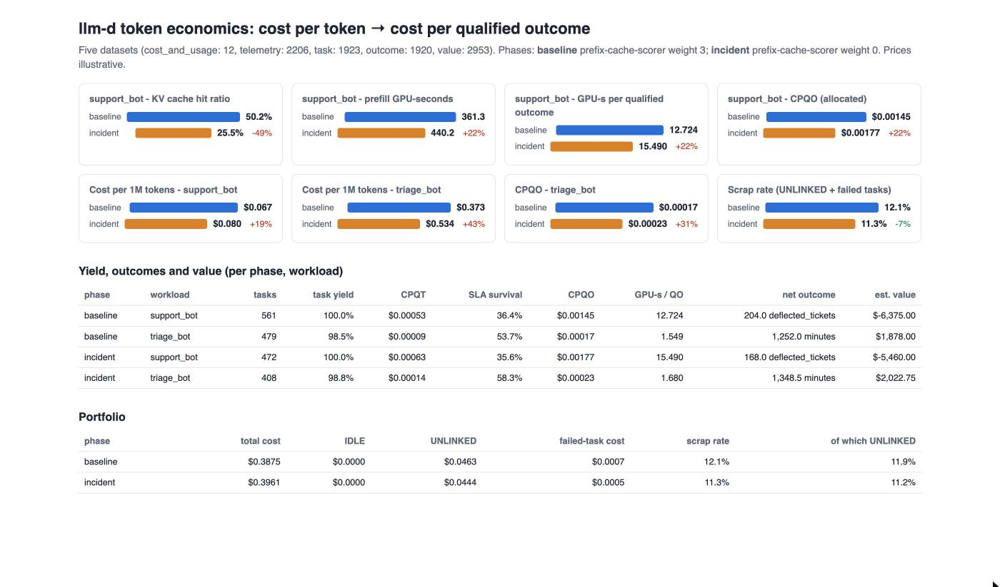
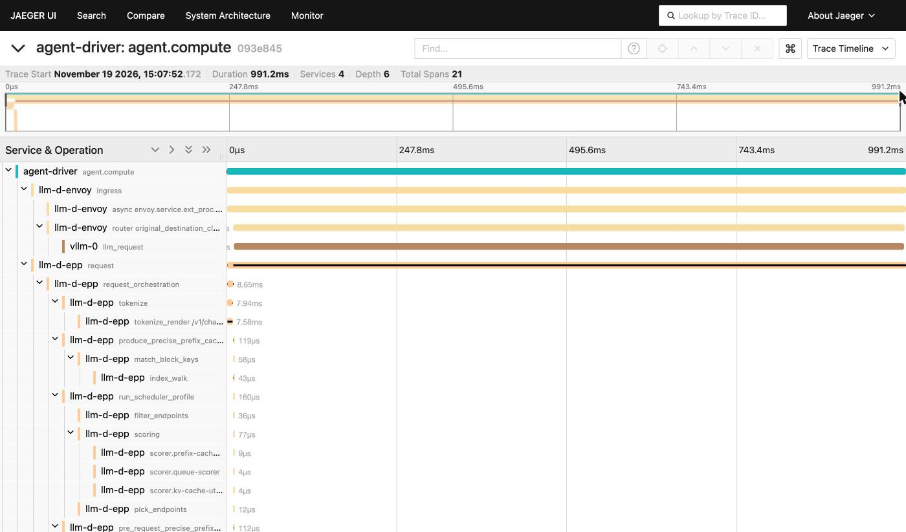
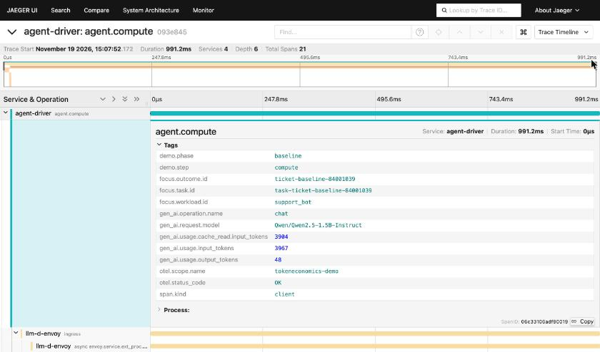
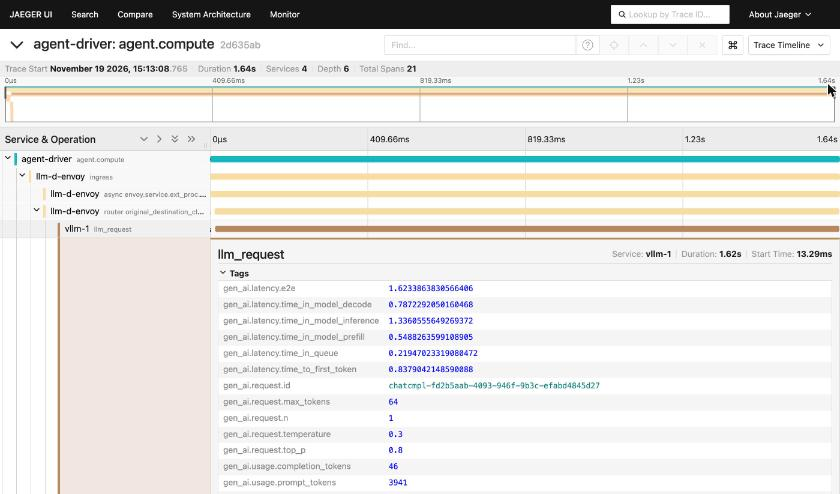
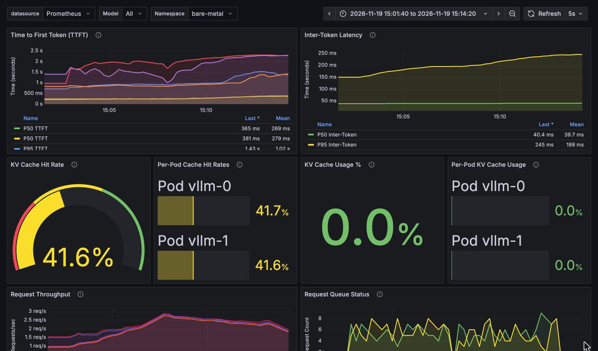

# llm-d Token 经济学：从每 token 成本到每个合格结果的成本

本演示在 llm-d 之上，在真实硬件上端到端地实现了 Tokenomics Foundation 的
[Value Attribution Data Architecture](https://www.tokeneconomics.com/projects/value-attribution-data-architecture/)
（v0.1.8，2026-11-19，下文简称“论文”）。它接续我们在 KubeCon NA 2026 的演讲
*"Seeing Through the Stack: End-to-End Observability and cost visibility for
llm-d with OpenCost"* 的终点：那次演讲做到了**每 token 成本**。本演示更进一步，做到了
**每个合格任务的成本、每个合格结果的成本以及价值**，并重放演讲中的那次事故
（EPP `prefix-cache-scorer` 权重 3 → 0），给它标上价格。

下文所有内容都于 **2026-11-19** 在一台 NVIDIA DGX Spark（`spark-3bee`，GB10）上运行，
**不使用 Kubernetes**，基于 [`../llm-d-spark-nonk8s-demo`](../llm-d-spark-nonk8s-demo) 中的技术栈。
每个 `console` 代码块都直接复制自实际会话（`logs/capture/`）。

English version: [`README.md`](README.md). 设计文档见 [`docs/design-zh.md`](docs/design-zh.md)
（[English](docs/design.md)）。

---

## 目录

- [0. 结果一览](#0-结果一览)
- [1. 背景](#1-背景)
- [2. 架构](#2-架构)
- [3. 用例与测试设计](#3-用例与测试设计)
- [4. 本目录内容](#4-本目录内容)
- [5. 环境与安装](#5-环境与安装)
- [6. 逐步运行演示](#6-逐步运行演示)
- [7. 结果与分析](#7-结果与分析)
- [8. 发现与问题](#8-发现与问题)
- [9. 后续计划](#9-后续计划)
- [10. 故障排查](#10-故障排查)

---

## 0. 结果一览



两个各 5 分钟的阶段，相同随机种子，12 个并发 agent，一块 GB10 上运行 2 × vLLM（Qwen2.5-1.5B-Instruct）：

| | 基线（权重 3） | 事故（权重 0） | 变化 |
|---|---|---|---|
| 后续步骤被发往**另一个副本**的 support_bot 任务 | 0 / 561 (0.0%) | 240 / 472 (50.8%) | 路由亲和性丢失 |
| support_bot `compute` 步骤 KV-cache 命中率（按 token） | 97.7% | 48.9% | −50% |
| support_bot `compute` 步骤 p50 延迟 | 2.45 s | 3.30 s | +35% |
| 310 s 内完成的任务数（全部工作负载） | 1,040 | 880 | 容量 −15% |
| support_bot **prefill GPU-s** | 361.3 | 440.2（请求更少） | +22% |
| support_bot **每个合格结果的 GPU-s** | 12.72 | 15.49 | **+22%** |
| support_bot **CPQO**（分摊账单） | $0.00145 | $0.00177 | **+22%** |
| triage_bot 每 1M token 成本（*未*受该 bug 影响） | $0.373 | $0.534 | **+43% 溢出效应** |
| support_bot 结果 SLA 存活率（质量） | 36.4% | 35.6% | 不变，符合预期 |
| 关联到其 vLLM span 的已链接模型调用 | 2,953 / 2,953 | | 100% |

本演示展示了仅靠每 token 成本无法看到的三件事：

1. **KubeCon 那个 bug 是有价格的：** 受影响的工作负载 GPU 秒数 +22%、每个合格结果的成本 +22%，
   整块 GPU 的容量 −15%。
2. **在共享、固定价格的 GPU 上，一个工作负载的事故会抬高其邻居的单位成本**
   （triage_bot 每 token 成本 +43%），因为同样的账单买到的吞吐量变少了。
   基于用量的 KPI（每个合格结果的 GPU-s）能把根因和溢出效应区分开。
3. **对小模型而言，主导经济性的是质量，而不是算力。** support_bot 在执行过程中的技术门
   100% 通过，但只有约 36% 的退款能通过交付后的检查。把人工摩擦和返工计入价格后，它的价值是
   **负的**（基线阶段 Reported 值为 −$6,375），而它全部的 GPU 账单只有
   $0.30。这正是论文所主张的“任务门 vs 结果门”拆分。

---

## 1. 背景

### 1.1 论文

大多数组织都能看到自己的 token 和 GPU 账单，工程团队也能追踪延迟和 token 数量，但
**存放成本的系统和存放结果的系统之间没有任何共享的连接键（join key）**。论文提出了五个逻辑数据集，
每个由不同的团队负责：

| 数据集 | 负责方 | 标准 | 回答的问题 |
|---|---|---|---|
| 成本与用量（Cost and Usage） | FinOps | FOCUS | 我们付了多少钱？ |
| 遥测（Telemetry） | 平台 / 网关 | OpenTelemetry（+ 提议的 `focus.*`） | 是哪些活动产生了这笔开销？ |
| 任务（Task） | 工程（应用 / 工作流） | 工作流状态 | 尝试了哪些工作，是否通过了**技术**门？ |
| 结果（Outcome） | 业务线 | 记录系统（system of record） | 结果是否经受住了**交付后**的 SLA？ |
| 价值（Value） | 财务（FP&A） | 费率卡、GAAP | 它值多少钱？ |

它们通过 `WorkloadId`、`TaskId` 和 `OutcomeId` 相互关联。这些键在运行时以 OTel 属性
`focus.workload.id`、`focus.task.id` 和 `focus.outcome.id` 的形式携带
（**只是连接键，绝不包含金额**）。共享开销按 `ActivityWeight` 拆分，
未关联的开销保留为 `'UNLINKED'`，因此不会丢失任何数据。论文点名 **vLLM
和 llm-d** 作为应当采用 `focus.*` 的推理引擎，其路线图也在征集
示例数据和参考实现（FOCUS 1.6 周期，2026 年 11 月 – 2027 年 4 月，
2027 年 6 月发布 playbook）。

### 1.2 KubeCon NA 2026 之后 llm-d 的现状

KubeCon 演讲交付了：

- 端到端 trace（Envoy → EPP → KV indexer → P/D sidecar → vLLM）；
- 指标 → trace → 日志的关联，并通过调试一个 TTFT 告警进行了演示，该告警由一次
  Helm 变更把 `prefix-cache-scorer` 权重从 3 改为 0 所引起；
- 借助 OpenCost，得到每 token 成本以及分摊成本与用量成本的拆分。

它**没有**把成本与*工作*或*结果*关联起来。本演示完成了这一步，并且运行在
llm-d 同样支持的环境中：Kubernetes 之外。

---

## 2. 架构

完整的设计依据：[`docs/design-zh.md`](docs/design-zh.md)（[English](docs/design.md)）。

```
                          W3C traceparent + baggage(focus.*)
 +----------------+  -------------------------------------->  +--------+  ext_proc  +---------------------+
 | agent driver   |                                           | Envoy  | <--------> | EPP (llm-d router)  |
 | support_bot    |  root span agent.<step>:                  | :8081  |            | precise prefix-cache|
 | triage_bot     |   focus.workload.id / task.id / outcome.id+--------+            | scorer w=3 or w=0   |
 | playground     |   gen_ai.usage.* (incl. cached tokens)       |                  +---------------------+
 | (UNLINKED)     |  playground: no keys, no traceparent         v                          ^ KV events
 +----------------+                                   +--------------+ +--------------+     |
        | OTLP/HTTP                                   | vllm-0 :8000 | | vllm-1 :8001 |-----+
        v                                             | llm_request  | | llm_request  |  one GB10 GPU
 +----------------+  <-- OTLP gRPC (Envoy, EPP, vLLM) +--------------+ +--------------+
 | OTel Collector | -> Jaeger
 +----------------+        |
                           v
  build.py: for each trace, copy the root span's focus.* onto vLLM's leaf span
  ("enterprise enrichment", paper 2.2.2 #4); aggregate per (60 s charge period,
  workload, task, replica); split the GPU bill by ActivityWeight = vLLM prefill+decode time
                           |
  tasks.jsonl (gates) -----+--> SQLite + CSV: cost_and_usage, telemetry, task, outcome, value
  configs/demo.toml -------+    + KPI views (kpis.sql) --> report.md / report.html
```

关键决策（详见设计文档）：

| 决策 | 选择 | 原因 |
|---|---|---|
| 血缘键从哪里进入 | 应用（driver）的根 span + W3C baggage | 论文中的第 1 层；目前上游还没有任何组件输出 `focus.*` |
| 如何关联到 GPU 用量 | 在摄取时按 `trace_id` 连接 | 没有任何组件把 baggage 复制到 span 上（[发现 F2](#f2-没有任何组件记录-baggage)） |
| GPU 范围对应的叶子 span | vLLM `llm_request` | 消耗计费资源的最深层 span（论文 2.3.1） |
| 消费范围（Consumption Scope） | 一块 GPU = `spark-3bee/gpu0`；副本信息保留在 `x_ServingReplica` 中 | 两个副本共享一块 GPU |
| 成本与用量 | 合成的 FOCUS 行，$4.00/GPU-h（示意值），60 s 计费周期 | 自托管 GPU 没有发票；在 Kubernetes 上可替换为 OpenCost 的 FOCUS 导出 |
| ActivityWeight | vLLM `time_in_model_prefill + time_in_model_decode`（也支持按 token 加权） | 对自托管引擎而言，成本驱动因素是 GPU 时间，而不是 token 单价 |
| 缓存 token | 经由根 span，取自 `usage.prompt_tokens_details.cached_tokens` | vLLM 的 span 没有缓存相关属性（[F3](#f3-vllm-的-span-缺少缓存-token-数和响应模型)） |
| 闲置容量 | 没有活动的周期记为一条 `IDLE` 行 | 论文对此未作规定（2.3.2） |

---

## 3. 用例与测试设计

### 3.1 工作负载（全部带有自动检查的质量门）

| 工作负载 | agent 做什么 | 第一道门（任务门，执行中） | 第二道门（结果门，交付后，60 s 结算窗口） | 价值视角 |
|---|---|---|---|---|
| `support_bot` | 账单争议。每个工单附带一份独有的约 3.9k token 的发票历史。第 1 步*调查*，第 2 步在同一会话中*调用退款计算工具*，最多重试 2 次 | 工具调用格式正确，**并且** `amount_usd` 与该套餐下真实存在的某张发票相符（工具会对照记录进行校验） | 退款精确到分（使用了**最新**的那张发票）；否则客户会重新打开工单 | CFO，降本，每个被分流的工单 $8.50；人工摩擦（2 分钟审核）和返工（3 分钟转交、12 分钟处理重开工单）按 $1.50/分钟计为负向收益 |
| `triage_bot` | 告警分诊，约 250 token 的 prompt，一次调用 | 输出 JSON，且严重级别和组件标签都在允许范围内 | 两个标签都与真实标注一致；否则告警会被重新升级（5 分钟返工） | CTO，工程产能，每净分钟 $1.50（基线 10 分钟，审核 0.5 分钟） |
| playground | 临时的“写一首俳句”调用，**不带任何键** | – | – | `UNLINKED` 报废 |

流量配比：50% support_bot，40% triage_bot，10% playground。任务生成器使用固定种子，因此
两个阶段处理的工作类型相同。

### 3.2 测试用例

| # | 测试 | 通过标准 | 结果 |
|---|---|---|---|
| T1 | 血缘传播：客户端 `traceparent` + `baggage` → Envoy → EPP → vLLM 位于同一条 trace | vLLM `llm_request` 位于 driver 的 trace 中 | ✅ 1 个根，21 个 span，4 个服务（§6.4） |
| T2 | 每个已关联的模型调用都被归因 | 已关联的 vLLM span 数 = 已关联的 driver 调用数 | ✅ 2,953 / 2,953 |
| T3 | UNLINKED 流量被保留而非丢弃 | 遥测、任务和报废率中都有 `UNLINKED` 行 | ✅ 247 次调用，占成本的 11-12% |
| T4 | 账单 100% 被分摊 | Σ `x_AllocatedCost` = Σ `EffectiveCost` | ✅ $0.80 = 12 个周期 × $0.0667 |
| T5 | 基线：缓存感知路由让一个任务始终留在同一个副本上 | 被拆分的任务 ≈ 0% | ✅ 0.0% |
| T6 | 事故（权重 0）：亲和性丢失，每个合格结果的成本上升，质量不变 | 拆分 ≈ 50%，CPQO ↑，SLA 存活率 ≈ | ✅ 50.8%，+22%，36.4% → 35.6% |
| T7 | support_bot 的两道门出现分化 | 任务良率 ≫ 结果存活率 | ✅ 100% vs 36% |
| T8 | 数据集遵循论文的 schema | 五个 CSV，使用论文中的列名 | ✅ `results/*.csv` |

---

## 4. 本目录内容

```
tokeneconomics/
├── README.md / README-zh.md         this report (English / Chinese)
├── docs/design.md / design-zh.md    design document
├── docs/screenshots/                report + Jaeger screenshots
├── configs/
│   ├── qwen2.5-1.5b.env             model env for ../llm-d-spark-nonk8s-demo/scripts/up.sh
│   └── demo.toml                    prices, ActivityWeight method, settlement window, rate cards
├── tokeneconomics/                  Python package, standard library only (3.11+)
│   ├── otlp.py                      W3C traceparent/baggage + OTLP/HTTP JSON span exporter
│   ├── workloads.py                 support_bot / triage_bot / playground + gates
│   ├── driver.py                    runs a phase; writes requests/tasks/phases.jsonl
│   ├── build.py                     Jaeger + driver records -> the five datasets (SQLite + CSV)
│   ├── kpis.sql                     KPI views (paper section 4)
│   └── report.py                    report.md + report.html
├── scripts/
│   ├── set-prefix-weight.sh         re-render EPP config with weight N and restart the EPP
│   ├── run-demo.sh                  baseline -> incident -> restore -> settle -> build -> report
│   ├── trace-tree.py                print a trace with focus.* / gen_ai.* / EPP picker attributes
│   └── capture-doc.sh               re-record every console block in this README
├── results/                         the run documented here: 5 CSVs + report.md/html + phases
└── logs/capture/                    raw "command + output" captures used below
```

---

## 5. 环境与安装

### 5.1 所用硬件和软件

```console
gyliu@spark-3bee:~/tokeneconomics$ hostname; uname -m; grep PRETTY /etc/os-release
spark-3bee
aarch64
PRETTY_NAME="Ubuntu 24.04.5 LTS"
gyliu@spark-3bee:~/tokeneconomics$ nvidia-smi --query-gpu=name,driver_version --format=csv
name, driver_version
NVIDIA GB10, 580.173.02
gyliu@spark-3bee:~/tokeneconomics$ docker compose version; python3 --version
Docker Compose version v5.0.2
Python 3.12.3
```

| 组件 | 版本 |
|---|---|
| vLLM | `nvcr.io/nvidia/vllm:26.08-py3` = vLLM 0.27.1（`sha256:4b16878d…`） |
| EPP（llm-d router） | `ghcr.io/llm-d/llm-d-router-endpoint-picker:main`，构建于 2026-11-16（`sha256:25706cb7…`） |
| Envoy / OTel Collector / Jaeger / Prometheus / Grafana | v1.36.2 / contrib 0.139.0 / 2.11.0 / v3.7.3 / 12.2.1 |
| 模型 | `Qwen/Qwen2.5-1.5B-Instruct`，2 个副本，`--gpu-memory-utilization 0.10`，`--kv-cache-memory-bytes 6G`，block size 64，开启 prefix caching |
| 演示代码 | 仅使用 Python 3.12 标准库（`sqlite3`、`tomllib`、`urllib`） |

GPU 显存：运行期间这块 GB10 与另一个租户共享（ComfyUI 占用约 40 GB），
这就是为什么使用 1.5B 模型并配置较小的 KV 预算。每个副本约占
9 GB。

### 5.2 前提：llm-d 非 Kubernetes 技术栈

本演示不自带推理服务栈，而是复用
[`../llm-d-spark-nonk8s-demo`](../llm-d-spark-nonk8s-demo)（Envoy + 带精确
prefix-cache 路由的 EPP + 2 个 vLLM 副本 + OTel/Jaeger/Prometheus/Grafana，全部使用 Docker
Compose 和主机网络）。按照其 README §3-§4 做一次准备工作（镜像、Docker GPU 运行时）。然后
用本演示的模型文件启动它：

```console
gyliu@spark-3bee:~$ cd ~/llm-d-nonk8s            # the copy of ../llm-d-spark-nonk8s-demo on the Spark
gyliu@spark-3bee:~/llm-d-nonk8s$ cp .env .env.bak-nemotron   # up.sh overwrites .env
gyliu@spark-3bee:~/llm-d-nonk8s$ scripts/up.sh ~/tokeneconomics/configs/qwen2.5-1.5b.env precise
...
waiting for both vLLM replicas (first start compiles; ~5-15 min)...
  vLLM :8000 ready
  vLLM :8001 ready
...
Envoy ready on :8081 (EPP config: config-precise.yaml, model: Qwen/Qwen2.5-1.5B-Instruct)
```

`configs/qwen2.5-1.5b.env` 添加了 `--enable-prompt-tokens-details`，使 vLLM 返回
`usage.prompt_tokens_details.cached_tokens`。driver 需要它来填充
`CacheReadTokenCount`。

### 5.3 安装演示

```console
$ rsync -a llm-d/tokeneconomics/ mygpu:tokeneconomics/     # from a checkout of this repo
gyliu@spark-3bee:~/tokeneconomics$ export NONK8S_DIR=~/llm-d-nonk8s   # where the stack's compose.yaml lives
```

不需要任何 `pip install`。

### 5.4 检查技术栈

```console
gyliu@spark-3bee:~/tokeneconomics$ docker ps --format '{{.Names}}\t{{.Image}}\t{{.Status}}' | grep -E 'vllm|epp|envoy|otel|jaeger|prometheus|grafana' | sort
envoy	envoyproxy/envoy:v1.36.2	Up 18 minutes
epp	ghcr.io/llm-d/llm-d-router-endpoint-picker:main	Up About a minute
grafana	grafana/grafana:12.2.1	Up 2 days
jaeger	jaegertracing/jaeger:2.11.0	Up 2 days
otel-collector	otel/opentelemetry-collector-contrib:0.139.0	Up 2 days
prometheus	prom/prometheus:v3.7.3	Up 2 days
vllm-0	nvcr.io/nvidia/vllm:26.08-py3	Up 22 minutes (healthy)
vllm-1	nvcr.io/nvidia/vllm:26.08-py3	Up 20 minutes (healthy)
gyliu@spark-3bee:~/tokeneconomics$ curl -s localhost:8081/v1/models | python3 -c 'import json,sys; print([m["id"] for m in json.load(sys.stdin)["data"]])'
['Qwen/Qwen2.5-1.5B-Instruct']
```

---

## 6. 逐步运行演示

### 6.1 一键运行

```console
gyliu@spark-3bee:~/tokeneconomics$ scripts/run-demo.sh 300 12     # 300 s per phase, 12 concurrent agents
```

它会依次执行下文的 §6.3 → §6.5 → §6.6，耗时约 12 分钟。本节其余部分
手动执行同样的步骤。

### 6.2 探测：一个带血缘键的请求

```console
gyliu@spark-3bee:~/tokeneconomics$ curl -s localhost:8081/v1/chat/completions -H 'Content-Type: application/json' \
  -H 'traceparent: 00-0af7651916cd43dd8448eb211c80319c-b7ad6b7169203331-01' \
  -H 'baggage: focus.workload.id=support_bot,focus.task.id=task-probe-1,focus.outcome.id=ticket-probe-1' \
  -d '{"model":"Qwen/Qwen2.5-1.5B-Instruct","messages":[{"role":"user","content":"Say hi"}],"max_tokens":8}' \
  | python3 -c 'import json,sys; r=json.load(sys.stdin); print(r["choices"][0]["message"]["content"], r["usage"])'
Hello! How can I assist you today {'prompt_tokens': 31, 'total_tokens': 39, 'completion_tokens': 8, 'prompt_tokens_details': {'cached_tokens': 0, 'created_cache_tokens': 0, 'multimodal_tokens': None}}
```

baggage 有没有被记录在任何地方？没有：

```console
$ curl -s localhost:16686/api/traces/0af7651916cd43dd8448eb211c80319c | python3 -c '...'   # see logs/capture/02b-probe-baggage.txt
17 spans: ['llm-d-envoy', 'llm-d-epp', 'vllm-0']
spans with focus.*/baggage attributes: []
```

这就是 driver 还要导出自己的根 span 的原因（§6.4，[F2](#f2-没有任何组件记录-baggage)）。

### 6.3 设置 EPP 打分器权重

```console
gyliu@spark-3bee:~/tokeneconomics$ NONK8S_DIR=/home/gyliu/llm-d-nonk8s scripts/set-prefix-weight.sh 0 2>&1 | grep -v -E '^ *Container'
        weight: 0
EPP running with config-precise-w0.yaml
gyliu@spark-3bee:~/tokeneconomics$ NONK8S_DIR=/home/gyliu/llm-d-nonk8s scripts/set-prefix-weight.sh 3 2>&1 | grep -v -E '^ *Container'
        weight: 3
EPP running with config-precise-w3.yaml
```

该脚本用新权重把 `configs/epp/config-precise.yaml` 重新渲染为
`config-precise-w<N>.yaml`，并且只重建 `epp` 容器。vLLM 保持运行，
KV cache 也保留。EPP 的索引会根据 KV 事件重建。

### 6.4 运行一个阶段

```console
gyliu@spark-3bee:~/tokeneconomics$ python3 -m tokeneconomics.driver --phase baseline --note "prefix-cache-scorer weight 3" --duration 300 --concurrency 12 --out data
[baseline] t+   10s tasks=26 requests=47 errors=0
[baseline] t+   20s tasks=59 requests=106 errors=0
...
phase baseline done in 310s: {'tasks': 1040, 'requests': 1735, 'errors': 0}, spans dropped=0
gyliu@spark-3bee:~/tokeneconomics$ scripts/set-prefix-weight.sh 0 && python3 -m tokeneconomics.driver --phase incident --note "prefix-cache-scorer weight 0" --duration 300 --concurrency 12 --out data
...
phase incident done in 310s: {'tasks': 880, 'requests': 1465, 'errors': 0}, spans dropped=0
```

一次 `support_bot` 模型调用的样子（基线，`compute` 步骤）：

```console
gyliu@spark-3bee:~/tokeneconomics$ python3 scripts/trace-tree.py 093e84546ebfd692dd01cade4a687a5f
trace 093e84546ebfd692dd01cade4a687a5f: 21 spans, services ['agent-driver', 'llm-d-envoy', 'llm-d-epp', 'vllm-0'], roots=1
[agent-driver] agent.compute  (991.2 ms)
    demo.step = compute
    focus.outcome.id = ticket-baseline-84001039
    focus.task.id = task-ticket-baseline-84001039
    focus.workload.id = support_bot
    gen_ai.usage.cache_read.input_tokens = 3904
    gen_ai.usage.input_tokens = 3967
    gen_ai.usage.output_tokens = 48
  [llm-d-envoy] ingress  (989.9 ms)
    [llm-d-envoy] async envoy.service.ext_proc.v3.ExternalProcessor.Process egress  (990.0 ms)
    [llm-d-envoy] router original_destination_cluster egress  (979.4 ms)
      [vllm-0] llm_request  (977.1 ms)
          gen_ai.latency.time_in_model_decode = 0.8500
          gen_ai.latency.time_in_model_inference = 0.9555
          gen_ai.latency.time_in_model_prefill = 0.1055
          gen_ai.usage.completion_tokens = 48
          gen_ai.usage.prompt_tokens = 3967
  [llm-d-epp] request  (990.0 ms)
    ...
        [llm-d-epp] match_block_keys  (0.1 ms)
            llm_d.kv_cache.prefix_match.key_count = 61
            llm_d.kv_cache.prefix_match.longest_chain = 61
            llm_d.kv_cache.prefix_match.pods_matched = 2
        ...
        [llm-d-epp] pick_endpoints  (0.0 ms)
            llm_d.epp.picker.candidate_endpoints = 2
            llm_d.epp.picker.top_endpoints = ["default/vllm-0","default/vllm-1"]
            llm_d.epp.picker.top_scores = [6.893986890852094,3.9767950329130244]
```





### 6.5 构建五个数据集

```console
gyliu@spark-3bee:~/tokeneconomics$ python3 -m tokeneconomics.build --data data
traces=3200 vLLM leaf spans=3200 (linked 2953 of 2953 linked driver calls, unlinked 247)
wrote data/tokeneconomics.db: cost_and_usage=12 telemetry=2206 task=1923 outcome=1920 value=2953
```

`run-demo.sh` 会先等待 60 s 的结算窗口结束，因此每个结果都是 `Settled` 状态，
每条价值记录都有 `RealizedValue`。生成的文件（已复制到 `results/`）：

```console
gyliu@spark-3bee:~/tokeneconomics$ head -3 data/cost_and_usage.csv
ServiceProviderName,BillingAccountId,SubAccountId,ServiceName,ResourceId,SkuPriceDetails.ModelId,ChargePeriodStart,ChargePeriodEnd,ChargeCategory,PricingCategory,ConsumedQuantity,ConsumedUnit,BilledCost,EffectiveCost
On-prem (DGX Spark),lab-001,spark-3bee,llm-d,spark-3bee/gpu0,,2026-11-19T20:02:00Z,2026-11-19T20:03:00Z,Usage,Committed,0.016666666666666666,GPU Hours,0.06666666666666667,0.06666666666666667
gyliu@spark-3bee:~/tokeneconomics$ head -2 data/telemetry.csv
TaskId,OutcomeId,WorkloadId,ServiceProviderName,BillingAccountId,ResourceId,ServiceName,SubAccountId,ModelId,TelemetryPeriodStart,TelemetryPeriodEnd,InvocationCount,InputTokenCount,OutputTokenCount,CacheReadTokenCount,CacheWriteTokenCount,TotalDurationMs,ActivityWeight,x_ServingReplica,x_PrefillSeconds,x_DecodeSeconds,x_AllocatedCost,x_Phase
UNLINKED,UNLINKED,UNLINKED,On-prem (DGX Spark),lab-001,spark-3bee/gpu0,llm-d,spark-3bee,Qwen/Qwen2.5-1.5B-Instruct,2026-11-19T20:02:00Z,2026-11-19T20:03:00Z,3,114,226,0,,13886.736,13.092542,vllm-0,0.602464,12.490078,0.00...
gyliu@spark-3bee:~/tokeneconomics$ head -2 data/task.csv
TaskId,OutcomeId,WorkloadId,UpstreamOutcomeId,TaskPeriodStart,TaskPeriodEnd,TaskType,TaskName,TaskQualityBarMet,AttemptedTaskCount,QualifiedTaskCount,TaskUnit,BaselineTaskQuantity,ObservedTaskQuantity,TaskFrictionQuantity,TaskReworkPenaltyQuantity,NetTaskQuantity,x_Phase,x_Attempts,x_Requests
task-alert-baseline-84000004,alert-baseline-84000004,triage_bot,,2026-11-19T20:02:50Z,2026-11-19T20:02:52Z,alert_triage,,1,1,1,minutes,10.0,10.0,0.5,0.0,9.5,baseline,1,1
gyliu@spark-3bee:~/tokeneconomics$ head -2 data/outcome.csv
OutcomeId,WorkloadId,OutcomeEntryNumber,OutcomePeriodStart,OutcomePeriodEnd,OutcomeRecordedDateTime,OutcomeStatus,OutcomeSettledDateTime,OutcomeType,OutcomeName,WorkloadName,OutcomeQualityBarMet,AttemptedOutcomeCount,QualifiedOutcomeCount,OutcomeUnit,...
alert-baseline-84000004,triage_bot,1,2026-11-19T20:02:50Z,2026-11-19T20:03:52Z,2026-11-19T20:14:27Z,Settled,2026-11-19T20:03:52Z,alert_triaged,,Alert Triage Copilot,1,1,1,minutes,10.0,10.0,0.5,0.0,9.5,,baseline
gyliu@spark-3bee:~/tokeneconomics$ wc -l < data/value.csv
2954
```

### 6.6 KPI 与报告

```console
gyliu@spark-3bee:~/tokeneconomics$ python3 -m tokeneconomics.report --data data     # writes data/report.md and data/report.html
gyliu@spark-3bee:~/tokeneconomics$ sqlite3 -header -column data/tokeneconomics.db "SELECT phase, WorkloadId, requests, kv_cache_hit_ratio, prefill_gpu_s, decode_gpu_s, printf('%.4f', cost_usd) cost FROM kpi_infra"
phase           WorkloadId   requests  kv_cache_hit_ratio  prefill_gpu_s  decode_gpu_s  cost
--------------  -----------  --------  ------------------  -------------  ------------  ------
baseline        UNLINKED     128       0.0                 19.17          448.03        0.0463
baseline        support_bot  1122      0.502               361.28         2234.46       0.2964
baseline        triage_bot   479       0.267               79.81          318.31        0.0448
between-phases  UNLINKED     9         0.0                 1.42           26.02         0.0164
incident        UNLINKED     110       0.0                 18.56          425.33        0.0444
incident        support_bot  944       0.255               440.19         2162.18       0.2972
incident        triage_bot   408       0.268               78.18          321.75        0.0544
gyliu@spark-3bee:~/tokeneconomics$ sqlite3 -header -column data/tokeneconomics.db "SELECT phase, WorkloadId, tasks, task_yield, sla_survival, printf('%.5f', cpqo) cpqo, printf('%.3f', gpu_s_per_qo) gpu_s_per_qo, printf('%.2f', estimated) value FROM kpi_workload"
phase     WorkloadId   tasks  task_yield  sla_survival  cpqo     gpu_s_per_qo  value
--------  -----------  -----  ----------  ------------  -------  ------------  --------
baseline  support_bot  561    1.0         0.364         0.00145  12.724        -6375.00
baseline  triage_bot   479    0.985       0.537         0.00017  1.549         1878.00
incident  support_bot  472    1.0         0.356         0.00177  15.490        -5460.00
incident  triage_bot   408    0.988       0.583         0.00023  1.680         2022.75
gyliu@spark-3bee:~/tokeneconomics$ sqlite3 -header -column data/tokeneconomics.db "SELECT OutcomeEntryNotes, COUNT(*) n FROM outcome GROUP BY 1 ORDER BY 2 DESC"
OutcomeEntryNotes                 n
--------------------------------  ---
                                  867
refund wrong: ticket reopened     661
wrong label: re-escalated         380
agent gave up: handed to a human  12
```

`between-phases` 这一行是 EPP 重启期间完成的少量 UNLINKED 调用。KPI 视图保留了它，
报告中的各阶段表格则不包含它。

---

## 7. 结果与分析

完整的生成报告见 [`results/report.md`](results/report.md)（HTML：
[`results/report.html`](results/report.html)）。KPI 视图位于
[`tokeneconomics/kpis.sql`](tokeneconomics/kpis.sql)。

### 7.1 机制：亲和性 → 缓存 → prefill

按步骤统计，数据来自 `data/requests.jsonl`（客户端侧用量）：

| 阶段 | 步骤 | 调用数 | KV-cache 命中率（按 token） | p50 延迟 | p95 延迟 |
|---|---|---|---|---|---|
| 基线 | investigate（新工单） | 561 | 1.7% | 2.15 s | 3.15 s |
| 基线 | **compute**（同一会话） | 561 | **97.7%** | 2.45 s | 3.32 s |
| 基线 | triage | 479 | 26.7% | 0.85 s | 1.55 s |
| 事故 | investigate | 472 | 1.7% | 2.47 s | 3.39 s |
| 事故 | **compute** | 472 | **48.9%** | 3.30 s | 4.08 s |
| 事故 | triage | 408 | 26.8% | 1.01 s | 1.84 s |

两个步骤由不同副本处理的任务（来自遥测数据的 `x_ServingReplica`）：

```console
phase     tasks  split_across_replicas  pct
--------  -----  ---------------------  ----
baseline  561    0                      0.0
incident  472    240                    50.8
```

权重为 0 时，后续步骤会被发往一个“掷硬币”选出的副本。50.8% 正是在 2 个副本间随机
放置所得到的结果。下面是事故阶段的一次未命中，可与 §6.4 中的基线
trace 对照：

```console
gyliu@spark-3bee:~/tokeneconomics$ python3 scripts/trace-tree.py 2d635ab91262686ad2f35f8ab56e491c   # an incident-phase compute step
[agent-driver] agent.compute  (1638.7 ms)
    gen_ai.usage.cache_read.input_tokens = 64
      [vllm-1] llm_request  (1623.5 ms)
          gen_ai.latency.time_in_model_prefill = 0.5488
            llm_d.kv_cache.prefix_match.longest_chain = 60
            llm_d.kv_cache.prefix_match.pods_matched = 2
            llm_d.epp.picker.top_endpoints = ["default/vllm-1","default/vllm-0"]
            llm_d.epp.picker.top_scores = [3.945853519521231,3.9293245939013963]
```

索引**知道**这个前缀（`longest_chain = 60`），但权重为 0 时，两个副本的
得分为 3.946 vs 3.929，最终由队列和 KV 利用率的噪声决定。对于同样约 3.9k token 的 prompt，
prefill 耗时 549 ms 而不是 105 ms（5.2×）。这与 KubeCon 演示中的特征
完全相同（52 → 569 ms）。



下图是现有的 llm-d Performance 仪表盘在整个运行期间的情况（本地时间 15:02-15:14；
事故从 15:08 开始）。权重改为 0 后，TTFT 出现阶跃式上升。缓存命中率仪表盘
显示的是窗口平均值（41.6%）。它无法告诉你是**哪个工作负载**为这些未命中买了单；
上面的数据集可以。



### 7.2 代价是多少

| KPI（support_bot） | 基线 | 事故 | Δ |
|---|---|---|---|
| prefill GPU-s（所有步骤） | 361.3 | 440.2 | +22%（调用数少了 16%） |
| 每个合格结果的 GPU-s | 12.72 | 15.49 | +22% |
| 分摊成本 | $0.2964 | $0.2972 | ≈（固定账单） |
| 合格结果数 | 204 | 168 | −18% |
| CPQT / CPQO | $0.00053 / $0.00145 | $0.00063 / $0.00177 | +19% / +22% |

每分钟的账单并没有变化（GPU 该花多少就花多少）。变化的是同样的账单
**能买到多少工作量**。这就是为什么用量口径的“每个合格结果的 GPU-s”要
与分摊口径的 CPQO 并列展示。这与 KubeCon 演讲幻灯片中
“分摊成本 vs 用量成本”的拆分是一回事。

### 7.3 溢出到一个没有做错任何事的工作负载上

triage_bot 的 prompt 很短，缓存命中率也没有变化（26.7% → 26.8%），但它的
**每 1M token 成本上升了 43%**（$0.373 → $0.534），CPQO 上升了 31%。每个周期固定的
账单被摊到数量更少、单次更贵的 support_bot 调用上，而 triage_bot
在每个周期中所占的权重份额变大了。**在共享的自托管 GPU 上，
每个工作负载的单位成本与邻居的效率是耦合在一起的。** 只看分摊成本的 FinOps 团队
会错怪无辜的工作负载。用量口径的 KPI
（triage_bot GPU-s/QO 1.549 → 1.680，+8%，来自整体资源争用）才能显示浪费
真正发生在哪里。

### 7.4 质量主导价值

| | support_bot | triage_bot |
|---|---|---|
| 任务良率（第一道门） | 100% | 98.5% |
| 结果 SLA 存活率（第二道门） | 36.4% | 53.7% |
| 每个合格结果的计算成本 | $0.00145 | $0.00017 |
| 估算价值，基线阶段 | **−$6,375.00**（+$1,734 分流收益，−$8,109 摩擦和返工） | +$1,878.00 |

这个便宜的模型通过了每一项技术检查，却依然在亏钱。357 个重开的工单
× 12 分钟返工，超过了 204 次分流 × $8.50。GPU 成本比人工成本小大约四个
数量级。真正的杠杆是**模型或 agent 的质量**：换更大的
模型，或者提供一个知道哪张发票才是最新的更好的工具，而不是 GPU 价格。
这正是论文中两道门的意义所在：如果没有结果数据集，本演示会报告“任务
100% 成功”。

### 7.5 报废与 UNLINKED

| 阶段 | 总成本 | IDLE | UNLINKED | 失败任务成本 | 报废率 | 其中 UNLINKED |
|---|---|---|---|---|---|---|
| 基线 | $0.3875 | $0.0000 | $0.0463 | $0.0007 | 12.1% | 11.9% |
| 事故 | $0.3961 | $0.0000 | $0.0444 | $0.0005 | 11.3% | 11.2% |

playground 调用只占请求数的 7%，却占了 **12% 的 GPU 成本**：prompt 短，回答长，
以 decode 为主。几乎所有报废都来自 UNLINKED，而非失败的任务，这也正是
论文把 UNLINKED 单独列为一行的原因（“缺失的关联并不等于失败的工作”）。

---

## 8. 发现与问题

所有发现的中英文对照汇总见 [`docs/findings.md`](docs/findings.md)。

### F1. vLLM 确实会延续调用方的 trace（与论文结论相反）

论文（第 2.2.2 节）称，在其作者的测试中 vLLM “没有”延续调用方的 trace。
在 vLLM 0.27.1 上开启 `--otlp-traces-endpoint` 后，`llm_request` 是调用方 trace 中
Envoy router span 的子 span（§6.4）；本次运行的全部 3,200 个 vLLM span 都
接入了各自的 trace。**行动项：** 把这一证据发给论文作者（FOCUS SemConv
WG）。差异的原因很可能是 tracing 开关，或者某个网关丢弃了 `traceparent`。

### F2. 没有任何组件记录 baggage

EPP 同时注册了 TraceContext 和 Baggage 两种 propagator
（`llm-d-router/pkg/common/observability/tracing/telemetry.go:55`），Envoy 也会转发
`baggage` 头。但 Envoy、EPP 或 vLLM 中没有任何 span 携带 `focus.*`（§6.2：17 个 span，
0 个属性）。这些键只存在于客户端的根 span 上，因此归因需要在摄取时做整条 trace
范围的连接，这意味着必须保留完整的 trace。**提议（llm-d-router）：**
提供一个可选启用的白名单（例如 `--trace-baggage-attributes=focus.workload.id,focus.task.id,focus.outcome.id`），
把 baggage 条目复制到 EPP 的 `request` span 上。这样 GPU 侧和路由侧的
span 无需客户端 span 也能被归因。vLLM span 和 P/D sidecar 也需要
类似的选项。

### F3. vLLM 的 span 缺少缓存 token 数和响应模型

`llm_request` 有 `gen_ai.usage.prompt_tokens` / `completion_tokens` 以及 prefill/decode
时间，但**没有 `gen_ai.usage.cache_read.input_tokens`，也没有 `gen_ai.response.model`**。
这两项都是论文直接从 OTel 映射的列。缓存 token 数只存在于
HTTP 响应中，而且只有开启 `--enable-prompt-tokens-details` 时才有，因此本演示从
客户端获取它。所以 UNLINKED 调用的缓存读取量是未知的。**提议（vLLM）：** 在请求 span 上
添加缓存 token 数（以及作为 `cache_write` 的 `created_cache_tokens`）和响应
模型。

### F4. 连续批处理下逐请求累加的 GPU 时间会重复计数

基线：所有调用的 Σ(prefill + decode) = **在 310 s 的阶段内达到 3,461 GPU-s**，约为
12 路并发下墙钟时间的 11 倍，因为批处理中的请求共享前向计算。作为
周期内的**相对** ActivityWeight，它仍然是一种公平的拆分方式，但不能
当作 GPU 秒数来解读，论文中的 `TotalDurationMs` 也有同样的问题。**提议：**
在引擎层面提供每个请求的“归因 GPU 时间”（把每次前向计算的时间按 token 加权
分摊给该批次的各个成员），并在 span 上导出。这可以作为论文中
“加权公式需要工作组进一步讨论”（第 2.3.2 节）的输入。

### F5. 固定成本分摊让工作负载相互耦合

见 §7.3。论文的分摊方法按活动份额拆分每个周期的账单，因此一个
低效的工作负载会抬高其邻居的分摊单位成本。**对论文 / playbook 的建议：**
对于自托管容量，在分摊成本类 KPI 旁边同时发布一个用量口径的 KPI（每个合格结果的
资源时间），就像 KubeCon 演讲幻灯片已经把分摊与用量分开那样。

### F6. 第一道门可以是 100%，而第二道门只有 36%

见 §7.4。如果没有交付后的结果数据，这个 agent 看起来会是完美的。工具的
参数校验（金额必须是该套餐下的一张真实发票）无法区分过期的
发票和最新的发票。这是一类真实存在的 agent 错误，只有
记录系统（一个被重新打开的工单）才能揭示。

### F7. 客户端发送 `traceparent` 时，EPP span 成为 Envoy span 的兄弟节点（已知问题）

与 `llm-d-spark-nonk8s-demo` §10.2 相同：`[llm-d-epp] request` 挂在客户端根 span 下，
而不是 Envoy 的 ext_proc span 下。这在这里不影响归因，因为
driver 导出了自己的根 span，所以仍然只有一个根。只是瀑布图的
可读性差一些。

### F8. 修改打分器权重需要重启 EPP

EPP 配置不支持热加载，因此每次切换阶段都会重建 EPP 容器
（约 6 s）。切换期间正在处理的调用会显示为一条 `between-phases` UNLINKED
行（$0.0164）。这对演示无害。在生产环境中，KubeCon 那次事故（一次
Helm 升级）同样会重启 EPP。

### F9. 工具问题：通过慢速远程链路访问 Jaeger / Grafana UI

通过本次运行使用的 Tailscale 链路，Jaeger 4.3 MB 的 UI 包加载约需 36 s，
Grafana 的插件则需要好几分钟，所以两个页面一开始看上去都是空白的。
`llm-d-spark-nonk8s-demo` 中的 Grafana 仪表盘无需修改即可用于本次运行
（§7.1）。“KV Cache Usage %” 显示的是*最后*一个值，运行结束后即为 0。请使用
SSH 隧道转发到 `localhost` 并耐心等待（§10）。

---

## 9. 后续计划

| # | 事项 | 所在位置 | 原因 |
|---|---|---|---|
| 1 | 在 EPP 中可选启用 baggage → span 属性（[F2](#f2-没有任何组件记录-baggage)） | llm-d-router | 无需客户端 span 即可归因路由和 GPU span；成为第一个输出 `focus.*` 的 llm-d 组件 |
| 2 | 在 vLLM 的请求 span 上提供缓存 token 数 + 响应模型（[F3](#f3-vllm-的-span-缺少缓存-token-数和响应模型)） | vLLM | 按论文的假设，从遥测数据中填充 `CacheReadTokenCount`、`CacheWriteTokenCount`、`ModelId` |
| 3 | 感知批处理的逐请求“归因 GPU 时间”（[F4](#f4-连续批处理下逐请求累加的-gpu-时间会重复计数)） | vLLM + 论文工作组 | 一个站得住脚的自托管 `ActivityWeight` |
| 4 | Kubernetes 版本：成本与用量取自 **OpenCost 的 FOCUS 导出** | `../llm-d-spark-full-demo` | 直接对接 KubeCon 上的 OpenCost 集成 |
| 5 | 基于五个数据集的 Grafana 仪表盘（把 KPI 推送到 Prometheus，或使用 SQL 数据源） | 本演示 | 在现有 llm-d 仪表盘旁边提供实时的 CPQO / 报废面板 |
| 6 | **按 CPQO 而不是每 token 成本选择模型：** 用 Nemotron-3-Nano-30B 重跑并对比 | 本演示 | 更大的模型每 token 成本更高，但应能提升第二道门的通过率；这是论文的核心承诺 |
| 7 | P/D 分离：两个消费范围（prefill 池、decode 池）+ KV 传输字节数 | 本演示 + P/D sidecar | 在真实 P/D 场景下按范围应用叶子 span 规则（论文 2.3.1） |
| 8 | 分层 KV cache：按层级（GPU / CPU / 磁盘）拆分 `CacheReadTokenCount` | llm-d-kv-cache + 论文 | 不同层级的成本不同 |
| 9 | 在同一次运行上对比 cohort 模式与 atomic 模式 | 本演示 | 论文 2.6 节：更便宜的模式能否得出相同的决策？ |
| 10 | 把 `results/` 和本代码作为示例数据 / 参考实现，连同 F1-F5 一起提交给 Tokenomics Foundation 和 FOCUS SemConv WG | 上游 | 论文路线图征集的正是这些（FOCUS 1.6 周期，2027 年 6 月演示） |

---

## 10. 故障排查

| 现象 | 原因 / 解决办法 |
|---|---|
| `build` 中出现 `linked N of M` 且 N < M | vLLM 启动时没有加 `--otlp-traces-endpoint`，或 Jaeger 淘汰了 trace（内存存储）。请在运行结束后立即构建 |
| `CacheReadTokenCount` 始终为 0 | vLLM 启动时没有加 `--enable-prompt-tokens-details`（请使用 `configs/qwen2.5-1.5b.env`） |
| `WARNING: ... hit limit=3000` | 在一个 15 s 的时间片内单个副本的调用超过 3,000 次；调低 `build.fetch_traces` 中的 `slice_s` |
| Jaeger UI 空白 | 它的 JS 包仍在通过慢速链路加载；建立到 localhost 的隧道：`ssh -L 16687:127.0.0.1:16686 mygpu` 并等待 |
| `set-prefix-weight.sh: .env: No such file` | `NONK8S_DIR` 必须指向运行 `up.sh` 的那个技术栈目录 |
| 两个阶段的成本出现重叠 | 阶段之间仅靠 EPP 重启来分隔；请设置 `charge_period_seconds` ≤ 阶段时长 / 4 |
| 恢复技术栈原来的模型 | `cp ~/llm-d-nonk8s/.env.bak-nemotron ~/llm-d-nonk8s/.env`，然后在该目录下用那个 env 文件运行 `scripts/up.sh` |
