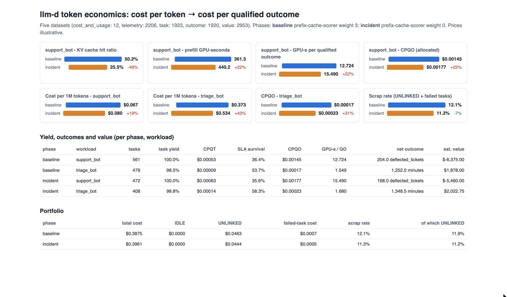
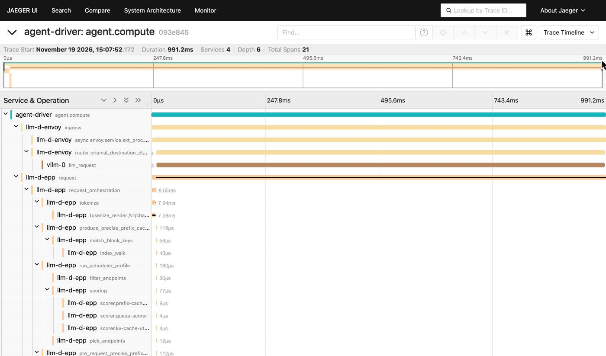
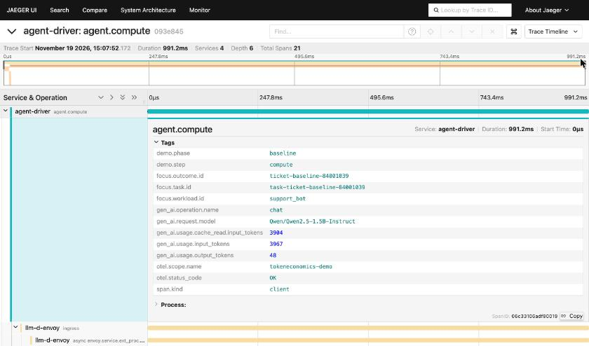
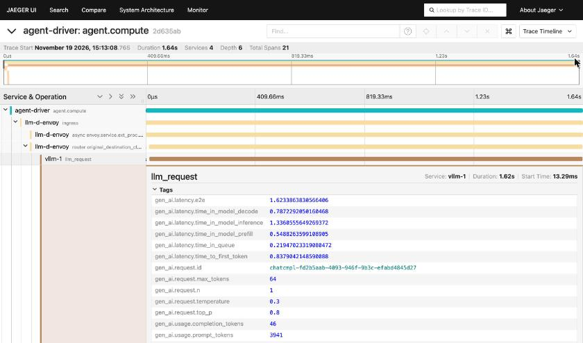
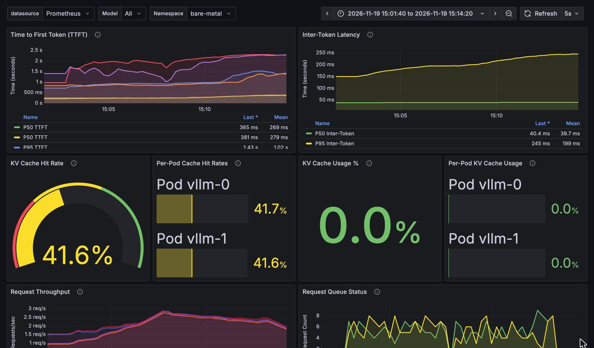

# llm-d Token Economics: from cost per token to cost per qualified outcome

This demo implements, end to end and on real hardware, the Tokenomics Foundation's
[Value Attribution Data Architecture](https://www.tokeneconomics.com/projects/value-attribution-data-architecture/)
(v0.1.8, 2026-11-19, "the paper") on top of llm-d. It continues where our KubeCon NA
2026 talk *"Seeing Through the Stack: End-to-End Observability and cost visibility for
llm-d with OpenCost"* stopped: the talk reached **cost per token**. This demo reaches
**cost per qualified task, cost per qualified outcome and value**, and replays the
talk's incident (EPP `prefix-cache-scorer` weight 3 → 0) to price it.

Everything below was run on **2026-11-19** on one NVIDIA DGX Spark (`spark-3bee`, GB10)
**without Kubernetes**, on the stack from [`../llm-d-spark-nonk8s-demo`](../llm-d-spark-nonk8s-demo).
Every `console` block is copied from the actual session (`logs/capture/`).

中文版见 [`README-zh.md`](README-zh.md). The design document is [`docs/design.md`](docs/design.md)
([中文](docs/design-zh.md)).

---

## Contents

- [0. Results at a glance](#0-results-at-a-glance)
- [1. Background](#1-background)
- [2. Architecture](#2-architecture)
- [3. Use cases and test design](#3-use-cases-and-test-design)
- [4. What's in this folder](#4-whats-in-this-folder)
- [5. Environment and installation](#5-environment-and-installation)
- [6. Running the demo, step by step](#6-running-the-demo-step-by-step)
- [7. Results and analysis](#7-results-and-analysis)
- [8. Findings and issues](#8-findings-and-issues)
- [9. Future plan](#9-future-plan)
- [10. Troubleshooting](#10-troubleshooting)

---

## 0. Results at a glance



Two 5-minute phases, same seed, 12 concurrent agents, 2 × vLLM (Qwen2.5-1.5B-Instruct) on one GB10:

| | baseline (weight 3) | incident (weight 0) | change |
|---|---|---|---|
| support_bot tasks whose follow-up step went to **another replica** | 0 / 561 (0.0%) | 240 / 472 (50.8%) | routing affinity lost |
| support_bot `compute` step KV-cache hit (tokens) | 97.7% | 48.9% | −50% |
| support_bot `compute` step p50 latency | 2.45 s | 3.30 s | +35% |
| Tasks completed in 310 s (all workloads) | 1,040 | 880 | −15% capacity |
| support_bot **prefill GPU-s** | 361.3 | 440.2 (fewer requests) | +22% |
| support_bot **GPU-s per qualified outcome** | 12.72 | 15.49 | **+22%** |
| support_bot **CPQO** (allocated bill) | $0.00145 | $0.00177 | **+22%** |
| triage_bot cost per 1M tokens (*not* affected by the bug) | $0.373 | $0.534 | **+43% spill-over** |
| support_bot Outcome SLA survival (quality) | 36.4% | 35.6% | unchanged, as expected |
| Linked model calls joined to their vLLM span | 2,953 / 2,953 | | 100% |

Three things this demo shows that cost per token alone cannot:

1. **The KubeCon bug has a price:** +22% GPU-seconds and +22% cost per qualified outcome
   for the affected workload, and −15% capacity for the whole GPU.
2. **On a shared, fixed-price GPU, one workload's incident raises its neighbours' unit
   cost** (triage_bot +43% per token) because the same bill buys less throughput.
   Usage-based KPIs (GPU-s per qualified outcome) separate cause from spill-over.
3. **Quality, not compute, dominates the economics of a small model.** support_bot passes
   its in-flight technical gate 100% of the time, but only ~36% of refunds survive
   the post-delivery check. With human friction and rework priced in, its value is
   **negative** (−$6,375 Reported in the baseline phase), while its whole GPU bill
   is $0.30. This is exactly the "Task gate vs Outcome gate" split the paper argues for.

---

## 1. Background

### 1.1 The paper

Most organizations can see their token and GPU bills, and engineering can trace latency
and token counts, but **the systems that hold cost and the systems that hold results share
no join keys**. The paper proposes five logical datasets, each owned by a different team:

| Dataset | Owner | Standard | Question |
|---|---|---|---|
| Cost and Usage | FinOps | FOCUS | what did we pay? |
| Telemetry | Platform / gateway | OpenTelemetry (+ proposed `focus.*`) | which activity drove it? |
| Task | Engineering (app / workflow) | workflow state | what work was attempted, did it pass the **technical** gate? |
| Outcome | Line of business | system of record | did the result survive its **post-delivery** SLA? |
| Value | Finance (FP&A) | rate cards, GAAP | what was it worth? |

They are linked by `WorkloadId`, `TaskId` and `OutcomeId`. These are carried at runtime
as the OTel attributes `focus.workload.id`, `focus.task.id` and `focus.outcome.id`
(**join keys only, never dollar amounts**). Shared spend is split by an `ActivityWeight`,
and unlinked spend is kept as `'UNLINKED'` so nothing is dropped. The paper names **vLLM
and llm-d** as inference engines that should adopt `focus.*`, and its roadmap asks for
sample data and a reference implementation (FOCUS 1.6 cycle, Nov 2026 – Apr 2027,
playbook June 2027).

### 1.2 Where llm-d stood after KubeCon NA 2026

The KubeCon talk delivered:

- end-to-end traces (Envoy → EPP → KV indexer → P/D sidecar → vLLM);
- metric → trace → log correlation, demonstrated by debugging a TTFT alert caused by a
  Helm change of the `prefix-cache-scorer` weight from 3 to 0;
- with OpenCost, cost per token and the split between allocation and usage cost.

It did **not** connect cost to *work* or *results*. This demo does that, and runs where
llm-d also runs: outside Kubernetes.

---

## 2. Architecture

Full design rationale: [`docs/design.md`](docs/design.md).

```
                          W3C traceparent + baggage(focus.*)
 +----------------+  -------------------------------------->  +--------+  ext_proc  +---------------------+
 | agent driver   |                                           | Envoy  | <--------> | EPP (llm-d router)  |
 | support_bot    |  root span agent.<step>:                  | :8081  |            | precise prefix-cache|
 | triage_bot     |   focus.workload.id / task.id / outcome.id+--------+            | scorer w=3 or w=0   |
 | playground     |   gen_ai.usage.* (incl. cached tokens)       |                  +---------------------+
 | (UNLINKED)     |  playground: no keys, no traceparent         v                          ^ KV events
 +----------------+                                   +--------------+ +--------------+     |
        | OTLP/HTTP                                   | vllm-0 :8000 | | vllm-1 :8001 |-----+
        v                                             | llm_request  | | llm_request  |  one GB10 GPU
 +----------------+  <-- OTLP gRPC (Envoy, EPP, vLLM) +--------------+ +--------------+
 | OTel Collector | -> Jaeger
 +----------------+        |
                           v
  build.py: for each trace, copy the root span's focus.* onto vLLM's leaf span
  ("enterprise enrichment", paper 2.2.2 #4); aggregate per (60 s charge period,
  workload, task, replica); split the GPU bill by ActivityWeight = vLLM prefill+decode time
                           |
  tasks.jsonl (gates) -----+--> SQLite + CSV: cost_and_usage, telemetry, task, outcome, value
  configs/demo.toml -------+    + KPI views (kpis.sql) --> report.md / report.html
```

Key decisions (details in the design doc):

| Decision | Choice | Why |
|---|---|---|
| Where lineage keys enter | the application (driver) root span + W3C baggage | the paper's layer 1; nothing upstream emits `focus.*` yet |
| How they reach GPU usage | join on `trace_id` at ingest | no component copies baggage onto spans ([finding F2](#f2-no-component-records-the-baggage)) |
| Leaf span for the GPU scope | vLLM `llm_request` | the deepest span that consumed the billed resource (paper 2.3.1) |
| Consumption Scope | one GPU = `spark-3bee/gpu0`; replica kept as `x_ServingReplica` | both replicas share one GPU |
| Cost and Usage | synthetic FOCUS rows, $4.00/GPU-h (illustrative), 60 s charge periods | a self-hosted GPU has no invoice; swap in an OpenCost FOCUS export on Kubernetes |
| ActivityWeight | vLLM `time_in_model_prefill + time_in_model_decode` (token weighting available) | GPU time is the cost driver of a self-hosted engine, not token prices |
| Cached tokens | from `usage.prompt_tokens_details.cached_tokens` via the root span | vLLM's span has no cache attribute ([F3](#f3-vllms-span-lacks-cached-tokens-and-the-response-model)) |
| Idle capacity | periods with no activity become an `IDLE` line | the paper leaves this open (2.3.2) |

---

## 3. Use cases and test design

### 3.1 Workloads (all with automatically checked quality gates)

| Workload | What the agent does | Gate 1 – Task (in flight) | Gate 2 – Outcome (after delivery, 60 s settlement window) | Value lens |
|---|---|---|---|---|
| `support_bot` | Billing dispute. Each ticket ships a unique ~3.9k-token invoice history. Step 1 *investigate*, step 2 *call the refund-calculator tool* on the same conversation, up to 2 retries | the tool call is well formed **and** `amount_usd` matches an invoice that exists for that plan (the tool validates against the record) | the refund is right to the cent (used the **most recent** invoice); otherwise the customer reopens the ticket | CFO, Cost Reduction, $8.50 per deflected ticket; human friction (2 min review) and rework (3 min hand-off, 12 min reopened ticket) as a negative claim at $1.50/min |
| `triage_bot` | Alert triage, ~250-token prompt, one call | JSON with allowed severity and component labels | both labels match ground truth; otherwise the alert is re-escalated (5 min rework) | CTO, Engineering Capacity, $1.50 per net minute (baseline 10 min, 0.5 min review) |
| playground | ad-hoc "write a haiku" calls with **no keys** | – | – | `UNLINKED` scrap |

Mix: 50% support_bot, 40% triage_bot, 10% playground. The task generators are seeded, so
both phases see the same kinds of work.

### 3.2 Test cases

| # | Test | Pass criterion | Result |
|---|---|---|---|
| T1 | Lineage propagates: client `traceparent` + `baggage` → Envoy → EPP → vLLM in one trace | vLLM `llm_request` is in the driver's trace | ✅ 1 root, 21 spans, 4 services (§6.4) |
| T2 | Every linked model call is attributed | linked vLLM spans = linked driver calls | ✅ 2,953 / 2,953 |
| T3 | UNLINKED traffic is kept, not dropped | `UNLINKED` line in Telemetry, Task and Scrap Rate | ✅ 247 calls, 11-12% of cost |
| T4 | 100% of the bill is allocated | Σ `x_AllocatedCost` = Σ `EffectiveCost` | ✅ $0.80 = 12 periods × $0.0667 |
| T5 | Baseline: cache-aware routing keeps a task on one replica | split tasks ≈ 0% | ✅ 0.0% |
| T6 | Incident (weight 0): affinity lost, cost per qualified outcome rises, quality does not | split ≈ 50%, CPQO ↑, SLA survival ≈ | ✅ 50.8%, +22%, 36.4% → 35.6% |
| T7 | Two gates diverge for support_bot | Task yield ≫ Outcome survival | ✅ 100% vs 36% |
| T8 | Datasets follow the paper's schema | five CSVs with the paper's column names | ✅ `results/*.csv` |

---

## 4. What's in this folder

```
tokeneconomics/
├── README.md / README-zh.md         this report (English / Chinese)
├── docs/design.md / design-zh.md    design document
├── docs/screenshots/                report + Jaeger screenshots
├── configs/
│   ├── qwen2.5-1.5b.env             model env for ../llm-d-spark-nonk8s-demo/scripts/up.sh
│   └── demo.toml                    prices, ActivityWeight method, settlement window, rate cards
├── tokeneconomics/                  Python package, standard library only (3.11+)
│   ├── otlp.py                      W3C traceparent/baggage + OTLP/HTTP JSON span exporter
│   ├── workloads.py                 support_bot / triage_bot / playground + gates
│   ├── driver.py                    runs a phase; writes requests/tasks/phases.jsonl
│   ├── build.py                     Jaeger + driver records -> the five datasets (SQLite + CSV)
│   ├── kpis.sql                     KPI views (paper section 4)
│   └── report.py                    report.md + report.html
├── scripts/
│   ├── set-prefix-weight.sh         re-render EPP config with weight N and restart the EPP
│   ├── run-demo.sh                  baseline -> incident -> restore -> settle -> build -> report
│   ├── trace-tree.py                print a trace with focus.* / gen_ai.* / EPP picker attributes
│   └── capture-doc.sh               re-record every console block in this README
├── results/                         the run documented here: 5 CSVs + report.md/html + phases
└── logs/capture/                    raw "command + output" captures used below
```

---

## 5. Environment and installation

### 5.1 Hardware and software used

```console
gyliu@spark-3bee:~/tokeneconomics$ hostname; uname -m; grep PRETTY /etc/os-release
spark-3bee
aarch64
PRETTY_NAME="Ubuntu 24.04.5 LTS"
gyliu@spark-3bee:~/tokeneconomics$ nvidia-smi --query-gpu=name,driver_version --format=csv
name, driver_version
NVIDIA GB10, 580.173.02
gyliu@spark-3bee:~/tokeneconomics$ docker compose version; python3 --version
Docker Compose version v5.0.2
Python 3.12.3
```

| Component | Version |
|---|---|
| vLLM | `nvcr.io/nvidia/vllm:26.08-py3` = vLLM 0.27.1 (`sha256:4b16878d…`) |
| EPP (llm-d router) | `ghcr.io/llm-d/llm-d-router-endpoint-picker:main`, built 2026-11-16 (`sha256:25706cb7…`) |
| Envoy / OTel Collector / Jaeger / Prometheus / Grafana | v1.36.2 / contrib 0.139.0 / 2.11.0 / v3.7.3 / 12.2.1 |
| Model | `Qwen/Qwen2.5-1.5B-Instruct`, 2 replicas, `--gpu-memory-utilization 0.10`, `--kv-cache-memory-bytes 6G`, block size 64, prefix caching on |
| Demo code | Python 3.12 standard library only (`sqlite3`, `tomllib`, `urllib`) |

GPU memory: the GB10 was shared with another tenant (ComfyUI holding ~40 GB) during the
run, which is why a 1.5B model with small KV budgets is used. Each replica takes about
9 GB.

### 5.2 Prerequisite: the llm-d no-Kubernetes stack

This demo does not ship its own serving stack; it reuses
[`../llm-d-spark-nonk8s-demo`](../llm-d-spark-nonk8s-demo) (Envoy + EPP with precise
prefix-cache routing + 2 vLLM replicas + OTel/Jaeger/Prometheus/Grafana, all Docker
Compose, host networking). Follow its README §3-§4 once (images, Docker GPU runtime). Then
start it with this demo's model file:

```console
gyliu@spark-3bee:~$ cd ~/llm-d-nonk8s            # the copy of ../llm-d-spark-nonk8s-demo on the Spark
gyliu@spark-3bee:~/llm-d-nonk8s$ cp .env .env.bak-nemotron   # up.sh overwrites .env
gyliu@spark-3bee:~/llm-d-nonk8s$ scripts/up.sh ~/tokeneconomics/configs/qwen2.5-1.5b.env precise
...
waiting for both vLLM replicas (first start compiles; ~5-15 min)...
  vLLM :8000 ready
  vLLM :8001 ready
...
Envoy ready on :8081 (EPP config: config-precise.yaml, model: Qwen/Qwen2.5-1.5B-Instruct)
```

`configs/qwen2.5-1.5b.env` adds `--enable-prompt-tokens-details`, so that vLLM returns
`usage.prompt_tokens_details.cached_tokens`. The driver needs this to fill
`CacheReadTokenCount`.

### 5.3 Install the demo

```console
$ rsync -a llm-d/tokeneconomics/ mygpu:tokeneconomics/     # from a checkout of this repo
gyliu@spark-3bee:~/tokeneconomics$ export NONK8S_DIR=~/llm-d-nonk8s   # where the stack's compose.yaml lives
```

There is nothing to `pip install`.

### 5.4 Check the stack

```console
gyliu@spark-3bee:~/tokeneconomics$ docker ps --format '{{.Names}}\t{{.Image}}\t{{.Status}}' | grep -E 'vllm|epp|envoy|otel|jaeger|prometheus|grafana' | sort
envoy	envoyproxy/envoy:v1.36.2	Up 18 minutes
epp	ghcr.io/llm-d/llm-d-router-endpoint-picker:main	Up About a minute
grafana	grafana/grafana:12.2.1	Up 2 days
jaeger	jaegertracing/jaeger:2.11.0	Up 2 days
otel-collector	otel/opentelemetry-collector-contrib:0.139.0	Up 2 days
prometheus	prom/prometheus:v3.7.3	Up 2 days
vllm-0	nvcr.io/nvidia/vllm:26.08-py3	Up 22 minutes (healthy)
vllm-1	nvcr.io/nvidia/vllm:26.08-py3	Up 20 minutes (healthy)
gyliu@spark-3bee:~/tokeneconomics$ curl -s localhost:8081/v1/models | python3 -c 'import json,sys; print([m["id"] for m in json.load(sys.stdin)["data"]])'
['Qwen/Qwen2.5-1.5B-Instruct']
```

---

## 6. Running the demo, step by step

### 6.1 One-shot

```console
gyliu@spark-3bee:~/tokeneconomics$ scripts/run-demo.sh 300 12     # 300 s per phase, 12 concurrent agents
```

It runs §6.3 → §6.5 → §6.6 below and takes about 12 minutes. The rest of this section
runs the same steps by hand.

### 6.2 Probe: one request with lineage keys

```console
gyliu@spark-3bee:~/tokeneconomics$ curl -s localhost:8081/v1/chat/completions -H 'Content-Type: application/json' \
  -H 'traceparent: 00-0af7651916cd43dd8448eb211c80319c-b7ad6b7169203331-01' \
  -H 'baggage: focus.workload.id=support_bot,focus.task.id=task-probe-1,focus.outcome.id=ticket-probe-1' \
  -d '{"model":"Qwen/Qwen2.5-1.5B-Instruct","messages":[{"role":"user","content":"Say hi"}],"max_tokens":8}' \
  | python3 -c 'import json,sys; r=json.load(sys.stdin); print(r["choices"][0]["message"]["content"], r["usage"])'
Hello! How can I assist you today {'prompt_tokens': 31, 'total_tokens': 39, 'completion_tokens': 8, 'prompt_tokens_details': {'cached_tokens': 0, 'created_cache_tokens': 0, 'multimodal_tokens': None}}
```

Is the baggage recorded anywhere? No:

```console
$ curl -s localhost:16686/api/traces/0af7651916cd43dd8448eb211c80319c | python3 -c '...'   # see logs/capture/02b-probe-baggage.txt
17 spans: ['llm-d-envoy', 'llm-d-epp', 'vllm-0']
spans with focus.*/baggage attributes: []
```

This is why the driver also exports its own root span (§6.4, [F2](#f2-no-component-records-the-baggage)).

### 6.3 Set the EPP scorer weight

```console
gyliu@spark-3bee:~/tokeneconomics$ NONK8S_DIR=/home/gyliu/llm-d-nonk8s scripts/set-prefix-weight.sh 0 2>&1 | grep -v -E '^ *Container'
        weight: 0
EPP running with config-precise-w0.yaml
gyliu@spark-3bee:~/tokeneconomics$ NONK8S_DIR=/home/gyliu/llm-d-nonk8s scripts/set-prefix-weight.sh 3 2>&1 | grep -v -E '^ *Container'
        weight: 3
EPP running with config-precise-w3.yaml
```

The script re-renders `configs/epp/config-precise.yaml` with the new weight into
`config-precise-w<N>.yaml` and recreates only the `epp` container. vLLM keeps running and
keeps its KV cache. The EPP's index is rebuilt from KV events.

### 6.4 Run a phase

```console
gyliu@spark-3bee:~/tokeneconomics$ python3 -m tokeneconomics.driver --phase baseline --note "prefix-cache-scorer weight 3" --duration 300 --concurrency 12 --out data
[baseline] t+   10s tasks=26 requests=47 errors=0
[baseline] t+   20s tasks=59 requests=106 errors=0
...
phase baseline done in 310s: {'tasks': 1040, 'requests': 1735, 'errors': 0}, spans dropped=0
gyliu@spark-3bee:~/tokeneconomics$ scripts/set-prefix-weight.sh 0 && python3 -m tokeneconomics.driver --phase incident --note "prefix-cache-scorer weight 0" --duration 300 --concurrency 12 --out data
...
phase incident done in 310s: {'tasks': 880, 'requests': 1465, 'errors': 0}, spans dropped=0
```

What one `support_bot` model call looks like (baseline, `compute` step):

```console
gyliu@spark-3bee:~/tokeneconomics$ python3 scripts/trace-tree.py 093e84546ebfd692dd01cade4a687a5f
trace 093e84546ebfd692dd01cade4a687a5f: 21 spans, services ['agent-driver', 'llm-d-envoy', 'llm-d-epp', 'vllm-0'], roots=1
[agent-driver] agent.compute  (991.2 ms)
    demo.step = compute
    focus.outcome.id = ticket-baseline-84001039
    focus.task.id = task-ticket-baseline-84001039
    focus.workload.id = support_bot
    gen_ai.usage.cache_read.input_tokens = 3904
    gen_ai.usage.input_tokens = 3967
    gen_ai.usage.output_tokens = 48
  [llm-d-envoy] ingress  (989.9 ms)
    [llm-d-envoy] async envoy.service.ext_proc.v3.ExternalProcessor.Process egress  (990.0 ms)
    [llm-d-envoy] router original_destination_cluster egress  (979.4 ms)
      [vllm-0] llm_request  (977.1 ms)
          gen_ai.latency.time_in_model_decode = 0.8500
          gen_ai.latency.time_in_model_inference = 0.9555
          gen_ai.latency.time_in_model_prefill = 0.1055
          gen_ai.usage.completion_tokens = 48
          gen_ai.usage.prompt_tokens = 3967
  [llm-d-epp] request  (990.0 ms)
    ...
        [llm-d-epp] match_block_keys  (0.1 ms)
            llm_d.kv_cache.prefix_match.key_count = 61
            llm_d.kv_cache.prefix_match.longest_chain = 61
            llm_d.kv_cache.prefix_match.pods_matched = 2
        ...
        [llm-d-epp] pick_endpoints  (0.0 ms)
            llm_d.epp.picker.candidate_endpoints = 2
            llm_d.epp.picker.top_endpoints = ["default/vllm-0","default/vllm-1"]
            llm_d.epp.picker.top_scores = [6.893986890852094,3.9767950329130244]
```





### 6.5 Build the five datasets

```console
gyliu@spark-3bee:~/tokeneconomics$ python3 -m tokeneconomics.build --data data
traces=3200 vLLM leaf spans=3200 (linked 2953 of 2953 linked driver calls, unlinked 247)
wrote data/tokeneconomics.db: cost_and_usage=12 telemetry=2206 task=1923 outcome=1920 value=2953
```

`run-demo.sh` first waits out the 60 s settlement window, so every Outcome is `Settled`
and every Value has a `RealizedValue`. The resulting files (copied to `results/`):

```console
gyliu@spark-3bee:~/tokeneconomics$ head -3 data/cost_and_usage.csv
ServiceProviderName,BillingAccountId,SubAccountId,ServiceName,ResourceId,SkuPriceDetails.ModelId,ChargePeriodStart,ChargePeriodEnd,ChargeCategory,PricingCategory,ConsumedQuantity,ConsumedUnit,BilledCost,EffectiveCost
On-prem (DGX Spark),lab-001,spark-3bee,llm-d,spark-3bee/gpu0,,2026-11-19T20:02:00Z,2026-11-19T20:03:00Z,Usage,Committed,0.016666666666666666,GPU Hours,0.06666666666666667,0.06666666666666667
gyliu@spark-3bee:~/tokeneconomics$ head -2 data/telemetry.csv
TaskId,OutcomeId,WorkloadId,ServiceProviderName,BillingAccountId,ResourceId,ServiceName,SubAccountId,ModelId,TelemetryPeriodStart,TelemetryPeriodEnd,InvocationCount,InputTokenCount,OutputTokenCount,CacheReadTokenCount,CacheWriteTokenCount,TotalDurationMs,ActivityWeight,x_ServingReplica,x_PrefillSeconds,x_DecodeSeconds,x_AllocatedCost,x_Phase
UNLINKED,UNLINKED,UNLINKED,On-prem (DGX Spark),lab-001,spark-3bee/gpu0,llm-d,spark-3bee,Qwen/Qwen2.5-1.5B-Instruct,2026-11-19T20:02:00Z,2026-11-19T20:03:00Z,3,114,226,0,,13886.736,13.092542,vllm-0,0.602464,12.490078,0.00...
gyliu@spark-3bee:~/tokeneconomics$ head -2 data/task.csv
TaskId,OutcomeId,WorkloadId,UpstreamOutcomeId,TaskPeriodStart,TaskPeriodEnd,TaskType,TaskName,TaskQualityBarMet,AttemptedTaskCount,QualifiedTaskCount,TaskUnit,BaselineTaskQuantity,ObservedTaskQuantity,TaskFrictionQuantity,TaskReworkPenaltyQuantity,NetTaskQuantity,x_Phase,x_Attempts,x_Requests
task-alert-baseline-84000004,alert-baseline-84000004,triage_bot,,2026-11-19T20:02:50Z,2026-11-19T20:02:52Z,alert_triage,,1,1,1,minutes,10.0,10.0,0.5,0.0,9.5,baseline,1,1
gyliu@spark-3bee:~/tokeneconomics$ head -2 data/outcome.csv
OutcomeId,WorkloadId,OutcomeEntryNumber,OutcomePeriodStart,OutcomePeriodEnd,OutcomeRecordedDateTime,OutcomeStatus,OutcomeSettledDateTime,OutcomeType,OutcomeName,WorkloadName,OutcomeQualityBarMet,AttemptedOutcomeCount,QualifiedOutcomeCount,OutcomeUnit,...
alert-baseline-84000004,triage_bot,1,2026-11-19T20:02:50Z,2026-11-19T20:03:52Z,2026-11-19T20:14:27Z,Settled,2026-11-19T20:03:52Z,alert_triaged,,Alert Triage Copilot,1,1,1,minutes,10.0,10.0,0.5,0.0,9.5,,baseline
gyliu@spark-3bee:~/tokeneconomics$ wc -l < data/value.csv
2954
```

### 6.6 KPIs and report

```console
gyliu@spark-3bee:~/tokeneconomics$ python3 -m tokeneconomics.report --data data     # writes data/report.md and data/report.html
gyliu@spark-3bee:~/tokeneconomics$ sqlite3 -header -column data/tokeneconomics.db "SELECT phase, WorkloadId, requests, kv_cache_hit_ratio, prefill_gpu_s, decode_gpu_s, printf('%.4f', cost_usd) cost FROM kpi_infra"
phase           WorkloadId   requests  kv_cache_hit_ratio  prefill_gpu_s  decode_gpu_s  cost
--------------  -----------  --------  ------------------  -------------  ------------  ------
baseline        UNLINKED     128       0.0                 19.17          448.03        0.0463
baseline        support_bot  1122      0.502               361.28         2234.46       0.2964
baseline        triage_bot   479       0.267               79.81          318.31        0.0448
between-phases  UNLINKED     9         0.0                 1.42           26.02         0.0164
incident        UNLINKED     110       0.0                 18.56          425.33        0.0444
incident        support_bot  944       0.255               440.19         2162.18       0.2972
incident        triage_bot   408       0.268               78.18          321.75        0.0544
gyliu@spark-3bee:~/tokeneconomics$ sqlite3 -header -column data/tokeneconomics.db "SELECT phase, WorkloadId, tasks, task_yield, sla_survival, printf('%.5f', cpqo) cpqo, printf('%.3f', gpu_s_per_qo) gpu_s_per_qo, printf('%.2f', estimated) value FROM kpi_workload"
phase     WorkloadId   tasks  task_yield  sla_survival  cpqo     gpu_s_per_qo  value
--------  -----------  -----  ----------  ------------  -------  ------------  --------
baseline  support_bot  561    1.0         0.364         0.00145  12.724        -6375.00
baseline  triage_bot   479    0.985       0.537         0.00017  1.549         1878.00
incident  support_bot  472    1.0         0.356         0.00177  15.490        -5460.00
incident  triage_bot   408    0.988       0.583         0.00023  1.680         2022.75
gyliu@spark-3bee:~/tokeneconomics$ sqlite3 -header -column data/tokeneconomics.db "SELECT OutcomeEntryNotes, COUNT(*) n FROM outcome GROUP BY 1 ORDER BY 2 DESC"
OutcomeEntryNotes                 n
--------------------------------  ---
                                  867
refund wrong: ticket reopened     661
wrong label: re-escalated         380
agent gave up: handed to a human  12
```

The `between-phases` row is the few UNLINKED calls that completed while the EPP was being
restarted. The KPI views keep it, and the report's phase tables leave it out.

---

## 7. Results and analysis

The full generated report is [`results/report.md`](results/report.md) (HTML:
[`results/report.html`](results/report.html)). The KPI views are in
[`tokeneconomics/kpis.sql`](tokeneconomics/kpis.sql).

### 7.1 The mechanism: affinity → cache → prefill

Per step, from `data/requests.jsonl` (client-side usage):

| phase | step | calls | KV-cache hit (tokens) | p50 latency | p95 latency |
|---|---|---|---|---|---|
| baseline | investigate (new ticket) | 561 | 1.7% | 2.15 s | 3.15 s |
| baseline | **compute** (same conversation) | 561 | **97.7%** | 2.45 s | 3.32 s |
| baseline | triage | 479 | 26.7% | 0.85 s | 1.55 s |
| incident | investigate | 472 | 1.7% | 2.47 s | 3.39 s |
| incident | **compute** | 472 | **48.9%** | 3.30 s | 4.08 s |
| incident | triage | 408 | 26.8% | 1.01 s | 1.84 s |

Tasks whose two steps were served by different replicas (from Telemetry `x_ServingReplica`):

```console
phase     tasks  split_across_replicas  pct
--------  -----  ---------------------  ----
baseline  561    0                      0.0
incident  472    240                    50.8
```

With weight 0, the follow-up step goes to a coin-flip replica. 50.8% is what random
placement over 2 replicas gives. One incident-phase miss, side by side with the baseline
trace in §6.4:

```console
gyliu@spark-3bee:~/tokeneconomics$ python3 scripts/trace-tree.py 2d635ab91262686ad2f35f8ab56e491c   # an incident-phase compute step
[agent-driver] agent.compute  (1638.7 ms)
    gen_ai.usage.cache_read.input_tokens = 64
      [vllm-1] llm_request  (1623.5 ms)
          gen_ai.latency.time_in_model_prefill = 0.5488
            llm_d.kv_cache.prefix_match.longest_chain = 60
            llm_d.kv_cache.prefix_match.pods_matched = 2
            llm_d.epp.picker.top_endpoints = ["default/vllm-1","default/vllm-0"]
            llm_d.epp.picker.top_scores = [3.945853519521231,3.9293245939013963]
```

The index **knows** the prefix (`longest_chain = 60`), but with weight 0 the two
replicas score 3.946 vs 3.929, decided by queue and KV-utilization noise. Prefill takes
549 ms instead of 105 ms (5.2×) for the same ~3.9k-token prompt. This is the same
signature as the KubeCon demo (52 → 569 ms).



The existing llm-d Performance dashboard over the whole run (15:02-15:14 local; the
incident starts at 15:08). TTFT steps up when the weight goes to 0. The cache-hit gauge
is the window average (41.6%). It cannot tell you **which workload** paid for the
misses; the datasets above can.



### 7.2 What it costs

| KPI (support_bot) | baseline | incident | Δ |
|---|---|---|---|
| prefill GPU-s (all steps) | 361.3 | 440.2 | +22% (with 16% fewer calls) |
| GPU-s per qualified outcome | 12.72 | 15.49 | +22% |
| allocated cost | $0.2964 | $0.2972 | ≈ (fixed bill) |
| qualified outcomes | 204 | 168 | −18% |
| CPQT / CPQO | $0.00053 / $0.00145 | $0.00063 / $0.00177 | +19% / +22% |

The bill per minute does not change (the GPU costs what it costs). What changes is how
much **work the same bill buys**. This is why GPU-s per qualified outcome, a usage basis,
sits next to CPQO, an allocation basis. It is the same split as the KubeCon deck's
"allocation cost vs usage cost".

### 7.3 Spill-over onto a workload that did nothing wrong

triage_bot's prompts are short and its cache hit is unchanged (26.7% → 26.8%), but its
**cost per 1M tokens rose 43%** ($0.373 → $0.534) and its CPQO rose 31%. The fixed
per-period bill is spread over fewer, more expensive support_bot calls, and triage_bot
takes a bigger share of the weight in each period. **On a shared self-hosted GPU,
per-workload unit cost is coupled to the neighbours' efficiency.** A FinOps team looking
only at allocated cost would blame the wrong workload. The usage-basis KPI
(triage_bot GPU-s/QO 1.549 → 1.680, +8% from general contention) shows where the waste
really is.

### 7.4 Quality dominates value

| | support_bot | triage_bot |
|---|---|---|
| Task yield (Gate 1) | 100% | 98.5% |
| Outcome SLA survival (Gate 2) | 36.4% | 53.7% |
| Compute cost per qualified outcome | $0.00145 | $0.00017 |
| Est. value, baseline phase | **−$6,375.00** (+$1,734 deflection, −$8,109 friction and rework) | +$1,878.00 |

The cheap model passes every technical check and still loses money. 357 reopened tickets
× 12 min of rework outweigh 204 deflections × $8.50. GPU cost is about four orders of
magnitude smaller than the human cost. The lever is **model or agent quality**: a bigger
model, or a better tool that knows which invoice is current. It is not the GPU price.
This is what the paper's two gates are for, and the demo would have reported "100% task
success" without the Outcome dataset.

### 7.5 Scrap and UNLINKED

| phase | total cost | IDLE | UNLINKED | failed-task cost | scrap rate | of which UNLINKED |
|---|---|---|---|---|---|---|
| baseline | $0.3875 | $0.0000 | $0.0463 | $0.0007 | 12.1% | 11.9% |
| incident | $0.3961 | $0.0000 | $0.0444 | $0.0005 | 11.3% | 11.2% |

Playground calls are 7% of requests but **12% of GPU cost**: short prompts with long,
decode-heavy answers. Almost all scrap is UNLINKED, not failed tasks, which is exactly
why the paper reports UNLINKED as its own line ("missing links are not failed work").

---

## 8. Findings and issues

### F1. vLLM does continue the caller's trace (contradicts the paper)

The paper (section 2.2.2) says vLLM "did not" continue the caller's trace in its authors'
testing. With `--otlp-traces-endpoint` on vLLM 0.27.1, `llm_request` is a child of
Envoy's router span in the caller's trace (§6.4); all 3,200 vLLM spans in this run
joined their trace. **Action:** send this evidence to the paper's authors (FOCUS SemConv
WG). The likely difference is the tracing flag, or a gateway that drops `traceparent`.

### F2. No component records the baggage

The EPP registers both the TraceContext and the Baggage propagators
(`llm-d-router/pkg/common/observability/tracing/telemetry.go:55`), and Envoy forwards the
`baggage` header. But no span in Envoy, the EPP or vLLM carries `focus.*` (§6.2: 17 spans,
0 attributes). The keys exist only on the client's root span, so attribution requires a
trace-wide join at ingest, which means keeping full traces. **Proposal (llm-d-router):**
an opt-in allowlist (for example `--trace-baggage-attributes=focus.workload.id,focus.task.id,focus.outcome.id`)
that copies baggage entries onto the EPP's `request` span. Then GPU-side and router-side
spans can be attributed without the client span. Similar options would be needed for the
vLLM span and the P/D sidecar.

### F3. vLLM's span lacks cached tokens and the response model

`llm_request` has `gen_ai.usage.prompt_tokens` / `completion_tokens` and prefill/decode
times, but **no `gen_ai.usage.cache_read.input_tokens` and no `gen_ai.response.model`**.
Both are columns the paper maps directly from OTel. The cached count exists only in the
HTTP response, and only with `--enable-prompt-tokens-details`, so the demo takes it from
the client. UNLINKED calls therefore have unknown cache reads. **Proposal (vLLM):** add
the cached-token count (and `created_cache_tokens` as `cache_write`) and the response
model to the request span.

### F4. Summed per-request GPU time over-counts under continuous batching

Baseline: Σ(prefill + decode) over all calls = **3,461 GPU-s in a 310 s phase**, about
11× wall-clock at 12-way concurrency, because batched requests share forward passes. As a
**relative** ActivityWeight within a period it is still a fair split, but it cannot be
read as GPU-seconds, and the paper's `TotalDurationMs` has the same problem. **Proposal:**
an engine-level "attributed GPU time" per request (each forward pass's time divided over
its batch members, weighted by tokens), exported on the span. This is input for the
paper's "weighting formulas require further working group discussion" (section 2.3.2).

### F5. Fixed-cost allocation couples workloads

See §7.3. The paper's allocation spreads each period's bill by activity share, so an
inefficient workload raises its neighbours' allocated unit cost. **Recommendation for the
paper / playbook:** for self-hosted capacity, publish a usage-basis KPI (resource time per
qualified outcome) next to the allocated-cost KPIs, as the KubeCon deck already separated
allocation from usage.

### F6. Gate 1 can be 100% while Gate 2 is 36%

See §7.4. Without post-delivery outcome data, this agent would look perfect. The tool's
argument validation (the amount must be a real invoice for the plan) cannot tell a stale
invoice from the current one. This is a realistic class of agent error that only the
system of record (a reopened ticket) reveals.

### F7. EPP span is a sibling of Envoy's span when the client sends `traceparent` (known)

Same as `llm-d-spark-nonk8s-demo` §10.2: `[llm-d-epp] request` hangs under the client root
instead of under Envoy's ext_proc span. This does not affect attribution here, because
the driver exports its root span, so there is still one root. The waterfall is less
readable.

### F8. Changing a scorer weight needs an EPP restart

The EPP config is not hot-reloaded, so each phase switch recreates the EPP container
(about 6 s). The calls in flight during the switch show up as a `between-phases` UNLINKED
line ($0.0164). This is harmless for the demo. In production, the KubeCon incident (a
Helm upgrade) would also restart the EPP.

### F9. Tooling: Jaeger / Grafana UIs over a slow remote link

Over the Tailscale link used for this run, Jaeger's 4.3 MB UI bundle took about 36 s to
load and Grafana's plugins took several minutes, so both pages looked blank at first. The
Grafana dashboards from `llm-d-spark-nonk8s-demo` work unchanged against this run
(§7.1). "KV Cache Usage %" shows the *last* value, which is 0 once the run is over. Use
an SSH tunnel to `localhost` and wait (§10).

---

## 9. Future plan

| # | Item | Where | Why |
|---|---|---|---|
| 1 | Opt-in baggage → span attributes in the EPP ([F2](#f2-no-component-records-the-baggage)) | llm-d-router | lets router and GPU spans be attributed without the client span; first llm-d component to emit `focus.*` |
| 2 | Cached tokens + response model on vLLM's request span ([F3](#f3-vllms-span-lacks-cached-tokens-and-the-response-model)) | vLLM | fills `CacheReadTokenCount`, `CacheWriteTokenCount`, `ModelId` from telemetry, as the paper assumes |
| 3 | Batch-aware "attributed GPU time" per request ([F4](#f4-summed-per-request-gpu-time-over-counts-under-continuous-batching)) | vLLM + paper WG | a defensible self-hosted `ActivityWeight` |
| 4 | Kubernetes variant: Cost and Usage from **OpenCost's FOCUS export** | `../llm-d-spark-full-demo` | connects directly to the KubeCon OpenCost integration |
| 5 | Grafana dashboard over the five datasets (push KPIs to Prometheus, or a SQL datasource) | this demo | live CPQO / scrap panels next to the existing llm-d dashboards |
| 6 | **Model choice by CPQO, not cost per token:** rerun with Nemotron-3-Nano-30B and compare | this demo | a larger model costs more per token but should lift Gate 2; the paper's main promise |
| 7 | P/D disaggregation: two Consumption Scopes (prefill pool, decode pool) + KV-transfer bytes | this demo + P/D sidecar | the leaf-span rule per scope (paper 2.3.1) with real P/D |
| 8 | Tiered KV cache: split `CacheReadTokenCount` by tier (GPU / CPU / disk) | llm-d-kv-cache + paper | different tiers have different cost |
| 9 | Cohort mode vs atomic mode on the same run | this demo | the paper's 2.6: does the cheaper mode reach the same decision? |
| 10 | Submit `results/` + this code as sample data / a reference implementation to the Tokenomics Foundation & FOCUS SemConv WG, together with F1-F5 | upstream | the paper's roadmap asks for exactly this (FOCUS 1.6 cycle, June 2027 demo) |

---

## 10. Troubleshooting

| Symptom | Cause / fix |
|---|---|
| `linked N of M` with N < M in `build` | vLLM started without `--otlp-traces-endpoint`, or Jaeger evicted traces (in-memory store). Build right after the run |
| `CacheReadTokenCount` always 0 | vLLM was started without `--enable-prompt-tokens-details` (use `configs/qwen2.5-1.5b.env`) |
| `WARNING: ... hit limit=3000` | more than 3,000 calls per replica in a 15 s slice; lower `slice_s` in `build.fetch_traces` |
| Jaeger UI blank | its JS bundle is still loading over a slow link; tunnel to localhost: `ssh -L 16687:127.0.0.1:16686 mygpu` and wait |
| `set-prefix-weight.sh: .env: No such file` | `NONK8S_DIR` must point at the stack directory that `up.sh` ran in |
| Two phases overlap in cost | phases are separated by the EPP restart only; use `charge_period_seconds` ≤ phase length / 4 |
| Restore the stack's original model | `cp ~/llm-d-nonk8s/.env.bak-nemotron ~/llm-d-nonk8s/.env` then `scripts/up.sh` there with that env file |
