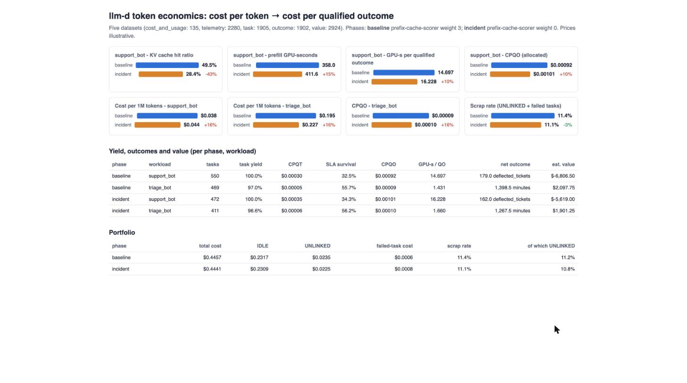
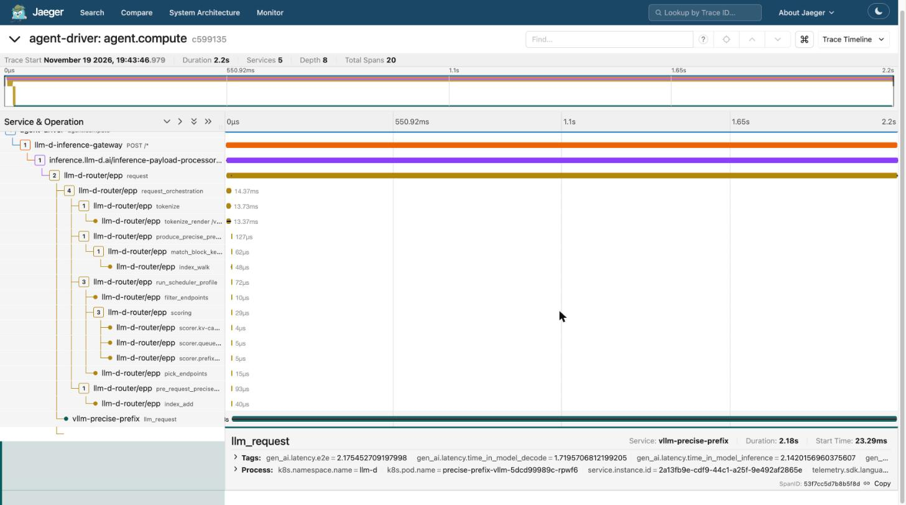

# Kubernetes 上的 llm-d Token 经济学：以 OpenCost 作为账单

这是 [`../`](../README-zh.md) 的 Kubernetes 版本。它运行相同的智能体工作负载、
相同的五个价值归因数据集以及相同的 KubeCon 事故（EPP
`prefix-cache-scorer` 权重 3 → 0）。这一次 llm-d 运行**在 Kubernetes 上**（DGX
Spark 上的 Kind，GPU 通过 NVIDIA device plugin 提供），**成本与用量数据集来自
OpenCost**，按 pod、按分钟计。它不再来自合成的 GPU 账单。

下文所有内容均于 **2026-11-19/20** 在来自
[`../../llm-d-spark-full-demo`](../../llm-d-spark-full-demo) 的 `llm-d` Kind 集群上运行。每个 `console` 块都复制自
该会话（`logs/capture/`）。

English version: [`README.md`](README.md). 设计与代码与
非 Kubernetes 版本共享：[`../docs/design-zh.md`](../docs/design-zh.md)（English: [`../docs/design.md`](../docs/design.md)）。第 2 节列出了这里的不同之处。

---

## 目录

- [0. 结果一览](#0-结果一览)
- [1. 背景](#1-背景)
- [2. Kubernetes 上有哪些变化](#2-kubernetes-上有哪些变化)
- [3. 用例与测试用例](#3-用例与测试用例)
- [4. 本目录内容](#4-本目录内容)
- [5. 环境与安装](#5-环境与安装)
- [6. 逐步运行演示](#6-逐步运行演示)
- [7. 结果与分析](#7-结果与分析)
- [8. 发现与问题](#8-发现与问题)
- [9. 后续计划](#9-后续计划)
- [10. 故障排查](#10-故障排查)

---

## 0. 结果一览



两个 5 分钟阶段，12 个并发智能体（一个集群内 Job），2 × vLLM pod（Qwen2.5-1.5B，
每个占一个时间分片的 GPU 单元），OpenCost 按每 GPU 单元小时 $1.00 计价（每块 GB10 $4/h）：

| | 基线（权重 3） | 事故（权重 0） | 变化 |
|---|---|---|---|
| 后续步骤被发到**另一个 pod** 的 support_bot 任务 | 7 / 550 (1.3%) | 212 / 472 (44.9%) | 亲和性丢失 |
| `compute` 步骤 KV 缓存命中率 | 96.3% | 54.5% | −42 个百分点 |
| `compute` 步骤 p50 延迟 | 2.68 s | 3.40 s | +27% |
| 310 s 内完成的任务数 | 1,019 | 883 | **−13% 容量** |
| support_bot 每个合格结果的 GPU 秒数 | 14.70 | 16.23 | **+10%** |
| support_bot CPQO（OpenCost，按 pod） | $0.00092 | $0.00101 | **+10%** |
| triage_bot 每 1M token 成本（不受该缺陷影响） | $0.195 | $0.227 | +16% 溢出效应 |
| **IDLE 占账单的比例**（OpenCost `__idle__`） | **52%** | **52%** | 4 个 GPU 单元中有 2 个从未被分配 |
| 服务开销（EPP、gateway、IPP、P/D 模拟 pod） | 0.8% | 0.8% | |
| 与其 vLLM span 关联上的已链接模型调用 | 2,923 / 2,923 | | 100% |

Kubernetes + OpenCost 相比非 Kubernetes 结果新增了什么：

1. **同一事故有同样的特征。** 亲和性丢失（被拆分的任务从 1% → 45%），
   缓存命中减半，每个合格结果的成本上升 10%，而账单现在来自
   OpenCost，而不是手写的费率。
2. **空闲容量成为最大的单项。** OpenCost 为整个节点定价，而
   GB10 的一半（4 个时间分片单元中的 2 个）没有任何 pod 申请。在这个负载下，
   **空闲项（每个 5 分钟阶段 $0.23）比 support_bot 的全部账单（$0.16）还大**：
   合理调整 GPU 分配比修复路由缺陷更重要。
3. **在 Kubernetes 上，消费范围是 pod。** 因此路由事故的溢出效应
   更小：这里邻居只增加 +16%，而在单一共享 GPU 范围下为 +43%。

---

## 1. 背景

关于 Tokenomics Foundation 论文（*Value Attribution Data Architecture* v0.1.8：成本与用量 → 遥测 → 任务 → 结果 → 价值，
通过 `focus.workload.id` / `focus.task.id` / `focus.outcome.id` 关联）以及本工作所延续的 KubeCon NA
2026 演讲，参见 [`../README-zh.md` §1](../README-zh.md#1-背景)。那次演讲展示了 llm-d + **OpenCost** 产出每 token 成本。本
版本将 OpenCost 的按 pod 分摊结果送入论文的数据集，从而同一份账单可以
按任务、按结果、按每美元价值来解读。

---

## 2. Kubernetes 上有哪些变化

| | 非 Kubernetes（[`../`](../README-zh.md)） | Kubernetes（本目录） |
|---|---|---|
| 服务路径 | Envoy → EPP → 2 个 vLLM 容器（Docker Compose） | agentgateway → payload processor（IPP）→ EPP → 2 个 vLLM **pod** |
| 智能体驱动程序运行位置 | 主机上的一个进程 | `llm-d` 命名空间中的一个 **Kubernetes Job**（`manifests/driver-job.tmpl.yaml`），代码来自 ConfigMap |
| 成本与用量 | 合成的 FOCUS 行：$4/GPU-h，单一 GPU 范围 | **OpenCost allocation API**，每个 pod 每分钟一行（`tokeneconomics/opencost.py`） |
| 消费范围 | GPU（`spark-3bee/gpu0`） | **pod** |
| 未分配容量 | 仅限没有流量的时段 | OpenCost `__idle__` → `IDLE`，每分钟 |
| 非服务 pod | 不计费 | EPP、gateway、IPP、P/D pod → `OVERHEAD`（论文 2.3.3，不算报废） |
| 哪个副本处理了某个 span | Jaeger 服务名（`vllm-0`、`vllm-1`） | `k8s.pod.name` 资源属性（两个 pod 共享同一个服务名） |
| Trace 拓扑 | client → Envoy → vLLM；EPP span 为兄弟节点 | client → gateway → IPP → EPP `request` → vLLM |
| 从 Jaeger 取出叶子 span | 运行结束后查询 | 运行期间**每 60 s 采集一次** + KV 事件 trace 过滤（[K2](#k2-epp-的-kv-事件追踪淹没了-jaeger)） |

分摊规则（`tokeneconomics/build.py:allocate`）。对每个 (ResourceId, 分钟)：

- **vLLM pod**：其 OpenCost 成本按 ActivityWeight（vLLM prefill + decode 时间）
  分摊到它所处理的请求上。如果该分钟它没有处理任何请求，成本归入 `IDLE`
  （已分配但未使用）；
- **`__idle__`**（没有 pod 申请的节点容量）→ `IDLE`；
- **`llm-d` 中的任何其他 pod**（EPP、gateway、IPP、Jaeger、collector、P/D pod）→ `OVERHEAD`；
- 驱动程序 Job 自身的 pod 被排除：它是应用本身，不是服务成本。

---

## 3. 用例与测试用例

工作负载、门、费率卡和阶段与 [`../README-zh.md` §3](../README-zh.md#3-用例与测试设计) 完全相同：
support_bot（账单争议智能体，长且唯一的上下文，2 个步骤）、triage_bot（告警分诊），
以及 UNLINKED 的 playground 流量。它们使用相同的随机种子和相同的流量配比运行。

| # | 测试 | 通过标准 | 结果 |
|---|---|---|---|
| K-T1 | 血缘沿 client → agentgateway → IPP → EPP → vLLM 传播 | vLLM span 位于驱动程序的 trace 内 | ✅ 20 个 span，5 个服务，1 个根（§6.4） |
| K-T2 | 每个已链接调用都被归因，并带有处理它的 pod | 已链接叶子数 = 已链接驱动程序调用数；副本 = pod 名 | ✅ 2,923 / 2,923，每个 vLLM span 上都有 `k8s.pod.name` |
| K-T3 | OpenCost 账单流入成本与用量数据集 | 每个 pod 每分钟一行 FOCUS，外加 `__idle__` | ✅ 135 行，成本拆分为 GPU / CPU / RAM |
| K-T4 | 范围内账单 100% 被分摊 | Σ 已分摊 = Σ EffectiveCost | ✅ $0.9974 = $0.9974 |
| K-T5 | 基线亲和性 | 被拆分的任务 ≈ 0% | ✅ 1.3% |
| K-T6 | 事故：亲和性丢失，CPQO 上升，质量不变 | 拆分 ≈ 50%，CPQO ↑ | ✅ 44.9%，+10%，SLA 存活率 32.5% → 34.3% |
| K-T7 | 空闲与开销可见，而不是藏在工作负载里 | `IDLE` 和 `OVERHEAD` 两项 | ✅ 52% / 0.8% |

---

## 4. 本目录内容

```
k8s/
├── README.md / README-zh.md               this report
├── demo-k8s.toml                          [cost] source = "opencost", namespace, serving pod prefix, [traces]
├── helm-values/opencost.values.yaml       OpenCost with custom on-prem pricing ($1 per GPU unit-hour)
├── manifests/
│   ├── driver-job.tmpl.yaml               the agent driver as a Kubernetes Job
│   └── vllm-patch.json                    vLLM: --enable-prompt-tokens-details + k8s.pod.name resource attribute
├── scripts/
│   ├── run-demo.sh                        baseline → incident → restore, 60 s leaf-span harvester, build, report
│   ├── run-driver-job.sh                  one phase as a Job (code shipped as a ConfigMap)
│   ├── set-prefix-weight.sh               edit the llm-d-epp ConfigMap and roll the EPP
│   ├── filter-kv-index-traces.sh          OTel Collector: drop per-event KV index traces (K2)
│   ├── port-forward.sh                    Jaeger :16686 and OpenCost :9003 on the host
│   └── capture-doc.sh                     re-record the console blocks below
├── docs/screenshots/                      report + Jaeger screenshots
├── results/                               this run's five datasets (CSV) + report.md / report.html
└── logs/capture/                          raw command + output captures
```

Python 代码是共享的：`../tokeneconomics/opencost.py` 是新增的，`build.py` 新增了
`allocate()`、`--harvest` 以及感知 pod 的叶子行。`../tests/` 覆盖了 OpenCost 路径。

---

## 5. 环境与安装

### 5.1 集群

```console
gyliu@spark-3bee:~/tokeneconomics$ kubectl config current-context; kubectl get nodes -o wide | cut -c1-120
kind-llm-d
NAME                  STATUS   ROLES           AGE   VERSION   INTERNAL-IP   EXTERNAL-IP   OS-IMAGE
llm-d-control-plane   Ready    control-plane   60d   v1.37.0   172.18.0.4    <none>        Debian GNU/Linux 13 (trixie)
gyliu@spark-3bee:~/tokeneconomics$ kubectl get node llm-d-control-plane -o jsonpath='{.status.allocatable.nvidia\.com/gpu}{" nvidia.com/gpu (GB10 time-sliced x4)\n"}'
4 nvidia.com/gpu (GB10 time-sliced x4)
gyliu@spark-3bee:~/tokeneconomics$ helm list -A | awk '{print $1, $2, $9, $10}' | column -t
NAME               NAMESPACE
agentgateway       agentgateway-system  agentgateway-v1.4.1           v1.4.1
agentgateway-crds  agentgateway-system  agentgateway-crds-v1.4.1      v1.4.1
ipp                llm-d                payload-processor-0.2.0       0.2.0
llm-d              llm-d                llm-d-router-gateway-v0       v0
llm-d-pd           llm-d                llm-d-router-gateway-v0       v0
llmd               llm-d-monitoring     kube-prometheus-stack-91.4.1  v0.94.0
opencost           opencost             opencost-2.5.34               1.121.4
gyliu@spark-3bee:~/tokeneconomics$ kubectl -n llm-d get pods -o custom-columns=NAME:.metadata.name,READY:.status.containerStatuses[*].ready,GPU:.spec.containers[*].resources.limits.nvidia\\.com/gpu | grep -v te-driver
NAME                                       READY   GPU
jaeger-554cff9d46-b4m7x                    true    <none>
llm-d-epp-5cf44f645c-z6ghg                 true    <none>
llm-d-inference-gateway-58b9564597-c5ptj   true    <none>
llm-d-pd-epp-6675d8658c-nlt64              true    <none>
otel-collector-bff977b58-t7xsr             true    <none>
payload-processor-697666c4f6-csl25         true    <none>
pd-decode-5fbc985d56-vc5ns                 true    <none>
pd-prefill-6d5db57479-p5nhd                true    <none>
precise-prefix-vllm-5dcd99989c-rpwf6       true    1
precise-prefix-vllm-5dcd99989c-zstxg       true    1
```

| 组件 | 版本 |
|---|---|
| Kind / Kubernetes | 节点镜像 `kindest/node:v1.37.0` |
| GPU | NVIDIA device plugin，GB10 时间分片 ×4（`nvidia.com/gpu: 4`） |
| Gateway | agentgateway v1.4.1（Gateway API + Inference Extension） |
| Router | `ghcr.io/llm-d/llm-d-router-endpoint-picker:main`（构建于 2026-11-16），精确前缀缓存打分器 |
| Payload processor | chart `payload-processor-0.2.0` |
| vLLM | `nvcr.io/nvidia/vllm:26.08-py3`（0.27.1），Qwen2.5-1.5B-Instruct，2 个 pod，`--enforce-eager` |
| 可观测性 | OTel Collector contrib 0.120.1 → Jaeger 2.15.0（内存存储）；kube-prometheus-stack 91.4.1 |
| 成本 | **OpenCost 1.121.4**（chart 2.5.34），自定义定价 |

### 5.2 前提：llm-d Kind 集群

使用 [`../../llm-d-spark-full-demo`](../../llm-d-spark-full-demo) 构建一次集群
（README §4：带 GPU 挂载的 Kind、device plugin、agentgateway、router、IPP、vLLM、OTel/Jaeger、
Prometheus）。本演示只是在其基础上做增量添加。

如果集群停止后无法正常恢复（`kube-proxy` / device plugin 处于
CrashLoopBackOff 并报 `too many open files`），参见 [K7](#k7-与其他集群并存时重启-kind-会耗尽-inotify-实例)。

### 5.3 本演示的附加组件

```console
# 1. vLLM: cached-token counts in responses + the pod name on every span
$ kubectl -n llm-d patch deploy precise-prefix-vllm --type=json -p "$(cat k8s/manifests/vllm-patch.json)"
$ kubectl -n llm-d scale deploy precise-prefix-vllm --replicas=2
# 2. EPP from main (same image as the no-Kubernetes run)
$ kind load docker-image ghcr.io/llm-d/llm-d-router-endpoint-picker:main --name llm-d
$ kubectl -n llm-d set image deploy/llm-d-epp epp=ghcr.io/llm-d/llm-d-router-endpoint-picker:main
# 3. OpenCost with on-prem pricing, scraped by the existing Prometheus
$ helm repo add opencost https://opencost.github.io/opencost-helm-chart
$ helm upgrade --install opencost opencost/opencost --version 2.5.34 -n opencost --create-namespace \
    -f k8s/helm-values/opencost.values.yaml
# 4. Stop the EPP's KV-event traces from evicting request traces in Jaeger (K2)
$ k8s/scripts/filter-kv-index-traces.sh
# 5. Jaeger and OpenCost on the host for the build step
$ k8s/scripts/port-forward.sh
Jaeger   http://127.0.0.1:16686
OpenCost http://127.0.0.1:9003
```

OpenCost 定价（`helm-values/opencost.values.yaml`）：**GPU 每 `nvidia.com/gpu` 单元小时 $1.00**
（时间分片 GB10 的四分之一，因此每块物理 GPU 为 $4/h，与
非 Kubernetes 演示价格相同），CPU 每 vCPU 小时 $0.03，RAM 每 GiB 小时 $0.004。OpenCost 对
vLLM pod 和空闲节点容量的按分钟视图：

```console
gyliu@spark-3bee:~/tokeneconomics$ curl -s 'http://127.0.0.1:9003/allocation/compute?window=3m&aggregate=namespace,pod&step=1m&resolution=1m&includeIdle=true&accumulate=false' | python3 -c '...'
__idle__                                                   2026-11-20T00:50:00Z gpuHours=0.0000 gpu=$0.03333 cpu=$0.00641 total=$0.04647
llm-d/llm-d-epp-5cf44f645c-z6ghg                           2026-11-20T00:50:00Z gpuHours=0.0000 gpu=$0.00000 cpu=$0.00025 total=$0.00032
llm-d/llm-d-pd-epp-6675d8658c-nlt64                        2026-11-20T00:50:00Z gpuHours=0.0000 gpu=$0.00000 cpu=$0.00013 total=$0.00016
llm-d/precise-prefix-vllm-5dcd99989c-rpwf6                 2026-11-20T00:50:00Z gpuHours=0.0167 gpu=$0.01667 cpu=$0.00100 total=$0.01807
llm-d/precise-prefix-vllm-5dcd99989c-zstxg                 2026-11-20T00:50:00Z gpuHours=0.0167 gpu=$0.01667 cpu=$0.00100 total=$0.01807
```

每个 vLLM pod 占一个 GPU 单元（$1/h = 每分钟 $0.01667），`__idle__` 占另外两个。

---

## 6. 逐步运行演示

### 6.1 一键运行

```console
gyliu@spark-3bee:~/tokeneconomics$ k8s/scripts/run-demo.sh 300 12
```

脚本将权重设为 3，运行基线 Job，将权重设为 0，运行
事故 Job，然后将权重恢复为 3。一个后台采集器 (harvester) 每 60 s 从
Jaeger 中复制出 vLLM 叶子 span。在等过结算窗口和 OpenCost 的最后一分钟之后，它
构建数据集和报告。整个过程约需 18 分钟。

### 6.2 探测：baggage 到达了每一跳，但没有人记录它

```console
gyliu@spark-3bee:~/tokeneconomics$ kubectl -n llm-d run probe --rm -i --restart=Never --image=curlimages/curl:8.11.1 --quiet -- \
  curl -s http://llm-d-inference-gateway.llm-d.svc.cluster.local/v1/chat/completions -H 'Content-Type: application/json' \
  -H 'traceparent: 00-1af7651916cd43dd8448eb211c80319c-b7ad6b7169203331-01' \
  -H 'baggage: focus.workload.id=support_bot,focus.task.id=task-probe-1,focus.outcome.id=ticket-probe-1' \
  -d '{"model":"Qwen/Qwen2.5-1.5B-Instruct","messages":[{"role":"user","content":"Say hi"}],"max_tokens":8}' | cut -c1-160
{"id":"chatcmpl-dbc84c7b-1734-452c-b11b-e3e1ef788206","object":"chat.completion","created":1795135964,"model":"Qwen/Qwen2.5-1.5B-Instruct","choices":[{"index":0
gyliu@spark-3bee:~/tokeneconomics$ curl -s http://127.0.0.1:16686/api/traces/1af7651916cd43dd8448eb211c80319c | python3 -c '...'
16 spans: ['inference.llm-d.ai/inference-payload-processor', 'llm-d-inference-gateway', 'llm-d-router/epp', 'vllm-precise-prefix']
spans with focus.*/baggage attributes: []
```

这与非 Kubernetes 的发现 F2 是同一个缺口，现在通过 agentgateway 和
IPP 也得到了确认：llm-d-router issue [#4378](https://github.com/llm-d/llm-d-router/issues/4378)。

### 6.3 事故开关

```console
gyliu@spark-3bee:~/tokeneconomics$ k8s/scripts/set-prefix-weight.sh 0
        weight: 0
deployment "llm-d-epp" successfully rolled out
EPP rolled with prefix-cache-scorer weight 0
```

该脚本改写 `llm-d-epp` ConfigMap 中的权重并滚动重启 EPP，这就是
KubeCon 事故中那次 Helm 变更在 Kubernetes 上的形式。

### 6.4 一次模型调用，端到端（基线 `compute` 步骤）

```console
gyliu@spark-3bee:~/tokeneconomics$ python3 scripts/trace-tree.py 4a7099cf968d2031ca843db9dc3ce4ce
[agent-driver] agent.compute  (1235.1 ms)
    focus.outcome.id = ticket-baseline-a240ef-01018
    focus.task.id = task-ticket-baseline-a240ef-01018
    focus.workload.id = support_bot
    gen_ai.usage.cache_read.input_tokens = 3840
    gen_ai.usage.input_tokens = 3940
  [llm-d-inference-gateway@llm-d-inference-gateway-58b9564597-c5ptj] POST /*  (1146.4 ms)
    [inference.llm-d.ai/inference-payload-processor@payload-processor-697666c4f6-csl25] gateway.request  (1145.8 ms)
      [llm-d-router/epp@llm-d-epp-56985b47db-4bt6c] request  (1143.5 ms)
        ...  match_block_keys: llm_d.kv_cache.prefix_match.longest_chain = 60
        ...  pick_endpoints:   llm_d.epp.picker.top_scores = [6.77356119393223,4.012132735962327]
        [vllm-precise-prefix@precise-prefix-vllm-5dcd99989c-zstxg] llm_request  (1125.2 ms)
            gen_ai.latency.time_in_model_prefill = 0.0978
            gen_ai.usage.prompt_tokens = 3940
```

事故阶段中的同一步骤：索引仍然知道该前缀，但得分持平，
请求落到了冷 pod 上，prefill 耗时变为 4.3 倍：

```console
gyliu@spark-3bee:~/tokeneconomics$ python3 scripts/trace-tree.py c599135941db732cbf753b4cc41e64e5
[agent-driver] agent.compute  (2203.7 ms)
    gen_ai.usage.cache_read.input_tokens = 64
        ...  llm_d.epp.picker.top_scores = [3.962952408093474,3.895126816756911]
        [vllm-precise-prefix@precise-prefix-vllm-5dcd99989c-rpwf6] llm_request
            gen_ai.latency.time_in_model_prefill = 0.4224
```



### 6.5 数据集与 KPI

```console
gyliu@spark-3bee:~/tokeneconomics$ python3 -m tokeneconomics.build --data k8s/data --config k8s/demo-k8s.toml
using 3168 harvested leaf spans from k8s/data/leaves.jsonl (0 outside the phase windows dropped)
traces=3168 vLLM leaf spans=3168 (linked 2923 of 2923 linked driver calls, unlinked 245)
opencost: 362 allocations -> 135 cost rows in scope
wrote k8s/data/tokeneconomics.db: cost_and_usage=135 telemetry=2280 task=1905 outcome=1902 value=2924
gyliu@spark-3bee:~/tokeneconomics$ sqlite3 -header -column k8s/data/tokeneconomics.db "SELECT CASE WHEN ResourceId LIKE 'precise-prefix-vllm-%' THEN 'vLLM pods' WHEN ResourceId='__idle__' THEN '__idle__' ELSE 'other llm-d pods' END AS scope, COUNT(*) rows_, printf('%.4f',SUM(EffectiveCost)) cost, printf('%.4f',SUM(x_GpuCost)) gpu, printf('%.4f',SUM(x_CpuCost)) cpu, printf('%.4f',SUM(x_RamCost)) ram FROM cost_and_usage GROUP BY 1"
scope             rows_  cost    gpu     cpu     ram
----------------  -----  ------  ------  ------  ------
__idle__          12     0.5552  0.4000  0.0747  0.0805
other llm-d pods  99     0.0085  0.0000  0.0064  0.0021
vLLM pods         24     0.4337  0.4001  0.0240  0.0096
gyliu@spark-3bee:~/tokeneconomics$ sqlite3 -header -column k8s/data/tokeneconomics.db "SELECT phase, WorkloadId, tasks, task_yield, sla_survival, printf('%.5f', cpqo) cpqo, printf('%.3f', gpu_s_per_qo) gpu_s_per_qo, printf('%.2f', estimated) value FROM kpi_workload"
phase     WorkloadId   tasks  task_yield  sla_survival  cpqo     gpu_s_per_qo  value
--------  -----------  -----  ----------  ------------  -------  ------------  --------
baseline  support_bot  550    1.0         0.325         0.00092  14.697        -6806.50
baseline  triage_bot   469    0.97        0.557         0.00009  1.431         2097.75
incident  support_bot  472    1.0         0.343         0.00101  16.228        -5619.00
incident  triage_bot   411    0.966       0.562         0.00010  1.660         1901.25
gyliu@spark-3bee:~/tokeneconomics$ sqlite3 -header -column k8s/data/tokeneconomics.db "SELECT phase, printf('%.4f',total_cost) total, printf('%.4f',idle_cost) idle, printf('%.4f',overhead_cost) overhead, printf('%.4f',unlinked_cost) unlinked, scrap_rate FROM kpi_phase"
phase           total   idle    overhead  unlinked  scrap_rate
--------------  ------  ------  --------  --------  ----------
baseline        0.4457  0.2317  0.0034    0.0235    0.114
between-phases  0.1076  0.0926  0.0015    0.0135
incident        0.4441  0.2309  0.0037    0.0225    0.111
```

`between-phases` 是两个 Job 之间约 75 s 的 EPP 滚动更新时间。其成本（主要是
空闲）被保留，而不是丢弃。

---

## 7. 结果与分析

完整的生成报告：[`results/report.md`](results/report.md)（[HTML](results/report.html)）。

### 7.1 与非 Kubernetes 相同的机制

| 阶段 | 步骤 | 调用数 | KV 缓存命中率 | p50 | p95 |
|---|---|---|---|---|---|
| baseline | investigate | 549 | 1.7% | 2.16 s | 3.33 s |
| baseline | **compute** | 550 | **96.3%** | 2.68 s | 3.45 s |
| incident | investigate | 472 | 1.7% | 2.34 s | 3.29 s |
| incident | **compute** | 472 | **54.5%** | 3.40 s | 4.10 s |

两个步骤由不同 pod 处理的 support_bot 任务：**1.3% → 44.9%**。

### 7.2 事故在 OpenCost 账单上的代价

| support_bot | 基线 | 事故 | Δ |
|---|---|---|---|
| prefill GPU 秒数 | 358.0 | 411.6 | +15%（调用数少了 14%） |
| 每个合格结果的 GPU 秒数 | 14.70 | 16.23 | +10% |
| CPQO | $0.00092 | $0.00101 | +10% |
| 合格结果数 | 179 | 162 | −9% |

事故的影响比非 Kubernetes 时更小（CPQO +10% 对比 +22%）。这里的 vLLM
pod 以 `--enforce-eager` 运行，因此 decode 在每请求 GPU 时间中占主导（2.4 s 中约 2.1 s），
额外的 prefill 只占其中较小的一部分。

### 7.3 空闲容量占账单的一半

OpenCost 节点有 4 个 `nvidia.com/gpu` 单元，而两个 vLLM pod 只申请了 2 个，因此 **$0.997 的范围内账单中有
$0.555（整个运行期间占 56%，每个阶段占 52%）是 `__idle__`**。其中一半
是 GPU，其余是未被申请的 CPU 和 RAM。FinOps 读者从这里学到的比从任何
每 token 数字中学到的都多：要么在空闲单元上增加副本（同样的账单换来更多吞吐量），
要么把这些单元归还。按照论文的默认做法（把空闲分摊给各使用方），本次运行中每个
CPQO 都会翻倍，而路由事故会被淹没在噪声中。这就是
本演示把 `IDLE` 单独列为一项的原因。

### 7.4 开销与溢出效应

- 服务组件（EPP、gateway、IPP、Jaeger、collector、P/D pod）在整个运行期间成本为 $0.0085，
  占账单的 **0.8%**，记为 `OVERHEAD`，而不是报废。
- 以 pod 作为范围时，邻居只分担它所落到的那个 pod 的成本，因此
  triage_bot 的每 token 成本上升 **16%**，而在单一共享 GPU 范围下（非 Kubernetes
  运行）为 43%。基于用量的 KPI（triage_bot GPU-s/QO +16%）在这里与之一致。两个 pod 都受到了影响，
  所以这是普遍的资源争用。

### 7.5 质量仍然决定价值

support_bot 第一道门（任务门）为 100%，第二道门（结果门）约为 33%；价值为 −$6,807，而整个运行的 vLLM pod 账单
仅为 $0.43。这与 [`../README-zh.md` §7.4](../README-zh.md#74-质量主导价值) 的结论相同。

---

## 8. 发现与问题

非 Kubernetes 的发现 F1-F6 在这里同样成立，特别是 **F2**（没有组件记录
`focus.*` baggage，已提交为 [llm-d-router#4378](https://github.com/llm-d/llm-d-router/issues/4378)）、
**F3**（vLLM span 没有缓存 token 数）和 **F4**（批处理下逐请求 GPU 时间
重复计数）。以下是 Kubernetes 特有的发现。所有发现的双语汇总列表：[`../docs/findings.md`](../docs/findings.md)。

### K1. OpenCost 让空闲 GPU 容量成为最大的单项

参见 §7.3：账单的 52-56% 是 `__idle__`。论文 §2.3.2 没有明确是把
未使用容量分摊出去还是单独列出。**建议：** 像
OpenCost 已经做的那样单独列出，并与 CPQO 并列报告。把它分摊出去会同时掩盖浪费和
其下的所有效率信号。

### K2. EPP 的 KV 事件追踪淹没了 Jaeger

在 `kvEventsConfig.tracing: true` 时，EPP 会为每个 KV 缓存索引
事件启动一个新的根 trace。在两个小副本上，这相当于**每分钟约 87,000 个单 span trace**（93%
是 `index_evict`，其余是 `index_add`），约为请求 trace 的 60 倍。Jaeger 的内存存储
在一两分钟内就会驱逐请求 trace：运行结束时的查询发现**76% 的基线
trace 已经丢失**，即使是 60 s 的采集器也漏掉了一半的事故 trace。这里采用的修复
（`scripts/filter-kv-index-traces.sh`）：在
Collector 的 filter processor 中丢弃 `index_evict` 和 `index_add` span。Collector 自身的计数器显示 98% 的 span 被过滤。
`IsRootSpan()` **没有**匹配到独立的 `index_add` trace，因此所有 `index_add` span
都被丢弃。**提议（llm-d-router）：** 将 KV 事件追踪与请求
追踪分开采样，或者把索引事件记录为某个长生命周期 span 上的 span event，并在
默认配置中关闭它。

### K3. 时间分片 GPU 需要按分片定价

OpenCost 以配置的 GPU 费率为每个 `nvidia.com/gpu` 单元定价。在时间分片 ×4 的情况下，
默认费率（$0.95/GPU-h）会把一块 GB10 当作四块 GPU 计费。应把 GPU 价格设为
物理 GPU 的费率除以分片数（这里 $1.00 = $4.00 / 4），并记住
一个分片的成本并不能说明它实际使用了多少 GPU。

### K4. 副本共享同一个 OTel 服务名

两个 vLLM pod 都以 `vllm-precise-prefix` 导出，因此仅凭 span 无法判断它属于哪个 pod，
也就无法判断它属于哪一行 OpenCost 记录。本演示通过
downward API（`manifests/vllm-patch.json`）添加了 `k8s.pod.name`。**提议（llm-d guides / charts）：** 默认在模型服务器上设置
`OTEL_RESOURCE_ATTRIBUTES=k8s.pod.name=$(POD_NAME),…`，就像 EPP
chart 已经为其自身所做的那样。

### K5. 两种部署之间的 trace 拓扑不同

在 Kubernetes 上，vLLM 的 `llm_request` 是 EPP `request` span 的子节点：EPP 向下游注入
它自己的上下文。在非 Kubernetes 部署中，它挂在 Envoy 的 router span 下。两者
都能正确归因，因为关联是基于 `trace_id` 的。任何假定固定父节点的做法
（例如"vLLM span 的父节点是 gateway"）在跨部署时都会失效。

### K6. 任务 ID 必须全局唯一

第一次 Kubernetes 运行从进程 ID 派生任务 ID，而在
容器中进程 ID 始终为 1。随后一次中止运行遗留的 Job 产生了冲突的 ID，其流量被
归因到新运行的任务上。驱动程序现在会加入一个随机的运行 ID。论文关于
ID 应为不透明内部键的建议，也必须意味着*全局唯一*。构建步骤还只保留
阶段窗口内的 span，并且对于被采集两次的 span 优先使用已链接的那份副本。

### K7. 与其他集群并存时重启 Kind 会耗尽 inotify 实例

在主机上有三个 Kind 集群的情况下停止/启动之后，`kube-proxy` 和 device plugin
因 `too many open files`（`fs.inotify.max_user_instances = 128`）而崩溃循环。本次运行时其他
集群已被停止。长期的修复是 Kind 文档中给出的 sysctl 设置
（`fs.inotify.max_user_instances=8192`、`fs.inotify.max_user_watches=524288`）。

### K8. 一个请求因 HTTP 503 失败

基线 Job 在 3,170 个请求中遇到了一次 `503 Service Unavailable`，正好发生在 EPP
滚动更新之后。它被计为错误并被排除。等待 EPP 就绪（脚本已经这样做了），
再加上几秒钟的 KV 事件重放，可以让这种情况保持罕见。

---

## 9. 后续计划

| # | 事项 | 原因 |
|---|---|---|
| 1 | 落地 [llm-d-router#4378](https://github.com/llm-d/llm-d-router/issues/4378)（baggage → span 属性） | 在两种部署上都无需客户端 span 即可实现 GPU 侧和 router 侧的归因 |
| 2 | KV 事件追踪：采样或改为 span event（K2） | 请求 trace 能在 Jaeger 中留存；不再需要采集器 |
| 3 | 默认在模型服务器 span 上带 `k8s.pod.name`（K4） | 无需补丁即可将 span 与 OpenCost 行关联 |
| 4 | 在 4 个单元上将 vLLM 扩展到 4 个 pod 并重新运行 | 把 52% 的空闲转化为吞吐量；在完全分配下测量 CPQO |
| 5 | 使用 OpenCost **FOCUS 导出**替代 allocation API | 获得 OpenCost 直接产出的论文成本与用量数据集 |
| 6 | 基于 SQLite 数据集的 CPQO / IDLE / 报废 Grafana 面板 | 与现有的 llm-d 仪表盘并列 |
| 7 | 不使用 `--enforce-eager`、并使用 P/D 池重做同一实验 | 与非 Kubernetes 的数据对比；P/D 有两个消费范围 |

---

## 10. 故障排查

| 现象 | 原因 / 修复 |
|---|---|
| `linked N of M` 且 N < M | Jaeger 驱逐了 trace：运行 `scripts/filter-kv-index-traces.sh`；保留采集器（它在 `run-demo.sh` 中） |
| linked > 驱动程序调用数 | 来自另一个驱动程序的流量（遗留的 Job）：`kubectl -n llm-d get jobs`；构建步骤会丢弃阶段窗口之外的 span |
| OpenCost `__idle__` 每分钟高达数美元 | 安装 OpenCost 后的最初几分钟；等待节点资产有数据 |
| `kube-proxy` / device plugin 报 `too many open files` | inotify 限制（K7） |
| 重启后 gateway 处于 CrashLoopBackOff | agentgateway 控制平面未就绪；待 `agentgateway-system` 处于 Running 后删除一次 gateway pod |
| 所有成本都落入 `OVERHEAD` | `demo-k8s.toml` 中的 `serving_pod_prefix` 与 vLLM pod 名称不匹配 |
| 恢复非 Kubernetes 技术栈 | `cd ~/llm-d-nonk8s && docker compose --profile obs --profile model --profile router start`（如果 GPU 内存不足，先停止 Kind 集群） |
