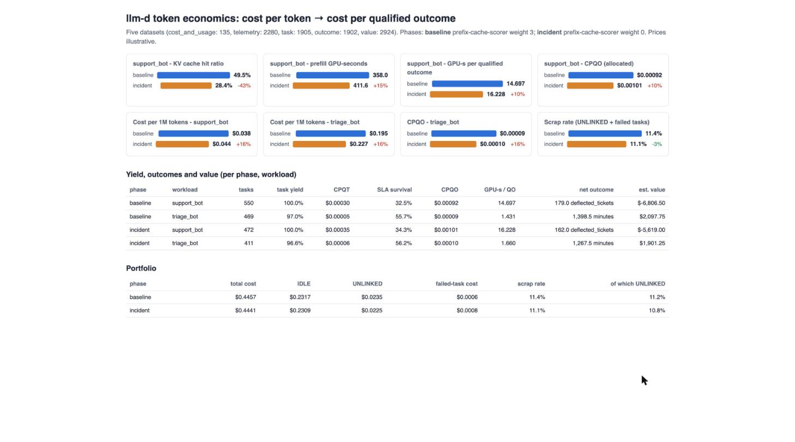
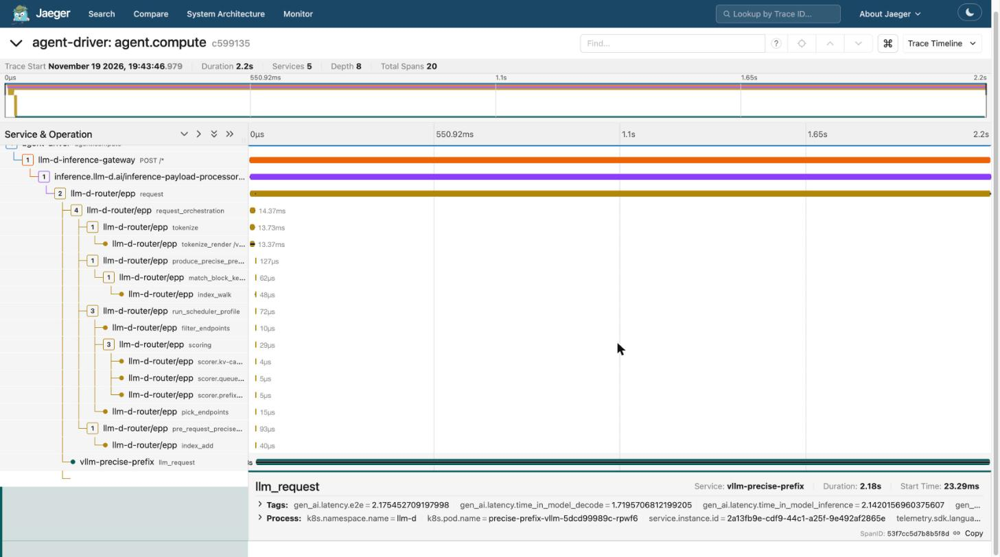

# llm-d Token Economics on Kubernetes: OpenCost as the bill

This is the Kubernetes variant of [`../nonk8s/`](../nonk8s/README.md). It runs the same agent workloads,
the same five value-attribution datasets and the same KubeCon incident (EPP
`prefix-cache-scorer` weight 3 → 0). This time llm-d runs **on Kubernetes** (Kind on the DGX
Spark, GPU through the NVIDIA device plugin), and the **Cost and Usage dataset comes
from OpenCost**, per pod and per minute. It no longer comes from a synthesized GPU bill.

Everything below was run on **2026-11-19/20** on the `llm-d` Kind cluster from
[`../../llm-d-spark-full-demo`](../../llm-d-spark-full-demo). Every `console` block is copied
from the session (`logs/capture/`).

中文版见 [`README-zh.md`](README-zh.md). Design and code are shared with the
no-Kubernetes variant: [`../docs/design.md`](../docs/design.md). Section 2 lists what is different here.

---

## Contents

- [0. Results at a glance](#0-results-at-a-glance)
- [1. Background](#1-background)
- [2. What changes on Kubernetes](#2-what-changes-on-kubernetes)
- [3. Use cases and test cases](#3-use-cases-and-test-cases)
- [4. What's in this folder](#4-whats-in-this-folder)
- [5. Environment and installation](#5-environment-and-installation)
- [6. Running the demo, step by step](#6-running-the-demo-step-by-step)
- [7. Results and analysis](#7-results-and-analysis)
- [8. Findings and issues](#8-findings-and-issues)
- [9. Future plan](#9-future-plan)
- [10. Troubleshooting](#10-troubleshooting)

---

## 0. Results at a glance



Two 5-minute phases, 12 concurrent agents (an in-cluster Job), 2 × vLLM pods (Qwen2.5-1.5B,
one time-sliced GPU unit each), OpenCost at $1.00 per GPU unit-hour ($4/h per GB10):

| | baseline (weight 3) | incident (weight 0) | change |
|---|---|---|---|
| support_bot tasks whose follow-up step went to **another pod** | 7 / 550 (1.3%) | 212 / 472 (44.9%) | affinity lost |
| `compute` step KV-cache hit | 96.3% | 54.5% | −42 pts |
| `compute` step p50 latency | 2.68 s | 3.40 s | +27% |
| Tasks completed in 310 s | 1,019 | 883 | **−13% capacity** |
| support_bot GPU-s per qualified outcome | 14.70 | 16.23 | **+10%** |
| support_bot CPQO (OpenCost, per pod) | $0.00092 | $0.00101 | **+10%** |
| triage_bot cost per 1M tokens (not affected by the bug) | $0.195 | $0.227 | +16% spill-over |
| **IDLE share of the bill** (OpenCost `__idle__`) | **52%** | **52%** | 2 of 4 GPU units never allocated |
| Serving overhead (EPP, gateway, IPP, P/D sim pods) | 0.8% | 0.8% | |
| Linked model calls joined to their vLLM span | 2,923 / 2,923 | | 100% |

What Kubernetes + OpenCost adds to the no-Kubernetes result:

1. **The same incident has the same signature.** Affinity is lost (1% → 45% of tasks split),
   cache hits halve, and the cost per qualified outcome rises 10%, with the bill now coming from
   OpenCost instead of a hand-written rate.
2. **Idle capacity becomes the largest line item.** OpenCost prices the whole node, and
   half of the GB10 (2 of 4 time-sliced units) is requested by no pod. At this load the
   **idle line ($0.23 per 5-minute phase) is larger than support_bot's whole bill ($0.16)**:
   right-sizing the GPU allocation matters more than the routing bug.
3. **On Kubernetes the Consumption Scope is the pod.** A routing incident therefore spills
   over less: +16% for the neighbour here, against +43% with one shared GPU scope.

---

## 1. Background

See [`../README.md` §1](../nonk8s/README.md#1-background) for the Tokenomics Foundation paper
(*Value Attribution Data Architecture* v0.1.8: Cost and Usage → Telemetry → Task → Outcome → Value,
joined by `focus.workload.id` / `focus.task.id` / `focus.outcome.id`) and for the KubeCon NA
2026 talk this continues. That talk showed llm-d + **OpenCost** producing cost per token. This
variant feeds OpenCost's per-pod allocation into the paper's datasets, so the same bill can be
read per task, per outcome and per dollar of value.

---

## 2. What changes on Kubernetes

| | no Kubernetes ([`../nonk8s/`](../nonk8s/README.md)) | Kubernetes (this folder) |
|---|---|---|
| Serving path | Envoy → EPP → 2 vLLM containers (Docker Compose) | agentgateway → payload processor (IPP) → EPP → 2 vLLM **pods** |
| Where the agent driver runs | a process on the host | a **Kubernetes Job** in the `llm-d` namespace (`manifests/driver-job.tmpl.yaml`), code from a ConfigMap |
| Cost and Usage | synthesized FOCUS rows: $4/GPU-h, one GPU scope | **OpenCost allocation API**, one row per pod per minute (`tokeneconomics/opencost.py`) |
| Consumption Scope | the GPU (`spark-3bee/gpu0`) | the **pod** |
| Unallocated capacity | only periods with no traffic | OpenCost `__idle__` → `IDLE`, every minute |
| Non-serving pods | not billed | EPP, gateway, IPP, P/D pods → `OVERHEAD` (paper 2.3.3, not scrap) |
| Which replica served a span | Jaeger service name (`vllm-0`, `vllm-1`) | `k8s.pod.name` resource attribute (both pods share one service name) |
| Trace topology | client → Envoy → vLLM; EPP span a sibling | client → gateway → IPP → EPP `request` → vLLM |
| Getting leaf spans out of Jaeger | query after the run | **harvest every 60 s** during the run + KV-event trace filter ([K2](#k2-the-epps-kv-event-tracing-floods-jaeger)) |

Allocation rule (`tokeneconomics/build.py:allocate`). For each (ResourceId, minute):

- a **vLLM pod**: its OpenCost cost is split over the requests it served, by ActivityWeight
  (vLLM prefill + decode time). If it served nothing that minute, the cost goes to `IDLE`
  (allocated but unused);
- **`__idle__`** (node capacity no pod requested) → `IDLE`;
- **any other pod in `llm-d`** (EPP, gateway, IPP, Jaeger, collector, P/D pods) → `OVERHEAD`;
- the driver Job's own pod is excluded: it is the application, not serving cost.

---

## 3. Use cases and test cases

The workloads, gates, rate cards and phases are identical to [`../README.md` §3](../nonk8s/README.md#3-use-cases-and-test-design):
support_bot (billing dispute agent, long unique context, 2 steps), triage_bot (alert triage),
and UNLINKED playground traffic. They run with the same seed and the same mix.

| # | Test | Pass criterion | Result |
|---|---|---|---|
| K-T1 | Lineage propagates client → agentgateway → IPP → EPP → vLLM | vLLM span inside the driver's trace | ✅ 20 spans, 5 services, 1 root (§6.4) |
| K-T2 | Every linked call attributed, with the pod that served it | linked leaves = linked driver calls; replica = pod name | ✅ 2,923 / 2,923, `k8s.pod.name` on every vLLM span |
| K-T3 | OpenCost bill flows into the Cost and Usage dataset | one FOCUS row per pod per minute, plus `__idle__` | ✅ 135 rows, cost split GPU / CPU / RAM |
| K-T4 | 100% of the in-scope bill allocated | Σ allocated = Σ EffectiveCost | ✅ $0.9974 = $0.9974 |
| K-T5 | Baseline affinity | split tasks ≈ 0% | ✅ 1.3% |
| K-T6 | Incident: affinity lost, CPQO up, quality unchanged | split ≈ 50%, CPQO ↑ | ✅ 44.9%, +10%, SLA survival 32.5% → 34.3% |
| K-T7 | Idle and overhead visible, not hidden in workloads | `IDLE` and `OVERHEAD` lines | ✅ 52% / 0.8% |

---

## 4. What's in this folder

```
k8s/
├── README.md / README-zh.md               this report
├── demo-k8s.toml                          [cost] source = "opencost", namespace, serving pod prefix, [traces]
├── helm-values/opencost.values.yaml       OpenCost with custom on-prem pricing ($1 per GPU unit-hour)
├── manifests/
│   ├── driver-job.tmpl.yaml               the agent driver as a Kubernetes Job
│   └── vllm-patch.json                    vLLM: --enable-prompt-tokens-details + k8s.pod.name resource attribute
├── scripts/
│   ├── run-demo.sh                        baseline → incident → restore, 60 s leaf-span harvester, build, report
│   ├── run-driver-job.sh                  one phase as a Job (code shipped as a ConfigMap)
│   ├── set-prefix-weight.sh               edit the llm-d-epp ConfigMap and roll the EPP
│   ├── filter-kv-index-traces.sh          OTel Collector: drop per-event KV index traces (K2)
│   ├── port-forward.sh                    Jaeger :16686 and OpenCost :9003 on the host
│   └── capture-doc.sh                     re-record the console blocks below
├── docs/screenshots/                      report + Jaeger screenshots
├── results/                               this run's five datasets (CSV) + report.md / report.html
└── logs/capture/                          raw command + output captures
```

The Python code is shared: `../tokeneconomics/opencost.py` is new, and `build.py` gained
`allocate()`, `--harvest` and pod-aware leaf rows. `../tests/` covers the OpenCost path.

---

## 5. Environment and installation

### 5.1 Cluster

```console
gyliu@spark-3bee:~/tokeneconomics$ kubectl config current-context; kubectl get nodes -o wide | cut -c1-120
kind-llm-d
NAME                  STATUS   ROLES           AGE   VERSION   INTERNAL-IP   EXTERNAL-IP   OS-IMAGE
llm-d-control-plane   Ready    control-plane   60d   v1.37.0   172.18.0.4    <none>        Debian GNU/Linux 13 (trixie)
gyliu@spark-3bee:~/tokeneconomics$ kubectl get node llm-d-control-plane -o jsonpath='{.status.allocatable.nvidia\.com/gpu}{" nvidia.com/gpu (GB10 time-sliced x4)\n"}'
4 nvidia.com/gpu (GB10 time-sliced x4)
gyliu@spark-3bee:~/tokeneconomics$ helm list -A | awk '{print $1, $2, $9, $10}' | column -t
NAME               NAMESPACE
agentgateway       agentgateway-system  agentgateway-v1.4.1           v1.4.1
agentgateway-crds  agentgateway-system  agentgateway-crds-v1.4.1      v1.4.1
ipp                llm-d                payload-processor-0.2.0       0.2.0
llm-d              llm-d                llm-d-router-gateway-v0       v0
llm-d-pd           llm-d                llm-d-router-gateway-v0       v0
llmd               llm-d-monitoring     kube-prometheus-stack-91.4.1  v0.94.0
opencost           opencost             opencost-2.5.34               1.121.4
gyliu@spark-3bee:~/tokeneconomics$ kubectl -n llm-d get pods -o custom-columns=NAME:.metadata.name,READY:.status.containerStatuses[*].ready,GPU:.spec.containers[*].resources.limits.nvidia\\.com/gpu | grep -v te-driver
NAME                                       READY   GPU
jaeger-554cff9d46-b4m7x                    true    <none>
llm-d-epp-5cf44f645c-z6ghg                 true    <none>
llm-d-inference-gateway-58b9564597-c5ptj   true    <none>
llm-d-pd-epp-6675d8658c-nlt64              true    <none>
otel-collector-bff977b58-t7xsr             true    <none>
payload-processor-697666c4f6-csl25         true    <none>
pd-decode-5fbc985d56-vc5ns                 true    <none>
pd-prefill-6d5db57479-p5nhd                true    <none>
precise-prefix-vllm-5dcd99989c-rpwf6       true    1
precise-prefix-vllm-5dcd99989c-zstxg       true    1
```

| Component | Version |
|---|---|
| Kind / Kubernetes | node image `kindest/node:v1.37.0` |
| GPU | NVIDIA device plugin, GB10 time-sliced ×4 (`nvidia.com/gpu: 4`) |
| Gateway | agentgateway v1.4.1 (Gateway API + Inference Extension) |
| Router | `ghcr.io/llm-d/llm-d-router-endpoint-picker:main` (built 2026-11-16), precise prefix-cache scorer |
| Payload processor | chart `payload-processor-0.2.0` |
| vLLM | `nvcr.io/nvidia/vllm:26.08-py3` (0.27.1), Qwen2.5-1.5B-Instruct, 2 pods, `--enforce-eager` |
| Observability | OTel Collector contrib 0.120.1 → Jaeger 2.15.0 (in-memory); kube-prometheus-stack 91.4.1 |
| Cost | **OpenCost 1.121.4** (chart 2.5.34), custom pricing |

### 5.2 Prerequisite: the llm-d Kind cluster

Build the cluster once with [`../../llm-d-spark-full-demo`](../../llm-d-spark-full-demo)
(README §4: Kind with the GPU mount, device plugin, agentgateway, router, IPP, vLLM, OTel/Jaeger,
Prometheus). This demo only adds to it.

If the cluster was stopped and does not come back cleanly (`kube-proxy` / device plugin in
CrashLoopBackOff with `too many open files`), see [K7](#k7-restarting-kind-next-to-other-clusters-runs-out-of-inotify-instances).

### 5.3 Add-ons for this demo

```console
# 1. vLLM: cached-token counts in responses + the pod name on every span
$ kubectl -n llm-d patch deploy precise-prefix-vllm --type=json -p "$(cat k8s/manifests/vllm-patch.json)"
$ kubectl -n llm-d scale deploy precise-prefix-vllm --replicas=2
# 2. EPP from main (same image as the no-Kubernetes run)
$ kind load docker-image ghcr.io/llm-d/llm-d-router-endpoint-picker:main --name llm-d
$ kubectl -n llm-d set image deploy/llm-d-epp epp=ghcr.io/llm-d/llm-d-router-endpoint-picker:main
# 3. OpenCost with on-prem pricing, scraped by the existing Prometheus
$ helm repo add opencost https://opencost.github.io/opencost-helm-chart
$ helm upgrade --install opencost opencost/opencost --version 2.5.34 -n opencost --create-namespace \
    -f k8s/helm-values/opencost.values.yaml
# 4. Stop the EPP's KV-event traces from evicting request traces in Jaeger (K2)
$ k8s/scripts/filter-kv-index-traces.sh
# 5. Jaeger and OpenCost on the host for the build step
$ k8s/scripts/port-forward.sh
Jaeger   http://127.0.0.1:16686
OpenCost http://127.0.0.1:9003
```

OpenCost pricing (`helm-values/opencost.values.yaml`): **GPU $1.00 per `nvidia.com/gpu` unit-hour**
(a quarter of the time-sliced GB10, so $4/h per physical GPU, the same price as the
no-Kubernetes demo), CPU $0.03 per vCPU-hour, RAM $0.004 per GiB-hour. OpenCost's
per-minute view of the vLLM pods and the idle node capacity:

```console
gyliu@spark-3bee:~/tokeneconomics$ curl -s 'http://127.0.0.1:9003/allocation/compute?window=3m&aggregate=namespace,pod&step=1m&resolution=1m&includeIdle=true&accumulate=false' | python3 -c '...'
__idle__                                                   2026-11-20T00:50:00Z gpuHours=0.0000 gpu=$0.03333 cpu=$0.00641 total=$0.04647
llm-d/llm-d-epp-5cf44f645c-z6ghg                           2026-11-20T00:50:00Z gpuHours=0.0000 gpu=$0.00000 cpu=$0.00025 total=$0.00032
llm-d/llm-d-pd-epp-6675d8658c-nlt64                        2026-11-20T00:50:00Z gpuHours=0.0000 gpu=$0.00000 cpu=$0.00013 total=$0.00016
llm-d/precise-prefix-vllm-5dcd99989c-rpwf6                 2026-11-20T00:50:00Z gpuHours=0.0167 gpu=$0.01667 cpu=$0.00100 total=$0.01807
llm-d/precise-prefix-vllm-5dcd99989c-zstxg                 2026-11-20T00:50:00Z gpuHours=0.0167 gpu=$0.01667 cpu=$0.00100 total=$0.01807
```

Each vLLM pod holds one GPU unit ($1/h = $0.01667 per minute), and `__idle__` holds the other two.

---

## 6. Running the demo, step by step

### 6.1 One-shot

```console
gyliu@spark-3bee:~/tokeneconomics$ k8s/scripts/run-demo.sh 300 12
```

The script sets the weight to 3, runs the baseline Job, sets the weight to 0, runs the
incident Job, and restores the weight to 3. A background harvester copies vLLM leaf spans out
of Jaeger every 60 s. After waiting out the settlement window and OpenCost's last minute, it
builds the datasets and the report. It takes about 18 minutes.

### 6.2 Probe: baggage reaches every hop, nobody records it

```console
gyliu@spark-3bee:~/tokeneconomics$ kubectl -n llm-d run probe --rm -i --restart=Never --image=curlimages/curl:8.11.1 --quiet -- \
  curl -s http://llm-d-inference-gateway.llm-d.svc.cluster.local/v1/chat/completions -H 'Content-Type: application/json' \
  -H 'traceparent: 00-1af7651916cd43dd8448eb211c80319c-b7ad6b7169203331-01' \
  -H 'baggage: focus.workload.id=support_bot,focus.task.id=task-probe-1,focus.outcome.id=ticket-probe-1' \
  -d '{"model":"Qwen/Qwen2.5-1.5B-Instruct","messages":[{"role":"user","content":"Say hi"}],"max_tokens":8}' | cut -c1-160
{"id":"chatcmpl-dbc84c7b-1734-452c-b11b-e3e1ef788206","object":"chat.completion","created":1795135964,"model":"Qwen/Qwen2.5-1.5B-Instruct","choices":[{"index":0
gyliu@spark-3bee:~/tokeneconomics$ curl -s http://127.0.0.1:16686/api/traces/1af7651916cd43dd8448eb211c80319c | python3 -c '...'
16 spans: ['inference.llm-d.ai/inference-payload-processor', 'llm-d-inference-gateway', 'llm-d-router/epp', 'vllm-precise-prefix']
spans with focus.*/baggage attributes: []
```

This is the same gap as no-Kubernetes finding F2, now confirmed through agentgateway and
the IPP too: llm-d-router issue [#4378](https://github.com/llm-d/llm-d-router/issues/4378).

### 6.3 The incident switch

```console
gyliu@spark-3bee:~/tokeneconomics$ k8s/scripts/set-prefix-weight.sh 0
        weight: 0
deployment "llm-d-epp" successfully rolled out
EPP rolled with prefix-cache-scorer weight 0
```

The script rewrites the weight in the `llm-d-epp` ConfigMap and rolls the EPP, which is the
Kubernetes form of the KubeCon incident's Helm change.

### 6.4 One model call, end to end (baseline `compute` step)

```console
gyliu@spark-3bee:~/tokeneconomics$ python3 scripts/trace-tree.py 4a7099cf968d2031ca843db9dc3ce4ce
[agent-driver] agent.compute  (1235.1 ms)
    focus.outcome.id = ticket-baseline-a240ef-01018
    focus.task.id = task-ticket-baseline-a240ef-01018
    focus.workload.id = support_bot
    gen_ai.usage.cache_read.input_tokens = 3840
    gen_ai.usage.input_tokens = 3940
  [llm-d-inference-gateway@llm-d-inference-gateway-58b9564597-c5ptj] POST /*  (1146.4 ms)
    [inference.llm-d.ai/inference-payload-processor@payload-processor-697666c4f6-csl25] gateway.request  (1145.8 ms)
      [llm-d-router/epp@llm-d-epp-56985b47db-4bt6c] request  (1143.5 ms)
        ...  match_block_keys: llm_d.kv_cache.prefix_match.longest_chain = 60
        ...  pick_endpoints:   llm_d.epp.picker.top_scores = [6.77356119393223,4.012132735962327]
        [vllm-precise-prefix@precise-prefix-vllm-5dcd99989c-zstxg] llm_request  (1125.2 ms)
            gen_ai.latency.time_in_model_prefill = 0.0978
            gen_ai.usage.prompt_tokens = 3940
```

The same step in the incident phase: the index still knows the prefix, the scores tie, the
request lands on the cold pod, and prefill takes 4.3× longer:

```console
gyliu@spark-3bee:~/tokeneconomics$ python3 scripts/trace-tree.py c599135941db732cbf753b4cc41e64e5
[agent-driver] agent.compute  (2203.7 ms)
    gen_ai.usage.cache_read.input_tokens = 64
        ...  llm_d.epp.picker.top_scores = [3.962952408093474,3.895126816756911]
        [vllm-precise-prefix@precise-prefix-vllm-5dcd99989c-rpwf6] llm_request
            gen_ai.latency.time_in_model_prefill = 0.4224
```



### 6.5 Datasets and KPIs

```console
gyliu@spark-3bee:~/tokeneconomics$ python3 -m tokeneconomics.build --data k8s/data --config k8s/demo-k8s.toml
using 3168 harvested leaf spans from k8s/data/leaves.jsonl (0 outside the phase windows dropped)
traces=3168 vLLM leaf spans=3168 (linked 2923 of 2923 linked driver calls, unlinked 245)
opencost: 362 allocations -> 135 cost rows in scope
wrote k8s/data/tokeneconomics.db: cost_and_usage=135 telemetry=2280 task=1905 outcome=1902 value=2924
gyliu@spark-3bee:~/tokeneconomics$ sqlite3 -header -column k8s/data/tokeneconomics.db "SELECT CASE WHEN ResourceId LIKE 'precise-prefix-vllm-%' THEN 'vLLM pods' WHEN ResourceId='__idle__' THEN '__idle__' ELSE 'other llm-d pods' END AS scope, COUNT(*) rows_, printf('%.4f',SUM(EffectiveCost)) cost, printf('%.4f',SUM(x_GpuCost)) gpu, printf('%.4f',SUM(x_CpuCost)) cpu, printf('%.4f',SUM(x_RamCost)) ram FROM cost_and_usage GROUP BY 1"
scope             rows_  cost    gpu     cpu     ram
----------------  -----  ------  ------  ------  ------
__idle__          12     0.5552  0.4000  0.0747  0.0805
other llm-d pods  99     0.0085  0.0000  0.0064  0.0021
vLLM pods         24     0.4337  0.4001  0.0240  0.0096
gyliu@spark-3bee:~/tokeneconomics$ sqlite3 -header -column k8s/data/tokeneconomics.db "SELECT phase, WorkloadId, tasks, task_yield, sla_survival, printf('%.5f', cpqo) cpqo, printf('%.3f', gpu_s_per_qo) gpu_s_per_qo, printf('%.2f', estimated) value FROM kpi_workload"
phase     WorkloadId   tasks  task_yield  sla_survival  cpqo     gpu_s_per_qo  value
--------  -----------  -----  ----------  ------------  -------  ------------  --------
baseline  support_bot  550    1.0         0.325         0.00092  14.697        -6806.50
baseline  triage_bot   469    0.97        0.557         0.00009  1.431         2097.75
incident  support_bot  472    1.0         0.343         0.00101  16.228        -5619.00
incident  triage_bot   411    0.966       0.562         0.00010  1.660         1901.25
gyliu@spark-3bee:~/tokeneconomics$ sqlite3 -header -column k8s/data/tokeneconomics.db "SELECT phase, printf('%.4f',total_cost) total, printf('%.4f',idle_cost) idle, printf('%.4f',overhead_cost) overhead, printf('%.4f',unlinked_cost) unlinked, scrap_rate FROM kpi_phase"
phase           total   idle    overhead  unlinked  scrap_rate
--------------  ------  ------  --------  --------  ----------
baseline        0.4457  0.2317  0.0034    0.0235    0.114
between-phases  0.1076  0.0926  0.0015    0.0135
incident        0.4441  0.2309  0.0037    0.0225    0.111
```

`between-phases` is the roughly 75 s of EPP rollouts between the two Jobs. Its cost (mostly
idle) is kept, not dropped.

---

## 7. Results and analysis

Full generated report: [`results/report.md`](results/report.md) ([HTML](results/report.html)).

### 7.1 Same mechanism as without Kubernetes

| phase | step | calls | KV-cache hit | p50 | p95 |
|---|---|---|---|---|---|
| baseline | investigate | 549 | 1.7% | 2.16 s | 3.33 s |
| baseline | **compute** | 550 | **96.3%** | 2.68 s | 3.45 s |
| incident | investigate | 472 | 1.7% | 2.34 s | 3.29 s |
| incident | **compute** | 472 | **54.5%** | 3.40 s | 4.10 s |

support_bot tasks whose two steps were served by different pods: **1.3% → 44.9%**.

### 7.2 What the incident costs, on OpenCost's bill

| support_bot | baseline | incident | Δ |
|---|---|---|---|
| prefill GPU-s | 358.0 | 411.6 | +15% (with 14% fewer calls) |
| GPU-s per qualified outcome | 14.70 | 16.23 | +10% |
| CPQO | $0.00092 | $0.00101 | +10% |
| qualified outcomes | 179 | 162 | −9% |

The incident's effect is smaller than without Kubernetes (+10% against +22% CPQO). The vLLM
pods here run `--enforce-eager`, so decode dominates per-request GPU time (about 2.1 s of 2.4 s), and
the extra prefill is a smaller share of it.

### 7.3 Idle capacity is half the bill

The OpenCost node has 4 `nvidia.com/gpu` units and the two vLLM pods request 2, so **$0.555
of the $0.997 in-scope bill (56% over the whole run, 52% per phase) is `__idle__`**. Half of it
is GPU, the rest is unrequested CPU and RAM. A FinOps reader learns more here than from any
per-token number: either add replicas onto the idle units (more throughput for the same bill)
or give the units back. Under the paper's default, which spreads idle across users, every
CPQO in this run would double, and the routing incident would vanish into the noise. That is
why the demo keeps `IDLE` as its own line.

### 7.4 Overhead and spill-over

- Serving components (EPP, gateway, IPP, Jaeger, collector, P/D pods) cost $0.0085 over the run,
  **0.8%** of the bill, recorded as `OVERHEAD` and not as scrap.
- With the pod as the scope, a neighbour only shares the cost of the pod it lands on, so
  triage_bot's cost per token rises **16%**, against 43% with one shared GPU scope (no-Kubernetes
  run). The usage-basis KPI (triage_bot GPU-s/QO +16%) agrees here. Both pods were affected,
  so this is general contention.

### 7.5 Quality still decides value

Gate 1 at 100% and Gate 2 at about 33% for support_bot; value −$6,807 against a vLLM-pod bill
of $0.43 for the whole run. This is the same conclusion as [`../README.md` §7.4](../nonk8s/README.md#74-quality-dominates-value).

---

## 8. Findings and issues

The no-Kubernetes findings F1-F6 hold here too, in particular **F2** (no component records
`focus.*` baggage, filed as [llm-d-router#4378](https://github.com/llm-d/llm-d-router/issues/4378)),
**F3** (vLLM span has no cached tokens) and **F4** (per-request GPU time over-counts under
batching). Kubernetes-specific findings follow. All findings in one bilingual list: [`../docs/findings.md`](../docs/findings.md).

### K1. OpenCost makes idle GPU capacity the largest line item

See §7.3: 52-56% of the bill is `__idle__`. The paper's §2.3.2 leaves open whether to spread
unused capacity or hold it separately. **Recommendation:** hold it separately, as
OpenCost already does, and report it next to CPQO. Spreading it hides both the waste and
every efficiency signal underneath it.

### K2. The EPP's KV-event tracing floods Jaeger

With `kvEventsConfig.tracing: true`, the EPP starts a new root trace for every KV-cache index
event. On two small replicas that is **~87,000 single-span traces per minute** (93%
`index_evict`, the rest `index_add`), about 60× the request traces. Jaeger's in-memory store
evicted request traces within a minute or two: an end-of-run query found **76% of the baseline
traces gone**, and even a 60 s harvester missed half the incident traces. Fix used here
(`scripts/filter-kv-index-traces.sh`): drop `index_evict` and `index_add` spans in the
Collector's filter processor. The collector's own counters showed 98% of spans filtered.
`IsRootSpan()` did **not** match the standalone `index_add` traces, so all `index_add` spans
are dropped. **Proposal (llm-d-router):** sample KV-event tracing separately from request
tracing, or record index events as span events on a long-lived span, and keep it off in
default profiles.

### K3. Time-sliced GPUs need a per-slice price

OpenCost prices each `nvidia.com/gpu` unit at the configured GPU rate. With time-slicing ×4,
the default rate ($0.95/GPU-h) would bill one GB10 as four GPUs. Set the GPU price to the
physical GPU's rate divided by the slice count ($1.00 = $4.00 / 4 here), and remember that a
slice's cost says nothing about how much of the GPU it actually used.

### K4. Replicas share one OTel service name

Both vLLM pods export as `vllm-precise-prefix`, so a span alone cannot say which pod and
therefore which OpenCost row it belongs to. The demo adds `k8s.pod.name` through the
downward API (`manifests/vllm-patch.json`). **Proposal (llm-d guides / charts):** set
`OTEL_RESOURCE_ATTRIBUTES=k8s.pod.name=$(POD_NAME),…` on model servers by default, as the EPP
chart already does for itself.

### K5. Trace topology differs between the two deployments

On Kubernetes, vLLM's `llm_request` is a child of the EPP's `request` span: the EPP injects
its own context downstream. Without Kubernetes it hangs under Envoy's router span. Both
attribute correctly because the join is on `trace_id`. Anything that assumes a fixed parent
(for example, "the vLLM span's parent is the gateway") breaks across deployments.

### K6. Task IDs must be globally unique

The first Kubernetes run derived task IDs from the process ID, which is always 1 in a
container. A leftover Job from an aborted run then produced colliding IDs, and its traffic was
attributed to the new run's tasks. The driver now adds a random run ID. The paper's advice
that IDs be opaque internal keys also has to mean *globally unique*. Build also keeps only
spans inside the phase windows and prefers the linked copy of a span harvested twice.

### K7. Restarting Kind next to other clusters runs out of inotify instances

After a stop/start with three Kind clusters on the host, `kube-proxy` and the device plugin
crash-looped with `too many open files` (`fs.inotify.max_user_instances = 128`). The other
clusters were stopped for this run. The durable fix is the sysctl Kind documents
(`fs.inotify.max_user_instances=8192`, `fs.inotify.max_user_watches=524288`).

### K8. One request failed with HTTP 503

The baseline Job saw one `503 Service Unavailable` among 3,170 requests, right after the EPP
rollout. It is counted as an error and excluded. Waiting for the EPP's readiness, which the
script already does, plus a few seconds of KV-event replay, keeps this rare.

---

## 9. Future plan

| # | Item | Why |
|---|---|---|
| 1 | Land [llm-d-router#4378](https://github.com/llm-d/llm-d-router/issues/4378) (baggage → span attributes) | GPU-side and router-side attribution without the client span, on both deployments |
| 2 | KV-event tracing: sampled or as span events (K2) | Request traces survive in Jaeger; no harvester needed |
| 3 | `k8s.pod.name` on model-server spans by default (K4) | Join spans to OpenCost rows with no patch |
| 4 | Scale vLLM to 4 pods on the 4 units and rerun | Turn the 52% idle into throughput; measure CPQO with full allocation |
| 5 | OpenCost **FOCUS export** instead of the allocation API | The paper's Cost and Usage dataset as OpenCost emits it |
| 6 | Grafana panels for CPQO / IDLE / scrap from the SQLite datasets | Next to the existing llm-d dashboards |
| 7 | Same experiment without `--enforce-eager`, and with the P/D pool | Compare with the no-Kubernetes numbers; two consumption scopes for P/D |

---

## 10. Troubleshooting

| Symptom | Cause / fix |
|---|---|
| `linked N of M` with N < M | Jaeger evicted traces: run `scripts/filter-kv-index-traces.sh`; keep the harvester (it is in `run-demo.sh`) |
| linked > driver calls | traffic from another driver (a leftover Job): `kubectl -n llm-d get jobs`; build drops spans outside the phase windows |
| OpenCost `__idle__` of several dollars per minute | the first minutes after installing OpenCost; wait until node assets have data |
| `kube-proxy` / device plugin `too many open files` | inotify limits (K7) |
| gateway CrashLoopBackOff after a restart | agentgateway control plane not ready; delete the gateway pod once `agentgateway-system` is Running |
| All costs land in `OVERHEAD` | `serving_pod_prefix` in `demo-k8s.toml` does not match the vLLM pod names |
| Restore the no-Kubernetes stack | `cd ~/llm-d-nonk8s && docker compose --profile obs --profile model --profile router start` (stop the Kind cluster first if GPU memory is short) |
